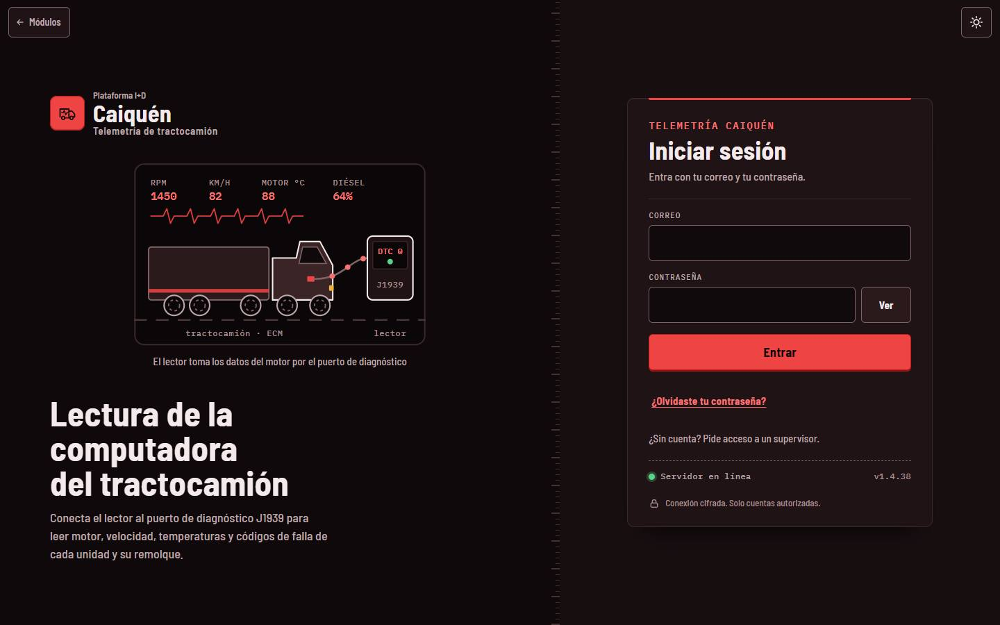
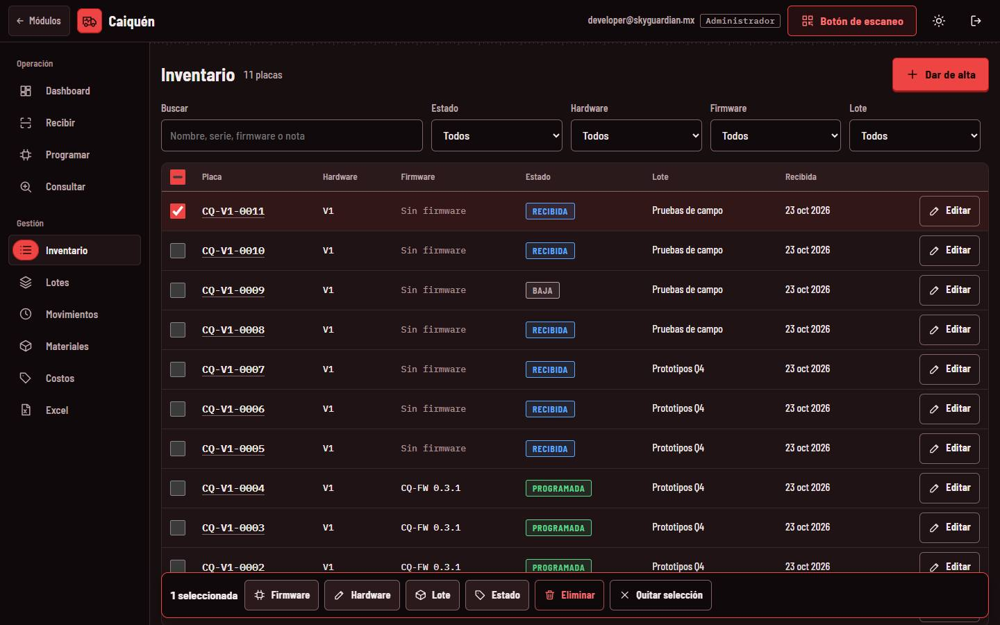
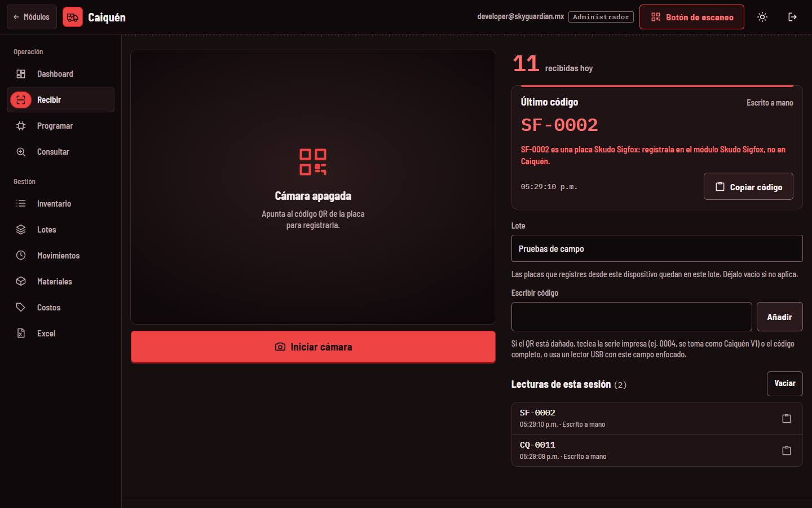
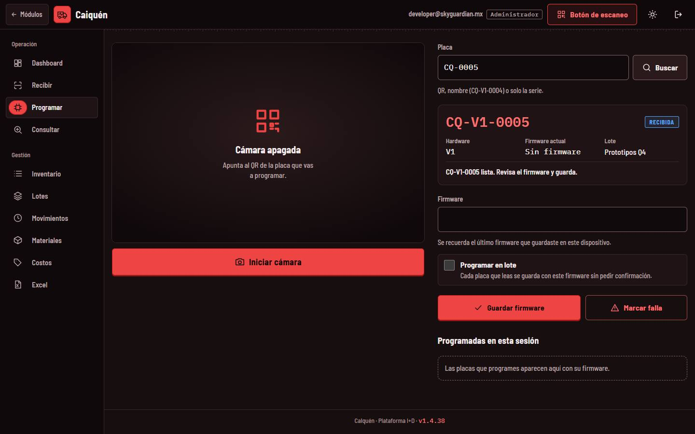
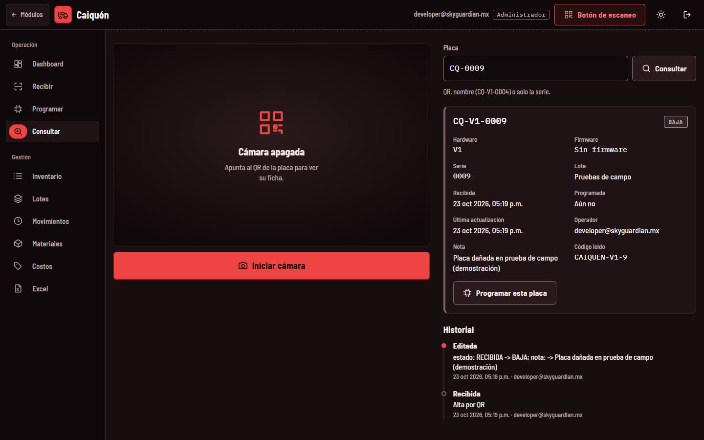
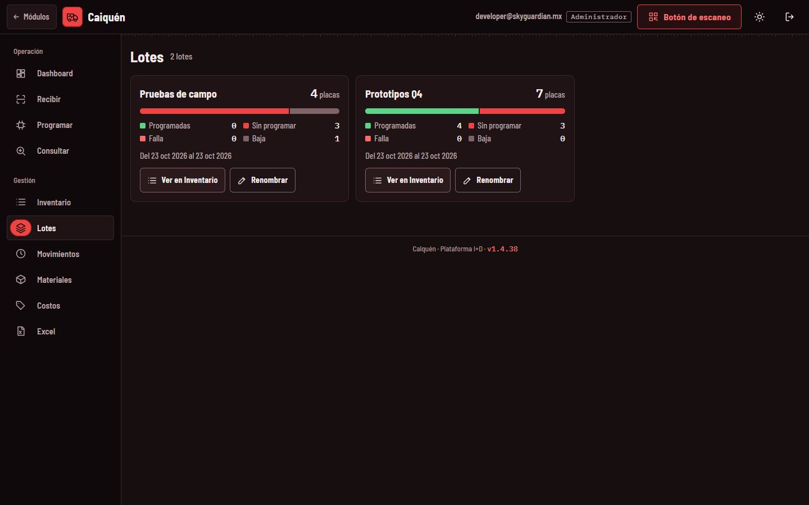
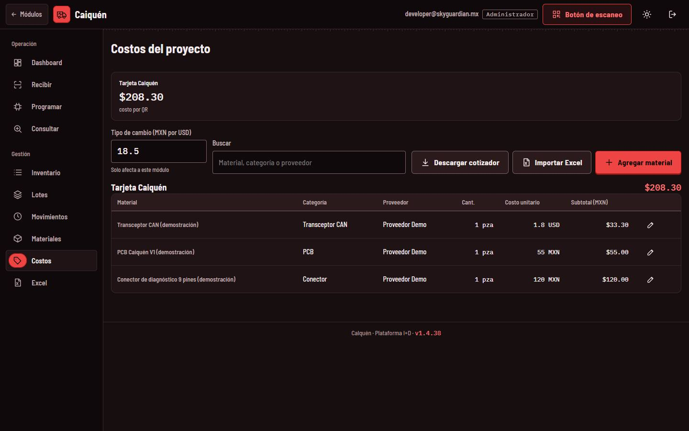
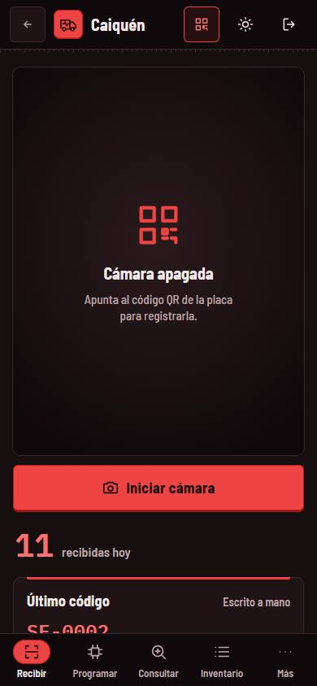

<!-- Generado por scripts/generar_manual_md.py desde app/static/documentacion/guias/caiquen.json. No editar a mano. -->

# Caiquén

*Telemetría de tractocamión* · Ruta: `/caiquen` · Lectura: 3 min

Banco de las placas Caiquén, el lector que se conecta al puerto de diagnóstico J1939 del tractocamión: se registran por su QR (CQ-0001), se anota su firmware y se sigue su estado, lote e historial. Usa la misma consola que TPMS y Skudo Sigfox.

**Quién puede hacer qué**

- **Administrador**: Todo: recibir, programar, editar, cambios en masa, eliminar, renombrar lotes, costos y materiales.
- **General**: Lo mismo que el administrador dentro de Caiquén, si su cuenta tiene asignado el módulo.
- **Consultor**: Solo consulta y descarga de Excel; no registra, programa, edita ni borra.

## ¿Qué es?

Caiquén es el lector que toma los datos de la computadora del tractocamión (motor, velocidad, temperaturas y códigos de falla) por el puerto de diagnóstico J1939. Este módulo lleva el control de sus placas en el banco de pruebas.

Sin sesión, /caiquen te lleva a su pantalla de acceso, /caiquen/acceso. Entra con la misma cuenta de la plataforma; tu cuenta necesita tener asignado el módulo Caiquén.

1. Correo
2. Contraseña
3. Entrar

## La consola

Las pestañas son las mismas que en TPMS: Dashboard, Recibir, Programar, Consultar, Inventario, Lotes, Movimientos, Materiales, Costos y Excel, más el «Botón de escaneo». El uso de cada una está explicado en las guías de TPMS y Skudo Sigfox; aquí va lo propio de Caiquén.

## Recibir y consultar placas Caiquén

### Paso 1. Lee el QR

El QR provisional es CQ- seguido de la serie, por ejemplo CQ-0001; se registra como CQ-V1-0001. Si el QR está dañado, escribe la serie impresa (0004) y se toma como Caiquén V1. Un QR de otro módulo se rechaza: en la captura, SF-0002 es una placa Skudo Sigfox.

1. Rechazo: va en Skudo Sigfox
2. Lote
3. Escribir código
4. Iniciar cámara

> **Nota:** El formato CQ-0001 es provisional: cuando se conozca el QR real de la placa, se ajustará.

### Paso 2. Programar

Busca la placa, escribe el firmware y pulsa «Guardar firmware»: pasa de RECIBIDA a PROGRAMADA.

### Paso 3. Consultar

La ficha muestra hardware, firmware, serie, lote, fechas, operador, nota y el código leído; abajo, el historial.

1. Placa o serie
2. Ficha
3. Historial

### Paso 4. Lotes

Agrupa las placas por entrega o prueba (por ejemplo «Pruebas de campo») y muestra su avance.

## Costos

Cada placa es una «Tarjeta Caiquén». Su lista de materiales (transceptor CAN, PCB, conector de diagnóstico…) da el costo por QR. Ver la guía Costos y Materiales.

1. Costo por tarjeta
2. Descargar, importar o agregar
3. Lista de materiales

## En el celular

El menú baja a la barra inferior y el resto de pestañas está en «Más».

## Ficha técnica

| Campo | Detalle |
| --- | --- |
| Rutas | /caiquen (consola) · /caiquen/acceso (inicio de sesión) |
| Formato del QR | PROVISIONAL: CQ-0001 → CQ-V1-0001. También acepta CAIQUEN-0001 o CAIQUÉN, prefijo PCB, guion bajo o espacio, minúsculas y versión explícita (CQ-V2-0001). Solo la serie (4) → CQ-V1-0004. |
| No válidos | QR de Skudo Sigfox, SpeedLocker, Skudo AntiJammer, TPMS o Escáner TQT: se rechazan diciendo a qué módulo van. |
| Estados | RECIBIDA → PROGRAMADA (al guardar firmware) · FALLA · BAJA |
| Exportación | Excel con hojas Placas y Movimientos |
| Tarjetas en Costos/Materiales | Una: Tarjeta Caiquén |

## Problemas frecuentes

**No veo Caiquén en el portal o me manda a /inicio.**

Tu cuenta no tiene asignado el módulo. Pide a un administrador que lo active en «Cuentas y módulos».

**Leí una placa y dice que es de Skudo Sigfox u otro módulo.**

El QR no es de Caiquén. Regístrala en el módulo que indica el mensaje.

**El QR real de mi placa no se reconoce.**

El formato CQ-0001 es provisional. Escribe la serie impresa y avisa al equipo para ajustar el formato.

## Guías relacionadas

- [Skudo Sigfox](skudo-sigfox.md)
- [TPMS](tpms.md)
- [Costos y Materiales](costos-materiales.md)
