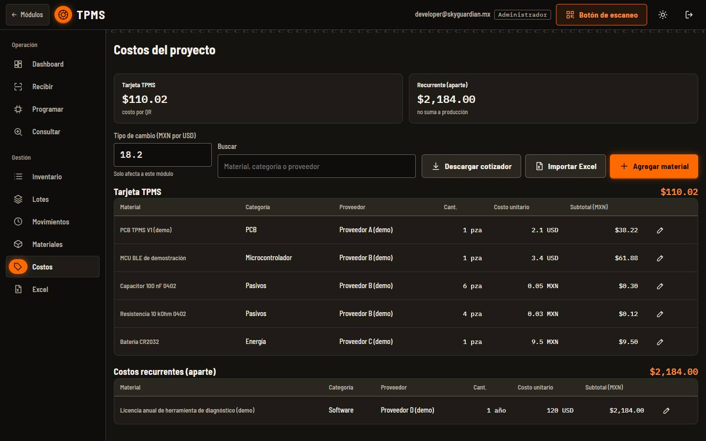
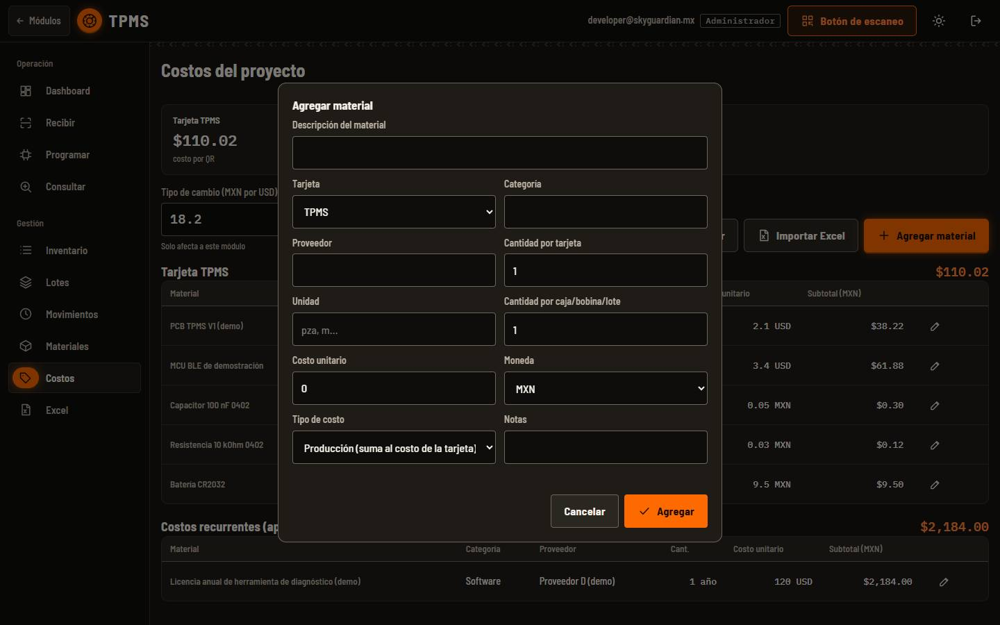
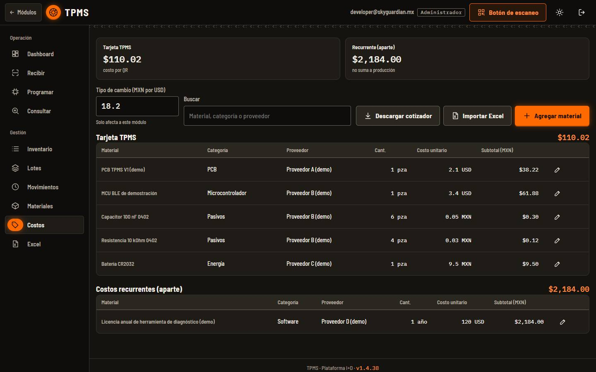
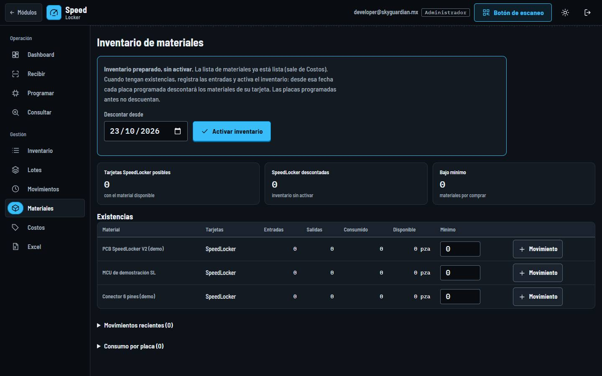
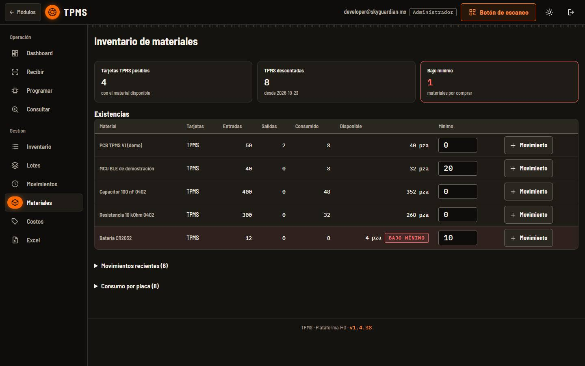
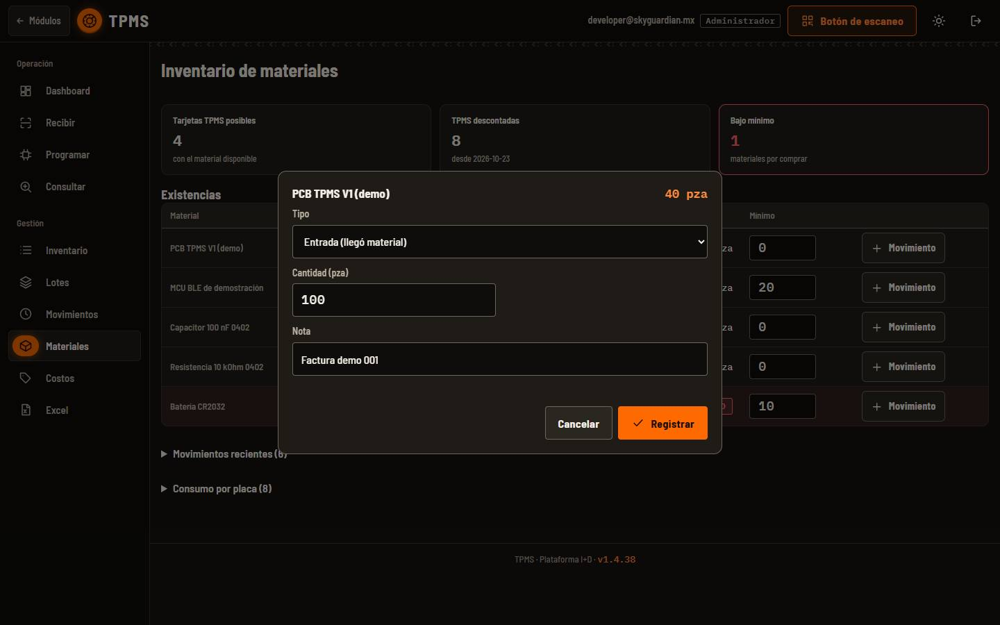
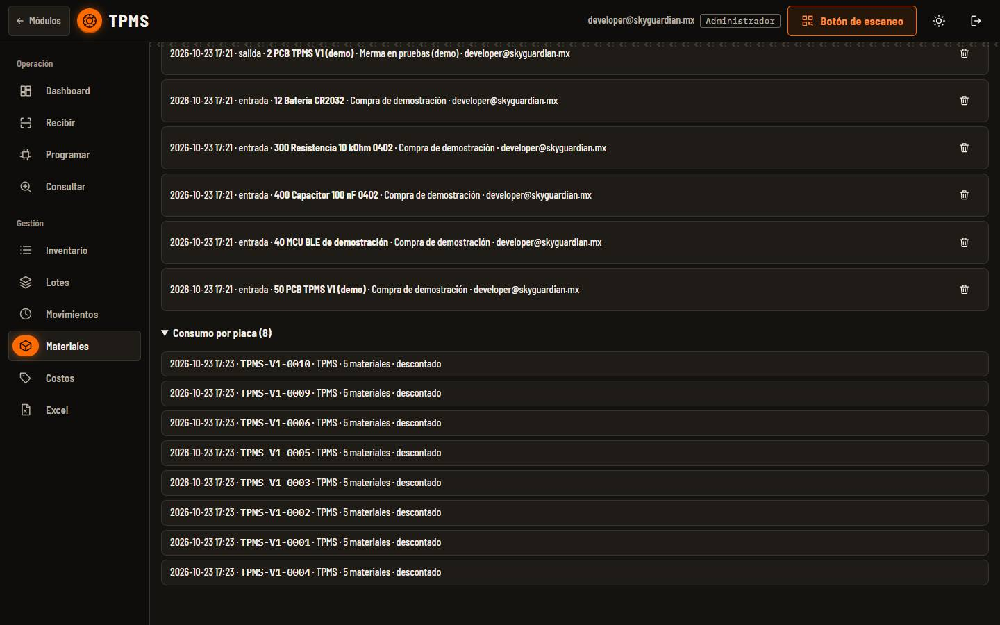
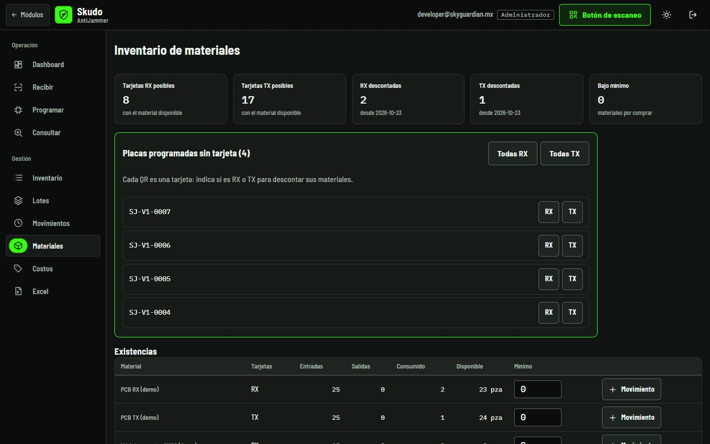

<!-- Generado por scripts/generar_manual_md.py desde app/static/documentacion/guias/costos-materiales.json. No editar a mano. -->

# Costos y Materiales

*Cotizador e inventario por módulo* · Ruta: `/tpms#costos` · Lectura: 6 min

Dos pestañas que tienen TPMS, Skudo AntiJammer, SpeedLocker, Skudo Sigfox y Caiquén. Costos es el cotizador: la lista de materiales de cada tarjeta y su costo por QR. Materiales es el inventario: entradas, salidas y lo que consume cada placa programada.

**Quién puede hacer qué**

- **Administrador**: Edita costos, importa el cotizador, registra movimientos y activa el inventario en todos los módulos.
- **General**: Lo mismo, en los módulos que tiene asignados.
- **Consultor**: Solo consulta; no edita costos ni registra movimientos.

## ¿Cómo se relacionan?

Cada módulo tiene su propia lista de materiales y su propio tipo de cambio: lo que cambies en TPMS no afecta a SpeedLocker. Cada QR es una tarjeta: en AntiJammer la tarjeta RX y la TX se cuentan por separado; en los demás módulos hay una sola tarjeta.

Costos dice qué lleva cada tarjeta. Materiales usa esa misma lista: cuando una placa pasa a PROGRAMADA, descuenta sus materiales de las existencias. Si la desprogramas o la eliminas, los devuelve.

## Costos: el cotizador

### Paso 1. Lee el resumen

Arriba ves el costo por QR de cada tarjeta y los costos recurrentes (licencias, herramientas), que se muestran aparte y no se suman a la producción. El tipo de cambio (MXN por USD) solo afecta a este módulo.

1. Costo por tarjeta
2. Recurrente (aparte)
3. Tipo de cambio
4. Materiales de la tarjeta
5. Costos recurrentes

### Paso 2. Agrega o edita un material

«Agregar material» (o el lápiz de una fila) abre el editor: descripción, tarjeta, categoría, proveedor, cantidad por tarjeta, cantidad por caja/bobina, unidad, costo unitario y moneda. En «Tipo de costo» eliges si es de producción (suma al costo de la tarjeta) o recurrente.

1. Tarjeta y categoría
2. Costo unitario y moneda
3. Tipo de costo
4. Agregar

### Paso 3. Importa o descarga el cotizador

«Descargar cotizador» baja un Excel con fórmulas. «Importar Excel» carga un cotizador: reemplaza toda la lista del módulo. Las filas marcadas «RX y TX» se reparten entre ambas tarjetas.

1. Descargar · Importar · Agregar

> **Nota:** Antes de importar, descarga el cotizador actual como respaldo.

### Paso 4. AntiJammer: RX, TX y equipo completo

En Skudo AntiJammer hay dos tarjetas. El resumen muestra el costo de la RX, el de la TX y el del equipo completo (RX + TX).

1. RX · TX · Equipo completo
2. Tarjeta RX
3. Tarjeta TX

## Materiales: el inventario

### Paso 1. Activa el inventario

Al principio la pestaña dice «Inventario preparado, sin activar»: la lista ya existe (sale de Costos) pero no hay existencias. Registra las entradas y elige la fecha en «Descontar desde»: desde ese día, cada placa programada descuenta sus materiales; las programadas antes no.

1. Aviso y fecha de inicio
2. Activar inventario

### Paso 2. Revisa existencias

Arriba: cuántas tarjetas puedes armar con lo disponible, cuántas se han descontado y cuántos materiales están bajo el mínimo. En la tabla, disponible = entradas − salidas − consumo. Escribe el «Mínimo» de cada material para que se marque «BAJO MÍNIMO».

1. Resumen
2. Existencias
3. Bajo mínimo
4. Movimiento

### Paso 3. Registra un movimiento

«Movimiento» abre un formulario: elige si es una entrada (llegó material) o una salida (merma, préstamo…), la cantidad y una nota, y pulsa «Registrar».

1. Tipo: entrada o salida
2. Cantidad
3. Registrar

### Paso 4. Historial y consumo por placa

«Movimientos recientes» lista entradas y salidas (puedes borrar una con el bote). «Consumo por placa» muestra qué placa descontó materiales y cuándo.

1. Movimientos recientes
2. Consumo por placa

### Paso 5. AntiJammer: indica RX o TX

El QR de AntiJammer no dice si la placa es RX o TX. Las placas programadas sin tarjeta aparecen en «Placas programadas sin tarjeta»: pulsa RX o TX en cada una (o «Todas RX» / «Todas TX») para que descuente sus materiales.

1. Placas sin tarjeta
2. Todas RX · Todas TX

## Ficha técnica

| Campo | Detalle |
| --- | --- |
| Dónde | Pestañas «Costos» y «Materiales» de TPMS, Skudo AntiJammer, SpeedLocker, Skudo Sigfox y Caiquén (por ejemplo /tpms#costos) |
| Tarjetas | TPMS · AntiJammer RX y TX · SpeedLocker · Tarjeta Sigfox (licencia recurrente) · Tarjeta Caiquén |
| Costo por tarjeta | Suma de (cantidad × costo unitario en MXN) de los materiales de producción; USD se convierte con el tipo de cambio del módulo |
| Importar Excel | Reemplaza la lista completa del módulo; filas «RX y TX» se reparten |
| Disponible | Entradas − salidas − consumo |
| Consumo | Al pasar una placa a PROGRAMADA (desde la fecha de activación); se devuelve al desprogramar o eliminar |

## Problemas frecuentes

**Importé un Excel y desapareció un material que agregué a mano.**

Importar reemplaza toda la lista del módulo. Agrega de nuevo el material o inclúyelo en el cotizador antes de importar.

**Programé placas y no se descontó nada.**

El inventario no está activo, o las placas se programaron antes de la fecha «Descontar desde». En AntiJammer revisa también que tengan RX o TX asignada.

**El costo cambió sin que tocara los materiales.**

Cambió el tipo de cambio del módulo; afecta a los materiales en USD.

**No puedo editar ni registrar movimientos.**

Tu cuenta es de consulta. Pide a un administrador el rol general o administrador.

## Guías relacionadas

- [TPMS](tpms.md)
- [Skudo AntiJammer](skudo-antijammer.md)
- [Skudo Sigfox](skudo-sigfox.md)
