<!-- Generado por scripts/generar_manual_md.py desde app/static/documentacion/guias/cuentas.json. No editar a mano. -->

# Cuentas y permisos

*Roles, módulos e invitaciones* · Ruta: `/inicio` · Lectura: 9 min

Quién puede entrar a cada módulo y qué puede hacer ahí. Cada cuenta tiene un rol (Administrador, General o Consultor) y una lista de módulos. Los administradores los asignan desde el núcleo «I+D» del portal e invitan a personas nuevas por correo.

**Quién puede hacer qué**

- **Administrador**: Entra a todos los módulos, abre el panel «Cuentas y módulos», cambia roles y módulos, invita cuentas y entra a Administración del Escáner TQT.
- **General**: Trabaja normalmente en los módulos asignados (registrar, editar, programar…). No entra a Administración ni al panel de cuentas.
- **Consultor**: Solo consulta en los módulos asignados: ve y escanea, pero no crea, edita, mueve, envía ni borra datos.

## Cómo funcionan los permisos

Para entrar a una pantalla, el servidor revisa dos cosas: primero que tu cuenta tenga asignado el módulo de esa pantalla, y después que tu rol permita la acción.

Los administradores tienen todos los módulos siempre, aunque no estén marcados. Las cuentas General y Consultor solo entran a los módulos que un administrador les marcó.

Los permisos se aplican en el servidor, no solo en la pantalla: aunque escribas la dirección a mano o llames a la API, una cuenta sin permiso recibe el rechazo.

## Qué hace cada rol

| Campo | Detalle |
| --- | --- |
| Acción | Administrador · General · Consultor |
| Entrar a un módulo | Todos · Solo los asignados · Solo los asignados |
| Ver datos, consultar y escanear | Sí · Sí · Sí |
| Crear, editar, mover, enviar o borrar datos | Sí · Sí · No |
| Descargar Excel | Sí · Sí · Sí (donde el módulo lo ofrece) |
| Escáner TQT: Recibir, Emparejar, Programar, Etiquetas DYMO | Sí · Sí · No (va a Consultar) |
| Escáner TQT: consola de escritorio /monitor | Completa · Completa · Solo Dashboard, Tarjetas, Inventario de PCB, Consultar y Excel |
| Administración del Escáner TQT (/admin) | Sí · No · No |
| Panel «Cuentas y módulos» del portal | Sí · No · No |
| Aprobar solicitudes de contraseña | De cualquier cuenta · De General y Consultor · No |
| Cambiar su propia contraseña y cerrar sesión | Sí · Sí · Sí |

## Qué ve una cuenta sin permiso

La plataforma siempre explica por qué no puedes entrar y qué hacer.

### Paso 1. Módulo no asignado

En el portal la estrella aparece con candado y «Sin acceso». Si abres la dirección del módulo, el servidor te regresa al portal (`/inicio?denegado=…`). Para Escáner TQT aparece arriba el aviso «Tu cuenta no tiene acceso a Escáner TQT. Pide a un administrador que te lo asigne.», que cierras con la ×.

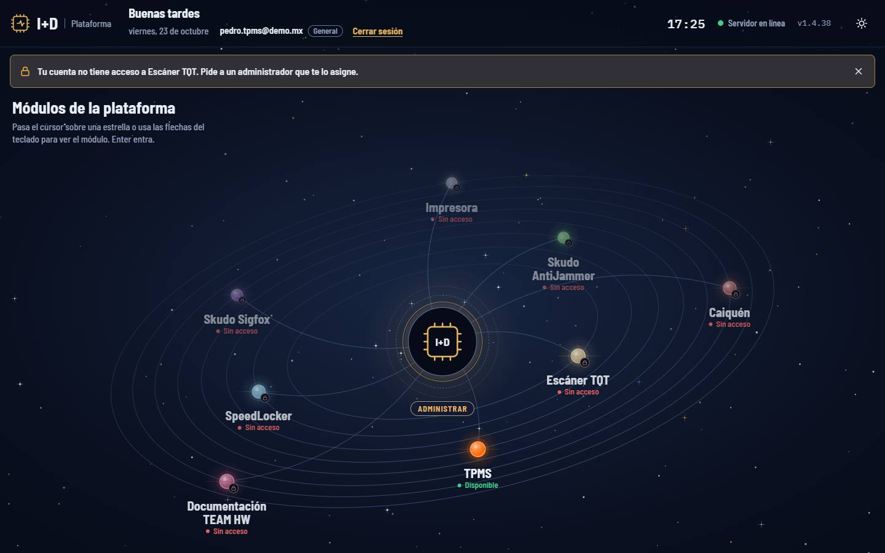

1. Aviso de acceso denegado
2. Descartar el aviso
3. Escáner TQT: «Sin acceso» para esta cuenta

> **Nota:** Para los demás módulos el portal no muestra este aviso: solo verás la estrella del módulo con «Sin acceso».

### Paso 2. Acción que tu rol no permite

Si un Consultor intenta abrir Recibir, Emparejar o Programar, o guardar algo, aparece la ventana «Acceso restringido» con lo que intentó, lo que sí puede hacer su rol y a quién pedir el cambio. Las pestañas que no puede usar llevan un candado.

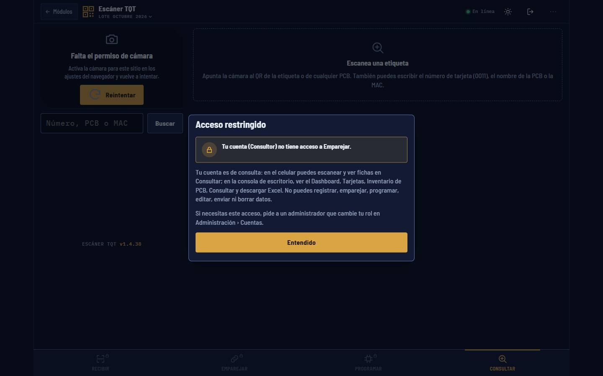

1. Qué intentaste y por qué no se puede
2. «Entendido» cierra la ventana
3. Pestaña con candado: sin permiso
4. Consultar: la página de inicio del Consultor

### Paso 3. Consola de escritorio para un Consultor

En la computadora, el Consultor entra a la consola del Escáner TQT con menos secciones: Dashboard, Tarjetas, Consultar, Inventario de PCB y Excel (además de Comandos).

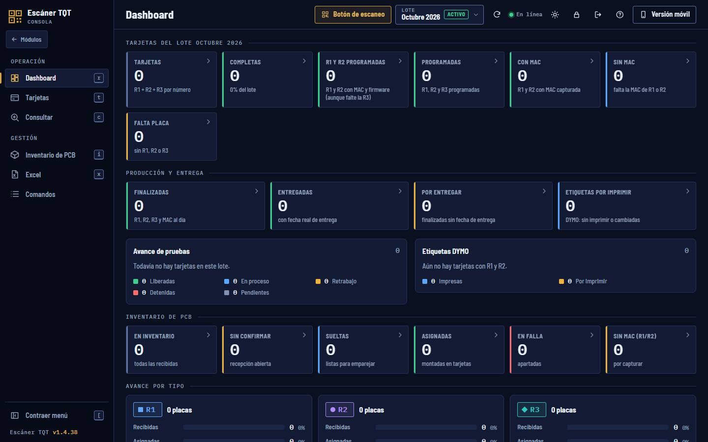

1. Menú reducido del Consultor
2. «Módulos»: volver al portal
3. Cerrar sesión

## Entrar como administrador desde el núcleo

El panel de cuentas se abre desde el núcleo «I+D», en el centro del portal (botón «Administrar»).

### Paso 1. Pulsa el núcleo «I+D»

Si ya tienes sesión de administrador, se abre directo el panel «Cuentas y módulos». Si no, aparece el formulario «Acceso de administrador».

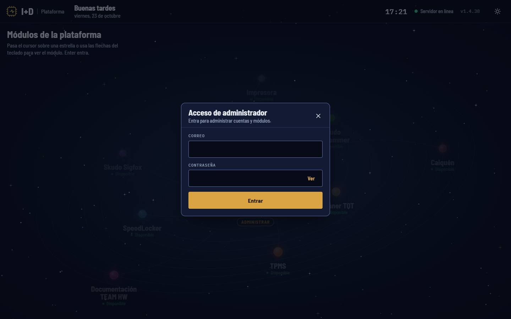

1. «Acceso de administrador»
2. Correo de una cuenta Administrador
3. Contraseña (con «Ver»)
4. «Entrar»
5. Cerrar el panel (también con Escape)

### Paso 2. Entra con una cuenta de administrador

Si tu sesión actual no es de administrador, el formulario lo indica. Al entrar con una cuenta Administrador, tu sesión pasa a ser la de esa cuenta y el mismo panel cambia a «Cuentas y módulos».

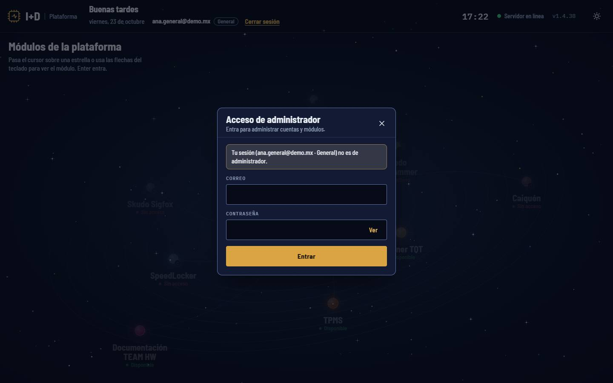

1. Tu sesión actual no es de administrador
2. Escribe aquí la cuenta de administrador
3. «Entrar»

> **Nota:** Con una cuenta General o Consultor verás «Esta cuenta no es de administrador…» y no se abre ninguna sesión. Si la cuenta debe cambiar su contraseña inicial, aparece «Ir a iniciar sesión»: cámbiala primero ahí.

## El panel «Cuentas y módulos»

Es una tabla: una fila por cuenta y una columna por módulo. Los cambios se guardan al instante y verás «Guardado» al pie del panel.

### Paso 1. Asigna módulos y cambia el rol

Marca o desmarca la casilla del módulo en la fila de la cuenta. La casilla «Todos» marca o quita todos los módulos de esa cuenta; si tiene algunos, se ve a medias. Cambia el rol con la lista «Rol». Las cuentas Administrador tienen todo marcado y bloqueado («Todos (administrador)»).

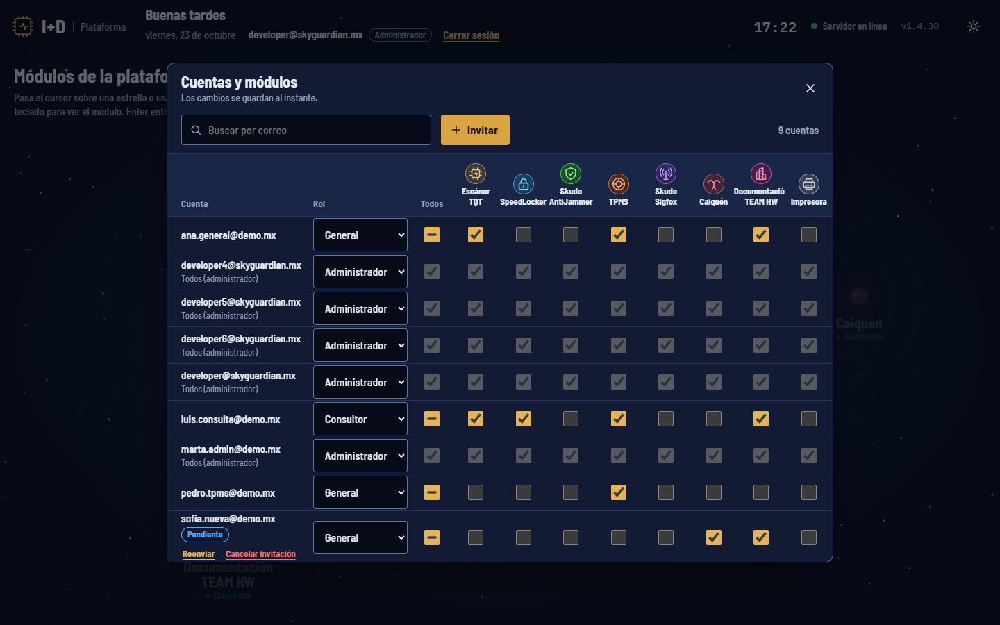

1. Buscar por correo
2. Rol de la cuenta
3. «Todos»: a medias si tiene algunos módulos
4. Encabezado del módulo: abre su menú
5. Administrador: todos los módulos siempre

> **Nota:** Siempre debe quedar al menos un administrador activo: el panel no te deja quitarle el rol al último. Si un cambio falla, la casilla vuelve a su estado y aparece el motivo en rojo.

### Paso 2. Da o quita un módulo a todos

Pulsa el nombre de un módulo en el encabezado. El menú ofrece «Dar a todos», «Quitar a todos» e «Invitar a este módulo». Afecta solo a las cuentas que no son administradoras.

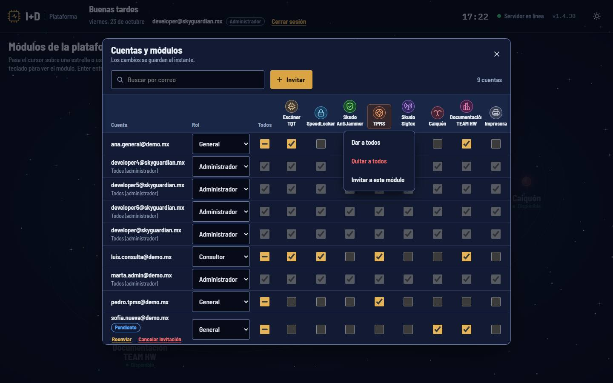

1. Encabezado TPMS
2. «Dar a todos»
3. «Quitar a todos»
4. «Invitar a este módulo»: abre la invitación con el módulo ya marcado

### Paso 3. Confirma el cambio masivo

Antes de aplicar, el panel pregunta, por ejemplo, «¿Dar «TPMS» a todas las cuentas que no son administradoras?». Pulsa «Dar a todos» (o «Quitar a todos») para aplicar o «Cancelar».

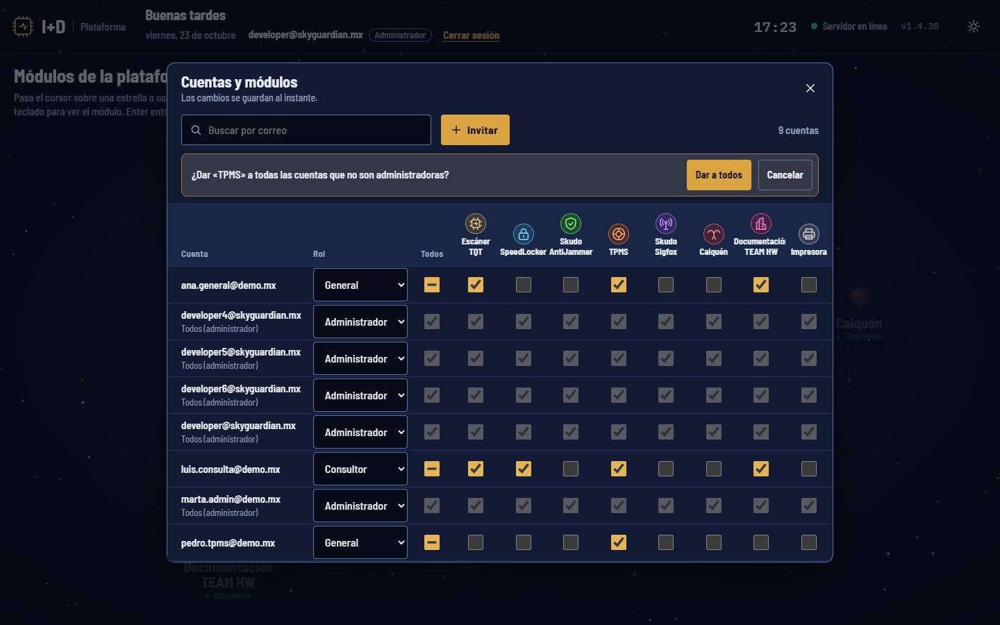

1. Pregunta de confirmación
2. Aplicar
3. «Cancelar»

### Paso 4. Desde el celular

En pantallas angostas cada cuenta se muestra como una tarjeta: rol, «Todos» y un botón por módulo. Arriba, la fila «Dar o quitar a todos» reemplaza a los encabezados de columna.

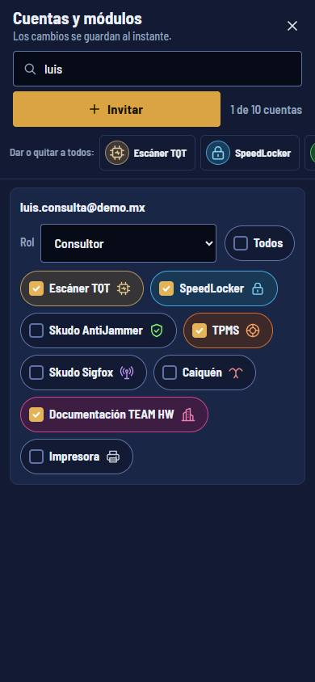

1. Tarjeta de una cuenta
2. Rol
3. «Todos»

## Invitar a una persona nueva

No hay registro libre: las cuentas nuevas entran por invitación. La invitación ya lleva el rol y los módulos.

### Paso 1. Llena la invitación

Pulsa «Invitar». Escribe el correo, elige el rol (por defecto General) y marca los módulos. Con rol Administrador se marcan todos y quedan bloqueados. Pulsa «Enviar invitación».

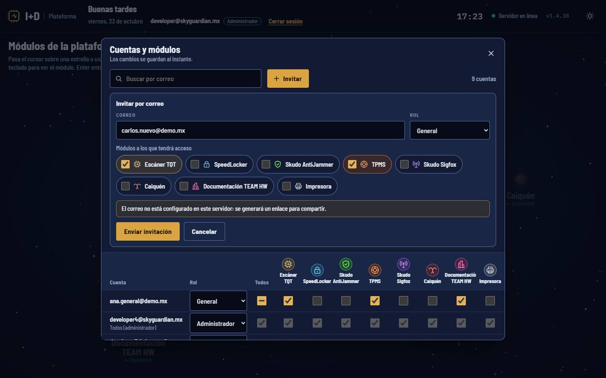

1. Correo de la persona
2. Rol
3. Módulos a los que tendrá acceso
4. Aviso: este servidor no envía correo
5. «Enviar invitación»

> **Nota:** Debes elegir al menos un módulo (salvo para Administrador). Si el correo ya tiene cuenta, verás «Ya existe una cuenta con ese correo.»

### Paso 2. Comparte el enlace si el correo no salió

Si el servidor tiene correo configurado, verás «Invitación enviada a …». Si no, aparece una tarjeta con el enlace de invitación y el motivo. Pulsa «Copiar enlace» y mándalo por otro medio (chat, mensaje).

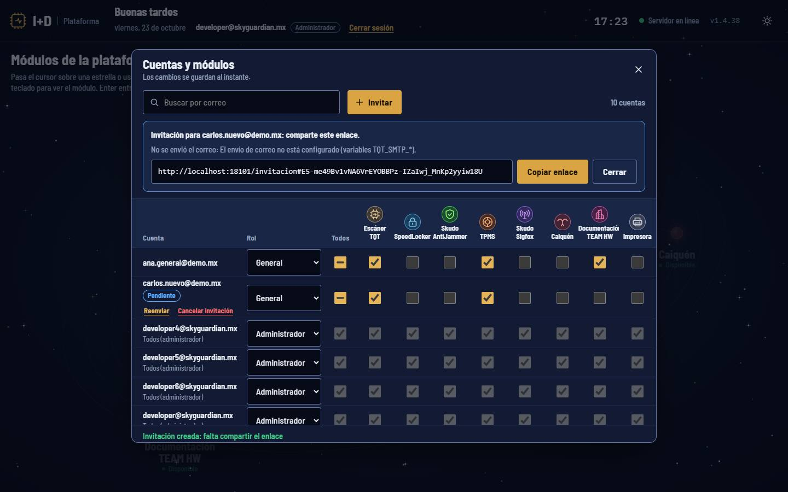

1. Para quién es la invitación
2. Por qué no se envió el correo
3. Enlace /invitacion#…
4. «Copiar enlace»

> **Nota:** El enlace da acceso a la cuenta: compártelo solo con esa persona. Vale 48 horas y se usa una sola vez.

### Paso 3. Sigue las invitaciones pendientes

Mientras la persona no active su cuenta, su fila lleva la etiqueta «Pendiente» y dos enlaces: «Reenviar» (crea un enlace nuevo; el anterior deja de servir) y «Cancelar invitación» (borra la cuenta que nunca se activó, tras confirmar con «Cancelar invitación» o «Conservar»). Puedes cambiarle rol y módulos aunque esté pendiente.

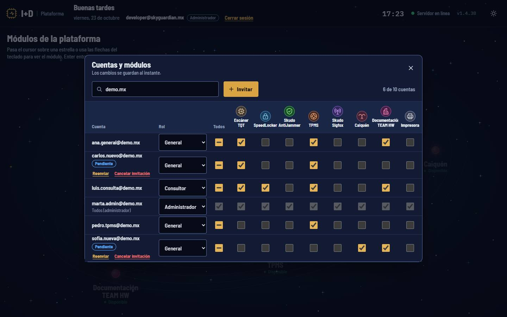

1. Búsqueda por correo
2. Cuántas cuentas coinciden
3. Etiqueta «Pendiente»
4. «Reenviar»
5. «Cancelar invitación»

### Paso 4. La persona activa su cuenta

Al abrir el enlace ve «Activa tu cuenta» con su correo y su rol. Elige una contraseña (mínimo 10 caracteres), la repite y pulsa «Activar y entrar». Entra con sesión abierta al portal, donde ve sus módulos.

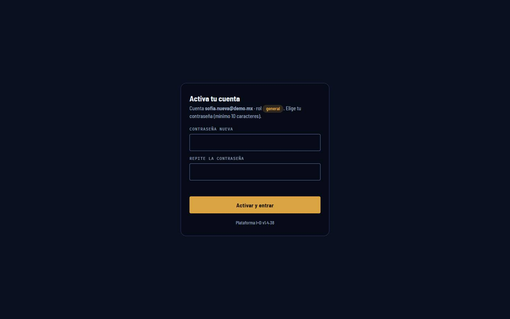

1. Cuenta y rol de la invitación
2. Contraseña nueva
3. Repite la contraseña
4. «Activar y entrar»

> **Nota:** Si el enlace venció o ya se usó, la página dice «La invitación no es válida o ya caducó. Pide al administrador que te la reenvíe.»

## Solicitudes de cambio de contraseña

Cuando alguien usa «¿Olvidaste tu contraseña?», la solicitud aparece en la consola de escritorio del Escáner TQT (`/monitor`) de las cuentas que pueden aprobarla: un botón con escudo y el número de pendientes, «Solicitudes de contraseña».

Aprueba solo si la persona está contigo y la reconoces. Al pulsar «Aprobar» obtienes un código de 6 dígitos, válido 10 minutos, que se muestra una sola vez: díctalo en persona. «Rechazar» cancela la solicitud.

Reglas: nadie aprueba su propia solicitud; nadie aprueba la de una cuenta con más permisos que la suya; un Consultor no aprueba ninguna. El paso a paso completo está en «Primeros pasos».

## Desactivar o eliminar cuentas

El panel del portal asigna roles y módulos e invita, pero no desactiva ni elimina cuentas activas. Eso se hace en Administración del Escáner TQT (`/admin`, pestaña «Cuentas»), solo para administradores. Ahí cada cuenta tiene «Desactivar»/«Activar» y «Eliminar» (pide un segundo clic para confirmar).

Desactivar una cuenta cierra sus sesiones. Tampoco ahí se puede desactivar ni eliminar al último administrador activo.

## Ficha técnica

| Campo | Detalle |
| --- | --- |
| Roles | administrador · general · consultor |
| Dónde se administran | Núcleo «I+D» del portal /inicio → «Cuentas y módulos» |
| Ingreso de administrador | Formulario «Acceso de administrador» en el núcleo; solo abre sesión si la cuenta es Administrador |
| Módulos asignables | Escáner TQT · SpeedLocker · Skudo AntiJammer · TPMS · Skudo Sigfox · Caiquén · Impresora (Documentación TEAM HW es pública y no necesita asignarse) |
| Cambios masivos | «Dar a todos» / «Quitar a todos» por módulo; no tocan a los administradores |
| Invitación | Enlace /invitacion#… · vale 48 h · un solo uso · «Reenviar» invalida el anterior |
| Contraseña al activar | Mínimo 10 caracteres |
| Sin módulo asignado | Página: vuelve a /inicio?denegado= · API: error 403 «Tu cuenta no tiene acceso al módulo…» |
| Rol sin permiso | Página: va a una zona permitida con ?denegado= y muestra «Acceso restringido» · API: error 403 |
| Lo único que un Consultor puede enviar | Cerrar sesión, cambiar su contraseña y el escáner del celular |
| Regla de seguridad | Siempre queda al menos un administrador activo |
| Registro | Invitaciones, cambios de rol y módulos y aprobaciones quedan en Movimientos con quién los hizo |

## Problemas frecuentes

**Le di un módulo a alguien y todavía ve «Sin acceso».**

Pídele que recargue el portal. El permiso se revisa en cada página, así que al recargar ya aparece Disponible.

**No me deja quitarle el rol de Administrador a una cuenta.**

Es el último administrador activo. Primero haz administradora a otra cuenta.

**Las casillas de un administrador están grises.**

Un Administrador tiene todos los módulos por su rol. Para limitarlo, cámbiale el rol a General y marca sus módulos.

**La persona invitada no recibió el correo.**

Revisa si el panel mostró la tarjeta con el enlace: el servidor no tiene correo configurado. Copia el enlace y envíaselo. Si ya pasaron 48 horas, usa «Reenviar».

**Abrí el núcleo y me pide correo y contraseña aunque ya tengo sesión.**

Tu sesión no es de administrador. Entra con una cuenta Administrador; tu sesión pasará a ser esa.

**Un Consultor necesita registrar placas.**

Cámbiale el rol a General en el panel. Los Consultores no pueden crear ni editar datos en ningún módulo.

**Dice «Esta cuenta debe cambiar su contraseña».**

Pulsa «Ir a iniciar sesión», cambia la contraseña inicial y vuelve a abrir el núcleo.

## Guías relacionadas

- [Primeros pasos](primeros-pasos.md)
- [Escáner TQT](escaner-tqt.md)
