<!-- Generado por scripts/generar_manual_md.py desde app/static/documentacion/guias/escaner-tqt.json. No editar a mano. -->

# Escáner TQT

*Tarjetas R1, R2 y R3* · Ruta: `/monitor` · Lectura: 10 min

El módulo principal: se reciben las PCB R1, R2 y R3 por su QR, se emparejan en una tarjeta TQT, se captura su MAC y firmware, se programan, se prueban, se imprime su etiqueta DYMO y se registra su entrega. También lleva el inventario de materiales TQTR y el Excel mensual de cada lote.

**Quién puede hacer qué**

- **Administrador**: Todo, incluida el área de Administración (borrados, cuentas y bitácora).
- **General**: Recibe, empareja, programa, prueba, imprime y entrega dentro de los módulos asignados.
- **Consultor**: Solo /consultar y /escaner para buscar y escanear; no modifica nada.

## ¿Qué es?

Una tarjeta TQT se arma con tres PCB: la R1 (principal, con MAC), la R2 (con MAC y firmware por Bluetooth) y la R3. Cada PCB trae un QR como TQT-R1-V30-0101: tipo, versión de hardware y número. Las tres del mismo número forman la tarjeta 0101.

El trabajo se organiza en lotes (por semana o por mes). La consola de computadora está en /monitor; la versión móvil, en /escaner. El Dashboard resume el lote activo: tarjetas, completas, programadas, con MAC, en producción y entregadas, avance de pruebas, etiquetas por imprimir e inventario de PCB.

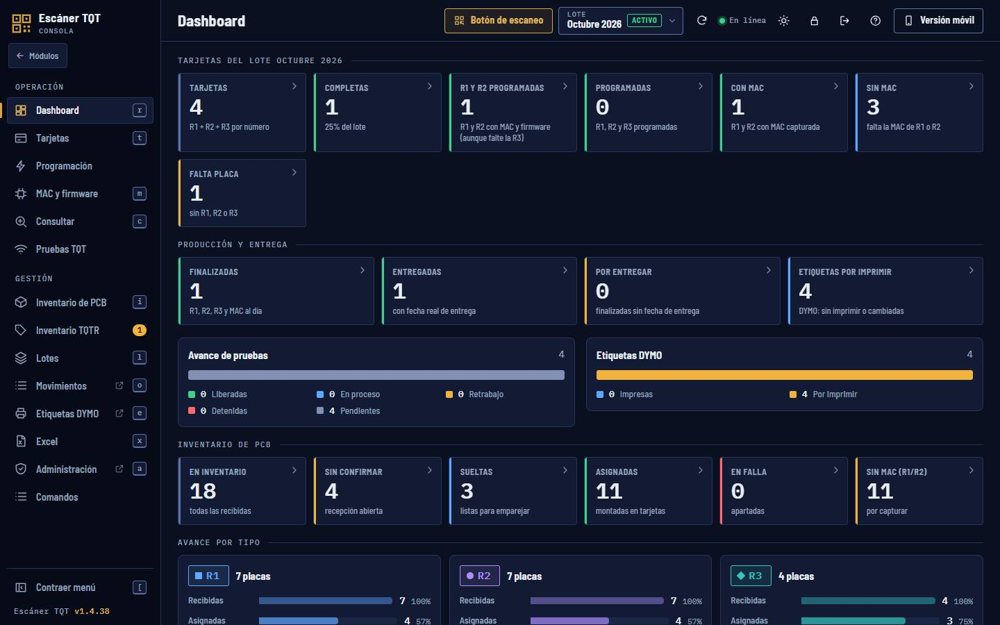

1. Menú: operación y gestión
2. Lote activo
3. Botón de escaneo
4. Tarjetas del lote
5. Producción, entrega, pruebas y etiquetas
6. Versión móvil

## Elegir o crear el lote

Todo lo que recibes y emparejas queda en tu lote activo. Cada usuario tiene el suyo.

### Paso 1. Selector de lote

Arriba, junto al Botón de escaneo, está el lote activo. Tócalo para cambiar de lote o «Usar o crear lote…».

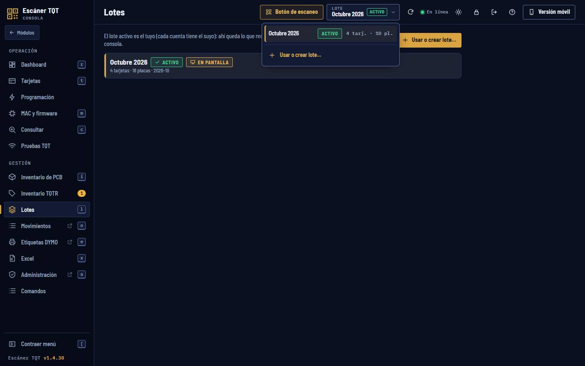

1. Lotes disponibles

### Paso 2. Crear un lote

Elige el tipo (semana o mes), el mes y el año, y pulsa «Crear y usar este lote». «Ver en el monitor» lo muestra en la pantalla del área.

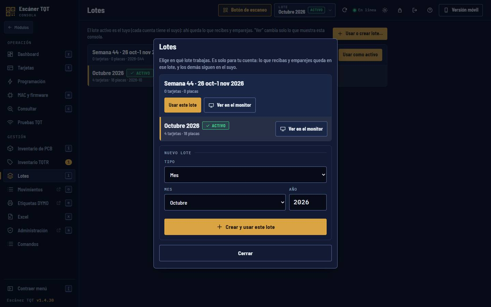

1. Lotes existentes
2. Nuevo lote
3. Crear y usar este lote

## Recibir PCB con el celular

La recepción se hace en /escaner, desde el celular.

### Paso 1. Escanea las PCB

Abre /escaner, permite la cámara y apunta al QR de cada PCB. Si la cámara no está disponible, usa «Teclear código». Arriba ves la última lectura y el conteo de R1, R2 y R3.

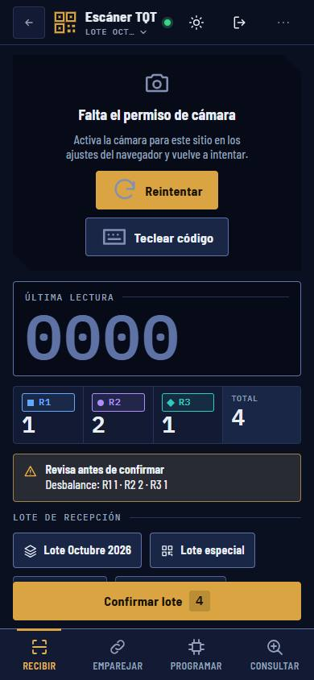

1. Reintentar / Teclear código
2. Última lectura
3. Conteo R1 · R2 · R3
4. Confirmar lote

### Paso 2. Revisa y confirma

Las lecturas se listan abajo (puedes corregir una con el lápiz). Si no cuadra el número de R1, R2 y R3 aparece «Revisa antes de confirmar». Cuando esté bien, pulsa «Confirmar lote».

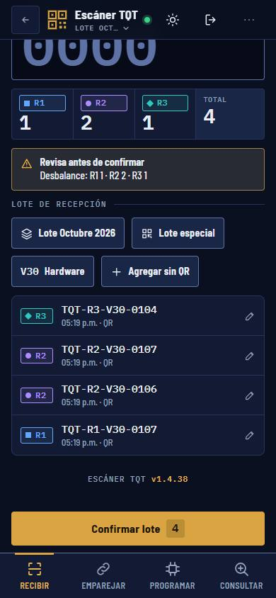

1. Aviso de desbalance
2. Lote, lote especial, hardware, agregar sin QR
3. Lecturas
4. Confirmar lote

### Paso 3. Lote especial

Para PCB cuyo QR no trae el formato TQT-R1-V30-0021 (por ejemplo TQT_R2_0008 o TQT_Timer_0033): indica la versión de hardware y el tipo («Del QR» lo toma del código; R1, R2 o R3 lo fija) y pulsa «Activar».

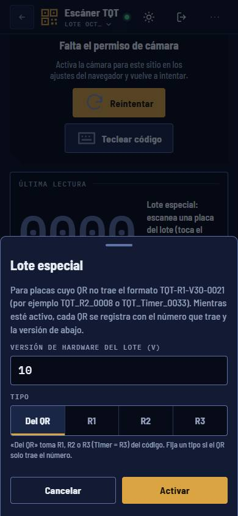

1. Versión de hardware
2. Tipo
3. Activar

## El celular como lector de la consola

### Paso 1. Vincular

En la consola pulsa «Botón de escaneo»: aparece un QR. Escanéalo con el celular (en la app: Más opciones → Escáner para la consola) e inicia sesión si te lo pide. Desde entonces cada PCB o etiqueta que escanees se abre en la sección que tengas abierta en la PC (Inventario, Tarjetas, MAC y firmware, Consultar…).

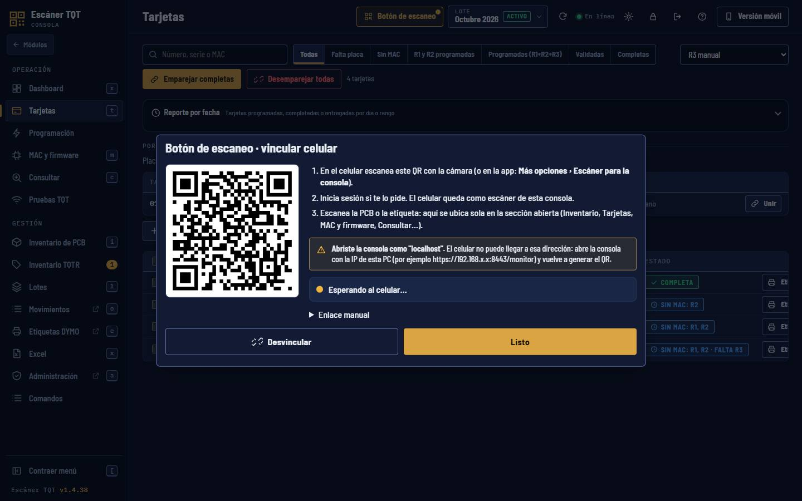

1. QR para el celular
2. Listo

> **Nota:** Si abriste la consola como «localhost», el celular no puede llegar: entra con la IP de la PC (por ejemplo https://192.168.x.x:8443/monitor).

### Paso 2. En el celular

El celular muestra «Vinculado a la consola» y la sección abierta en la PC. Lo que escanees o escribas en «Código a enviar» aparece en «Enviados a la consola». «Salir» lo desvincula.

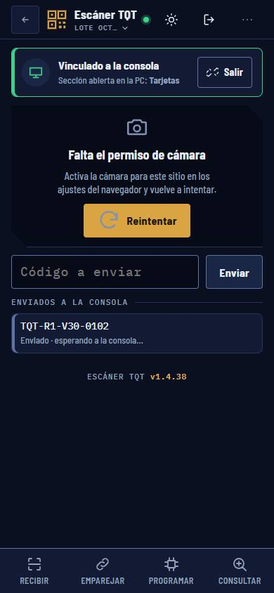

1. Vinculado · sección en la PC
2. Código a enviar
3. Enviados a la consola

## Tarjetas: emparejar R1, R2 y R3

### Paso 1. Emparejar

En Tarjetas, «Emparejar completas» une las R1 y R2 sueltas del mismo número en una tarjeta; la R3 se asigna a mano en cada tarjeta. «Armar a mano (impar)» sirve cuando los números no coinciden. Usa los filtros (Falta placa, Sin MAC, Programadas…) para ver qué falta.

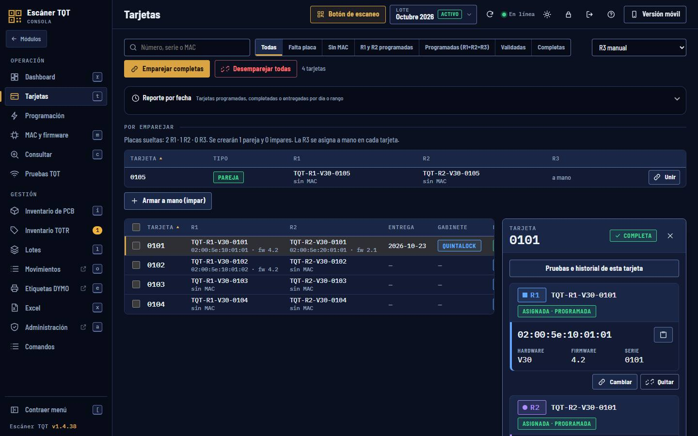

1. Buscar y filtros
2. Emparejar · Desemparejar
3. Placas sueltas por emparejar
4. Tarjetas del lote
5. Detalle de la tarjeta

### Paso 2. Registrar la entrega

Cuando una tarjeta ya tiene R1, R2, R3 y MAC, la aplicación pregunta cuándo se entrega: elige la fecha y el gabinete (para varias a la vez, selecciónalas y pulsa «Aplicar») y «Guardar fechas de entrega».

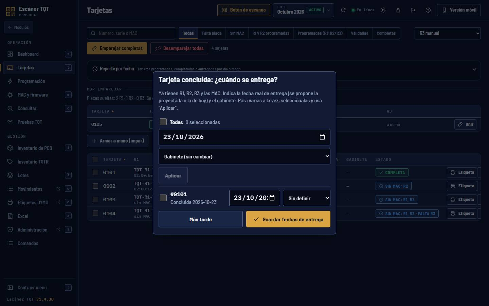

1. Fecha y gabinete para varias
2. Por tarjeta
3. Guardar fechas de entrega

## MAC, firmware y programación

### Paso 1. MAC y firmware

Lista las PCB pendientes: escribe la MAC (12 dígitos) y elige el firmware de cada una, o aplica un firmware a todas las R1 o R2. «Lote R3 (escanear)» marca R3 en serie. «Pegar varias» acepta una lista de MAC.

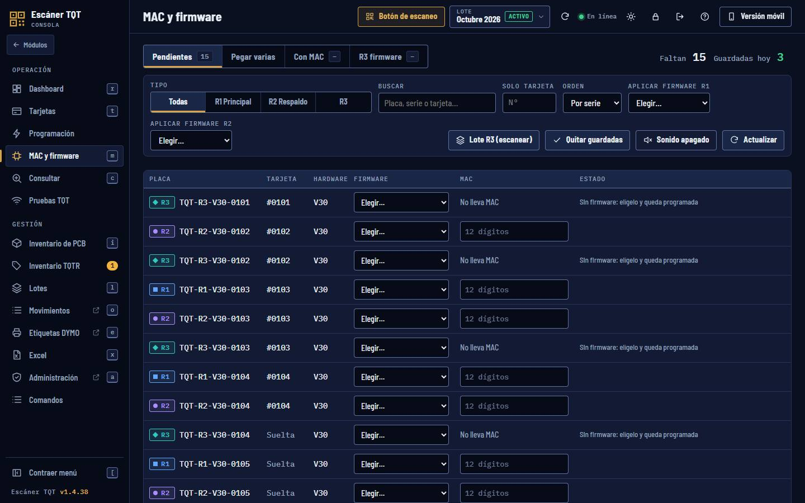

1. Pendientes · Pegar varias · Con MAC · R3
2. Filtros y firmware para todas
3. MAC y firmware por PCB

### Paso 2. Programar la R1

En Programación, pestaña TQT R1: elige la R1, revisa sus datos y la R2 vinculada, elige el firmware y pulsa «Programar R1 … con J-Link» (o ESP32). Necesita la estación Windows con el J-Link conectado a esta PC.

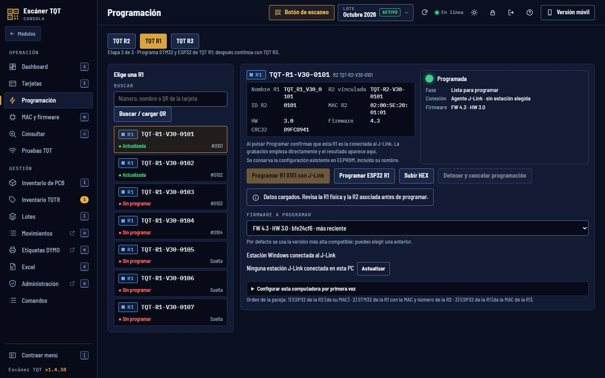

1. TQT R2 · R1 · R3
2. Elige una R1
3. Datos de la R1 y su R2
4. Programar con J-Link / ESP32
5. Firmware y estación

### Paso 3. Programar la R2 por Bluetooth

Pestaña TQT R2: conecta la tarjeta por USB o enciéndela cerca por Bluetooth, elige el firmware y pulsa «Actualizar por Bluetooth». Abajo está el terminal serial para ver lo que responde.

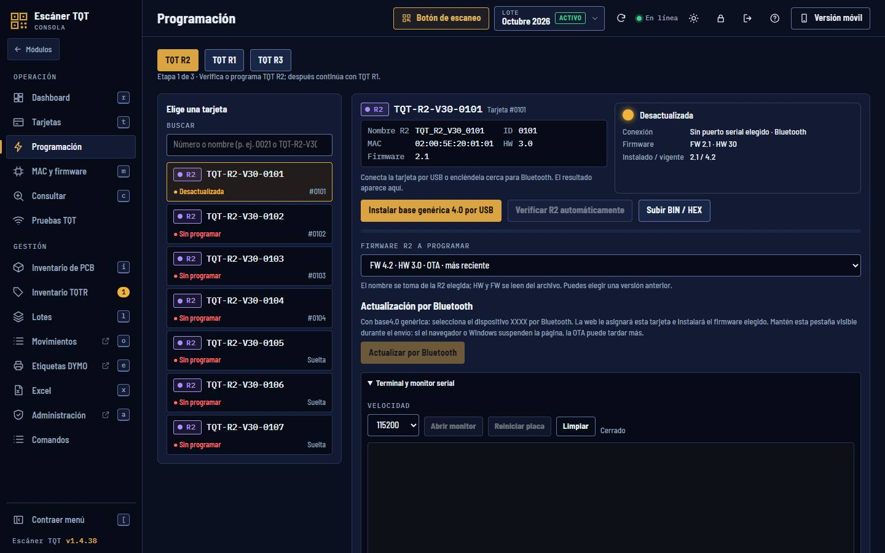

1. Elige una R2
2. Datos y conexión
3. Firmware y actualización
4. Terminal serial

### Paso 4. Pruebas TQT

Elige una tarjeta: se muestran los datos de R1, R2 y R3 y si su firmware está vigente. Conecta Bluetooth o el puerto serial y pulsa «Iniciar las 14 etapas» para la prueba automática; el resultado queda en el historial de la tarjeta.

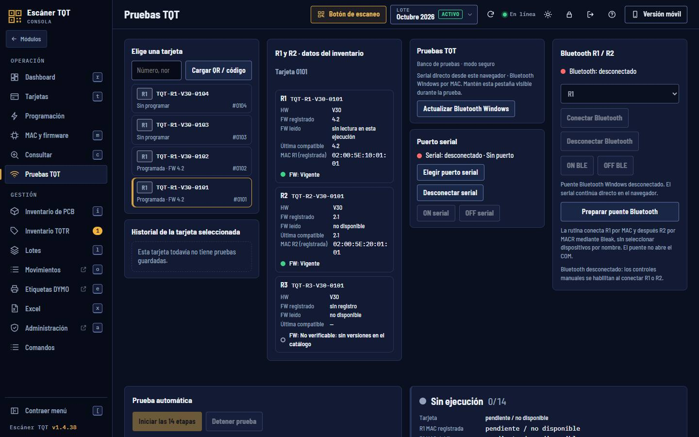

1. Elige una tarjeta
2. Datos y vigencia de R1, R2, R3
3. Bluetooth y serial
4. Iniciar las 14 etapas

## Consultar, etiquetas y Excel

### Paso 1. Consultar una tarjeta

Escribe o escanea el número de tarjeta, el nombre de una PCB, la MAC o hasta 4 líneas de la etiqueta. Verás el estatus (emparejada, programada, completa, entregada), la entrega y las tres PCB con su MAC y firmware. Desde aquí imprimes la etiqueta DYMO o copias los datos.

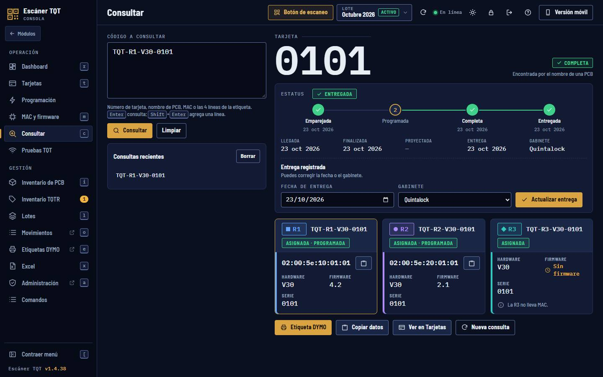

1. Código a consultar
2. Estatus
3. Entrega
4. R1 · R2 · R3
5. Etiqueta DYMO · copiar datos

### Paso 2. Etiquetas DYMO

Revisa que la impresora esté conectada (o pulsa «Actualizar»). Elige el tipo (Tarjetas, Escanear, R3, Cable, Cable R3), la tarjeta y las copias; la vista previa muestra la etiqueta a escala.

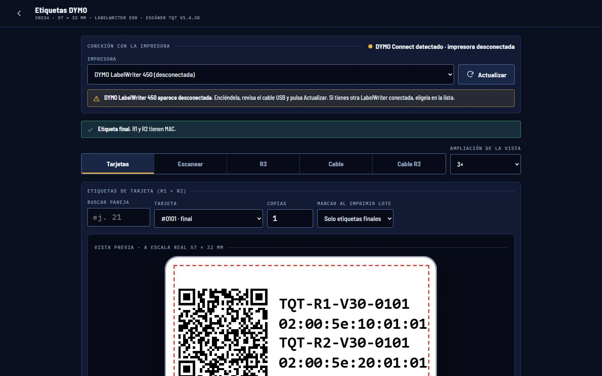

1. Impresora
2. Aviso de conexión
3. Tipo de etiqueta
4. Tarjeta y copias
5. Vista previa

### Paso 3. Excel mensual

«Sincronizar Excel» escribe las tarjetas del lote en su archivo mensual (las fórmulas y validaciones se conservan). «Descargar copia» baja una plantilla nueva con los datos y «Enviar por correo» la manda.

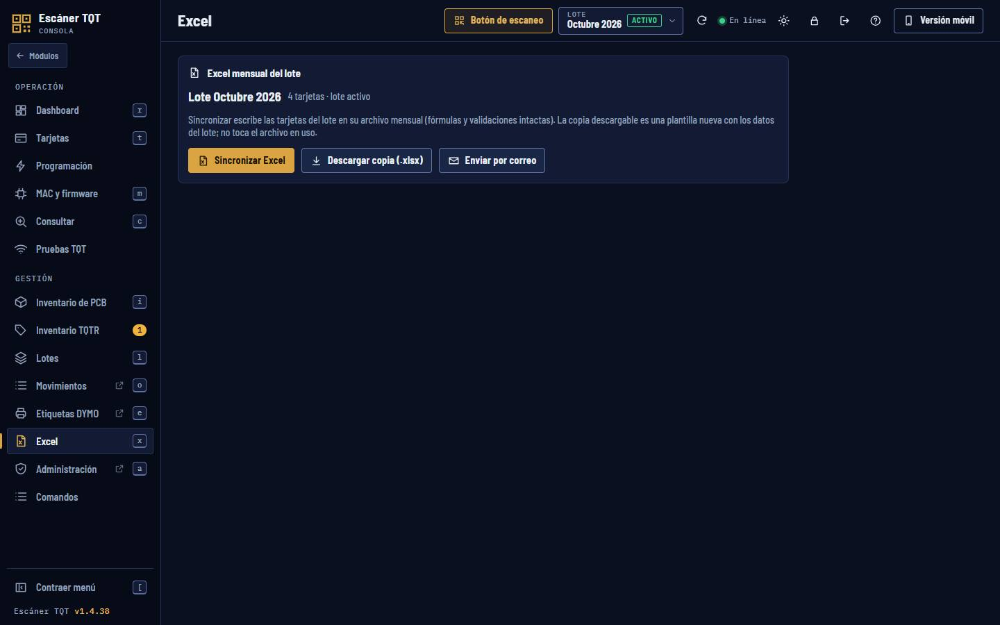

1. Sincronizar · descargar · enviar

## Inventario de PCB e Inventario TQTR

### Paso 1. Inventario de PCB

Todas las PCB recibidas, con hardware, firmware, MAC, estado (sin confirmar, suelta, asignada, programada), tarjeta y lote. Filtra por tipo, estado, versión o lote, o marca «Solo sin MAC». «Editar» corrige una PCB.

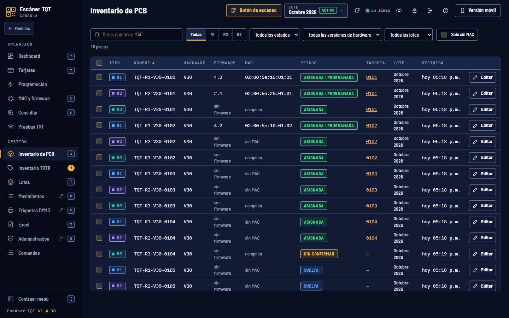

1. Buscar y filtros
2. PCB

### Paso 2. Inventario TQTR

El inventario de materiales de la tarjeta TQT: registro de entradas, componentes, costos, consumo y «Stock mínimo». Arriba ves qué hay que comprar, qué está agotado y qué no alcanza a cubrir la entrega; «Nuevo movimiento» registra entradas y salidas. Cuando un material cruza el mínimo se avisa por correo a los administradores.

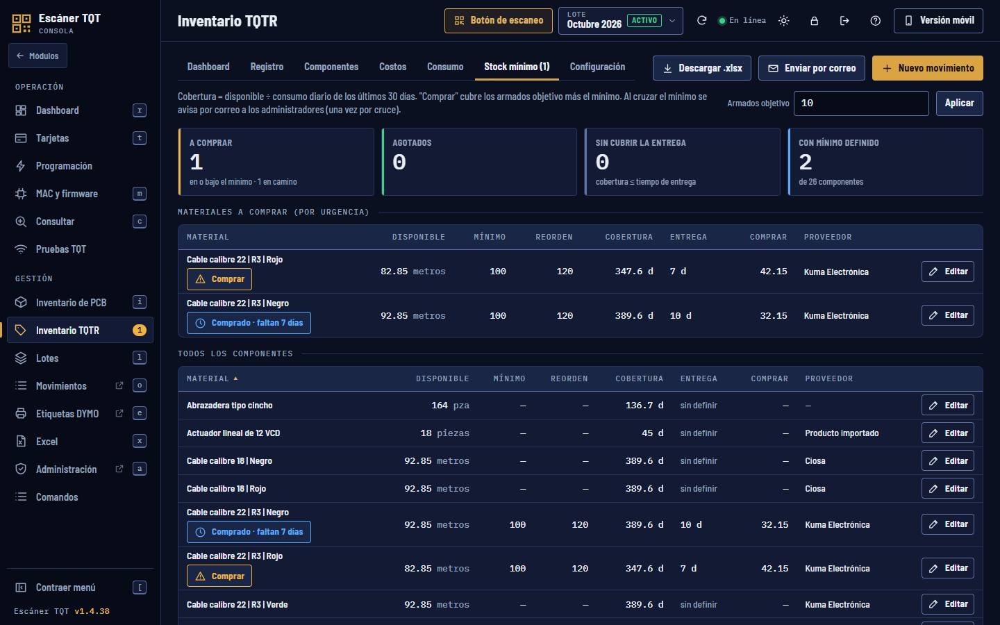

1. Pestañas del inventario
2. Descargar · correo · nuevo movimiento
3. A comprar · agotados · sin cubrir
4. Materiales a comprar

## Administración

El área /admin (solo administradores) muestra totales, últimos movimientos, lotes e inventario de PCB, y permite borrar registros, revisar movimientos y exportar a Excel. Pide la contraseña de administración y la sesión se cierra sola al pasar su tiempo.

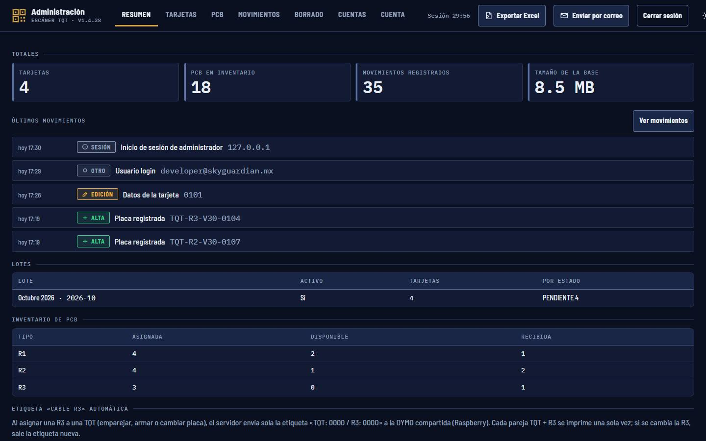

1. Secciones
2. Totales
3. Últimos movimientos

## Ficha técnica

| Campo | Detalle |
| --- | --- |
| Rutas | /monitor (consola) · /escaner (móvil) · /consultar · /admin |
| Formato del QR | TQT-R1-V30-0101: tipo (R1, R2, R3), versión de hardware (V30 = 3.0) y número. Formatos antiguos (TQT_R2_0008, TQT_Timer_0033) con «Lote especial». |
| Tarjeta | R1 + R2 + R3 del mismo número; R1 y R2 con MAC de 12 dígitos |
| Estados de tarjeta | Emparejada → Programada → Completa → Entregada |
| Programación | R1 con J-Link o ESP32 (estación Windows) · R2 por Bluetooth |
| Etiqueta | DYMO: tarjeta (R1 + R2 con MAC), escanear, R3, cable y cable R3 |
| Excel | Archivo mensual del lote, con fórmulas |

## Problemas frecuentes

**«Revisa antes de confirmar: desbalance».**

No leíste el mismo número de R1, R2 y R3. Revisa que no falte ni sobre una PCB; puedes confirmar igual si es correcto.

**El QR de una PCB vieja no se reconoce.**

Activa «Lote especial» con la versión de hardware y el tipo, o escribe el código a mano.

**«Falta el permiso de cámara».**

Permite la cámara en los ajustes del navegador para este sitio y pulsa «Reintentar», o usa «Teclear código».

**No aparece la estación J-Link.**

Abre la estación Windows en la PC con el J-Link conectado y pulsa «Actualizar».

**La DYMO aparece desconectada.**

Enciéndela, revisa el cable USB y pulsa «Actualizar». Si tienes otra conectada, elígela en la lista.

**Lo que recibí quedó en otro lote.**

Se guarda en tu lote activo. Cámbialo antes de recibir; para mover PCB ya recibidas usa «Mover a lote» en el inventario.

## Guías relacionadas

- [Primeros pasos](primeros-pasos.md)
- [Cuentas y permisos](cuentas.md)
- [TPMS](tpms.md)
