<!-- Generado por scripts/generar_manual_md.py desde app/static/documentacion/guias/impresora.json. No editar a mano. -->

# Impresora

*Activos con etiqueta DYMO y QR* · Ruta: `/impresora` · Lectura: 6 min

Libro de activos de la empresa: cada equipo recibe un número ACT 0000 y una etiqueta DYMO con su QR. Al escanear la etiqueta se abre la ficha del equipo con sus datos, características e historial.

**Quién puede hacer qué**

- **Administrador**: Todo: registrar, editar, importar, imprimir, exportar y eliminar activos.
- **General**: Lo mismo, si su cuenta tiene asignado el módulo Impresora.
- **Consultor**: Solo lectura: consulta y escanea fichas; no registra, edita, imprime ni elimina.

## ¿Qué es?

Impresora lleva el registro de activos: computadoras, herramientas, instrumentos y mobiliario. Cada uno tiene un código ACT con número consecutivo, departamento, ubicación, responsable, estado y una etiqueta DYMO 30334 con QR.

Sin sesión, /impresora te lleva a su pantalla de acceso, /impresora/acceso.

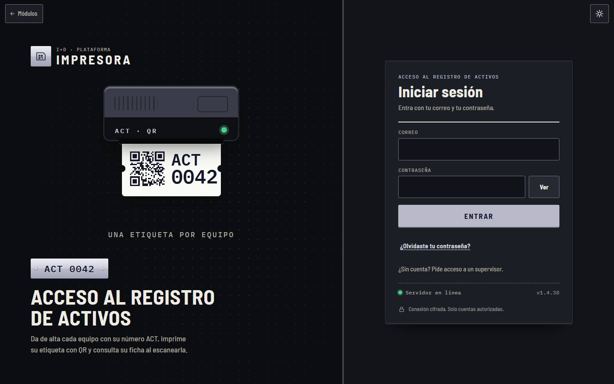

1. Correo y contraseña
2. Entrar

## El libro de activos

A la izquierda está la lista de activos; a la derecha, la ficha del que elijas. Arriba puedes buscar por código, nombre o serie y filtrar por estado, departamento y categoría. La columna «Impr.» cuenta cuántas veces se imprimió la etiqueta.

El aviso «Impresora sin conexión» indica que la DYMO compartida de la oficina no está disponible en ese momento.

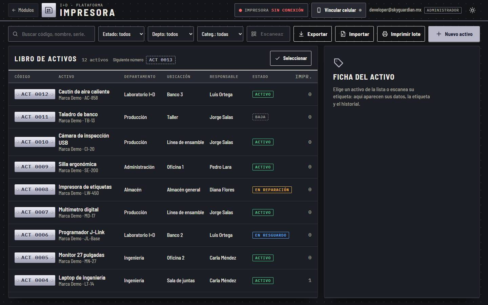

1. Buscar y filtros
2. Exportar · Importar · Imprimir lote · Nuevo activo
3. Lista de activos
4. Ficha del activo
5. Estado de la impresora

## Registrar un activo e imprimir su etiqueta

### Paso 1. Nuevo activo

Pulsa «Nuevo activo» y llena estado, marca, modelo, número de serie, ubicación, responsable, fecha de adquisición, valor y notas. En «Características» agrega datos extra (procesador, memoria…), cada uno con nombre y valor. Pulsa «Guardar activo».

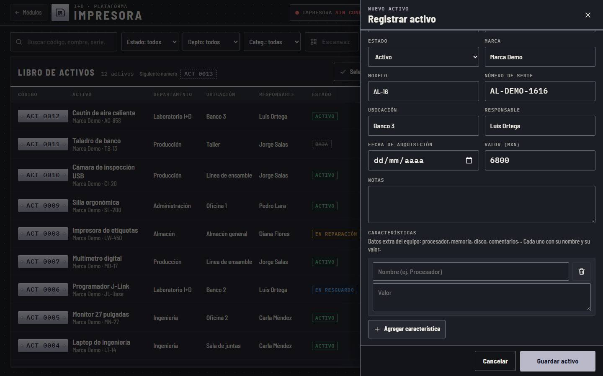

1. Datos del activo
2. Características
3. Guardar activo

### Paso 2. Imprime la etiqueta

Al guardar se asigna el siguiente número (ACT 0013) y se muestra la etiqueta. Elige cómo imprimirla: DYMO compartida (la de la oficina, desde cualquier equipo), DYMO Connect (una DYMO conectada por USB a esta computadora), descargar el archivo .dymo, o imprimir desde el navegador.

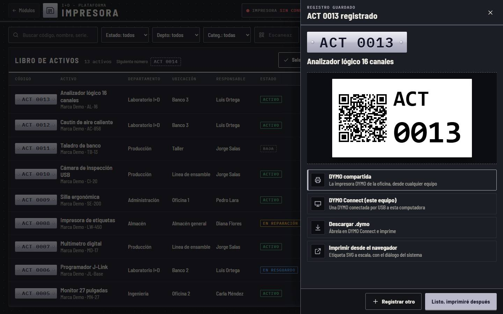

1. Etiqueta ACT 0013
2. Formas de imprimir
3. Registrar otro · imprimir después

## La ficha del activo

### Paso 1. Abre la ficha

Toca un activo de la lista o escanea su etiqueta. La ficha muestra el código, el nombre, la etiqueta y los botones «Imprimir etiqueta», «Otras vías» (DYMO Connect, .dymo o navegador) y «Editar».

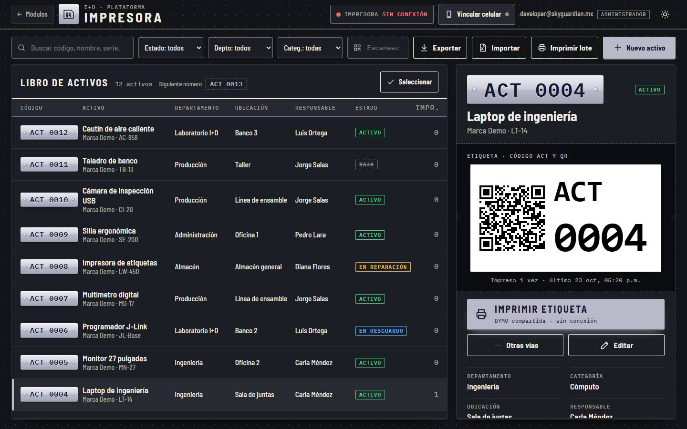

1. Código y nombre
2. Imprimir etiqueta
3. Otras vías · Editar

### Paso 2. Datos e historial

Más abajo: departamento, categoría, ubicación, responsable, serie, fecha de adquisición, valor, notas, características y el historial (alta, ediciones e impresiones, con fecha y usuario).

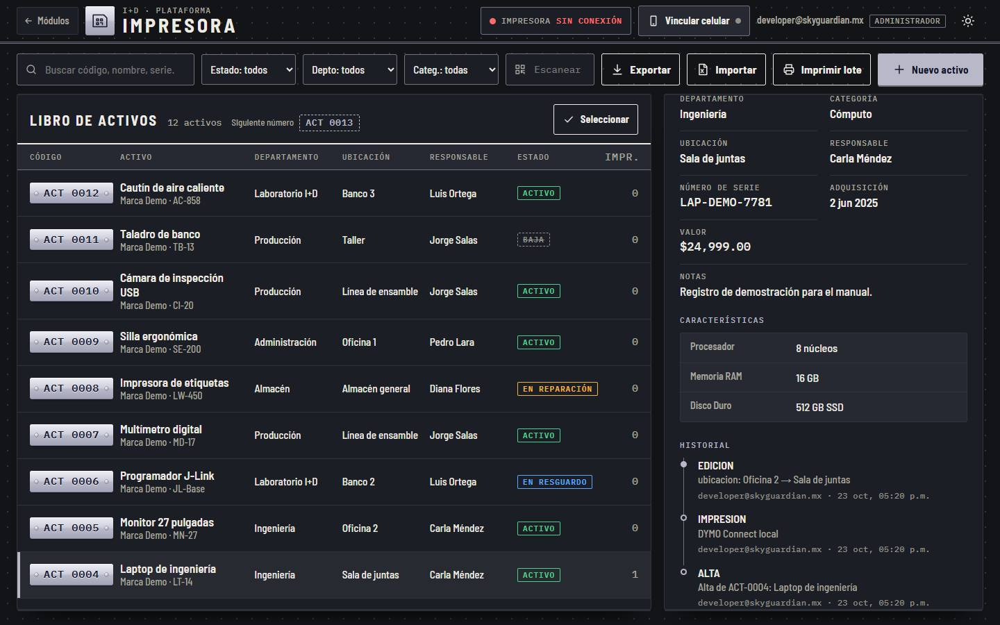

1. Datos
2. Características
3. Historial

### Paso 3. En el celular

La ficha ocupa toda la pantalla y «Imprimir etiqueta» queda abajo. Es lo que ves al escanear una etiqueta con la cámara del celular.

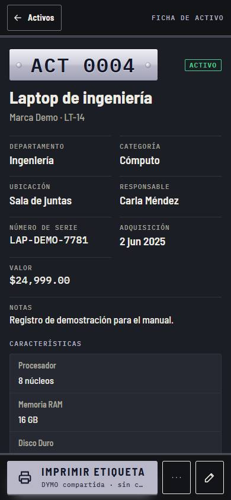

1. Código y nombre
2. Imprimir etiqueta · más · editar

## Varios activos a la vez

### Paso 1. Seleccionar

«Seleccionar» agrega casillas a la lista. Con varios activos marcados puedes exportarlos, imprimir sus etiquetas o eliminarlos.

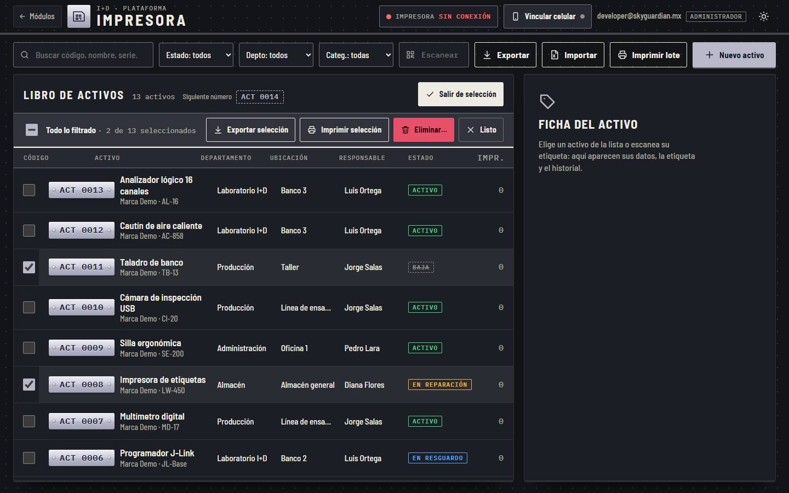

1. Acciones de la selección
2. Salir de selección

### Paso 2. Imprimir lote

«Imprimir lote» deja elegir etiquetas por fecha de alta (todas, hoy, ayer, un día o un rango), departamento o búsqueda; «Solo sin imprimir» oculta las que ya salieron. Envíalas a la impresora o descárgalas en un .zip. Si la DYMO compartida no está disponible, el aviso lo dice y puedes volver a comprobar.

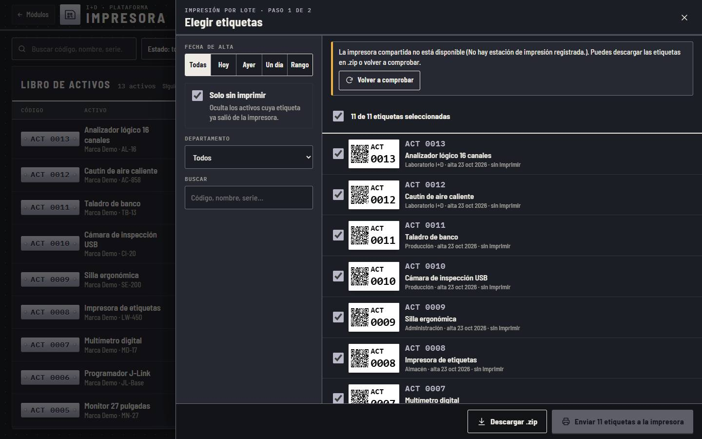

1. Filtros
2. Estado de la impresora
3. Descargar .zip · Enviar a la impresora

### Paso 3. Importar desde Excel

«Importar» carga un Excel con activos. Antes de guardar te muestra cuántos son nuevos, cuántos se actualizan y cuántos se omiten, por hoja, y una muestra. Al terminar puedes imprimir todas las etiquetas nuevas.

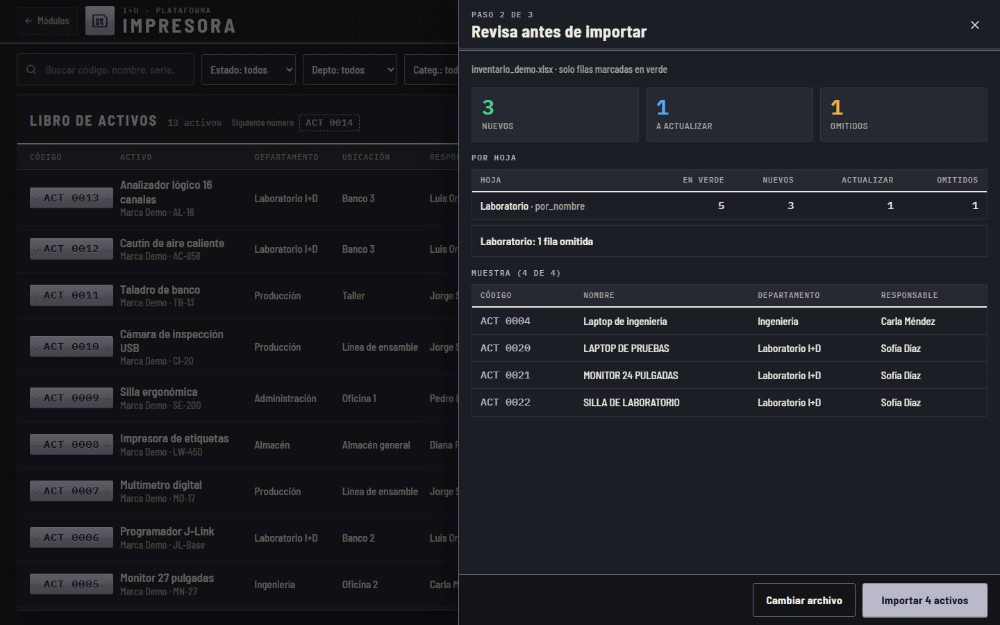

1. Nuevos · actualizar · omitidos
2. Por hoja
3. Importar

### Paso 4. Importación terminada

Al final puedes imprimir todas las etiquetas en la DYMO compartida, descargarlas (.zip) o ver los activos importados.

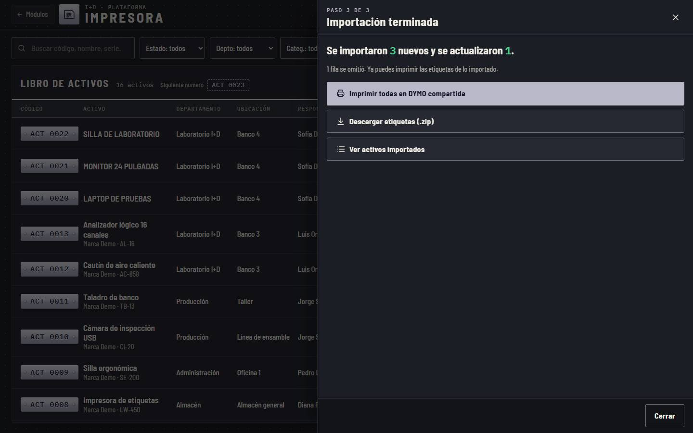

1. Imprimir · descargar · ver

### Paso 5. Eliminar

Eliminar borra los activos para siempre, con su historial. Para confirmar, escribe tu contraseña.

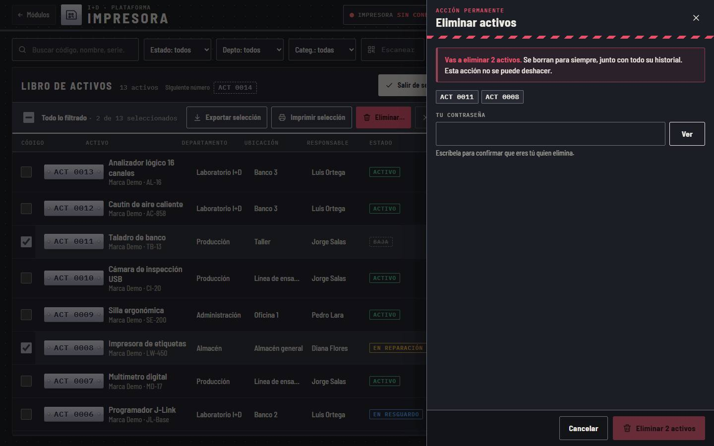

1. Aviso
2. Tu contraseña
3. Eliminar

## El celular como lector

### Paso 1. Vincular celular

«Vincular celular» muestra un QR. Escanéalo con la cámara del celular e inicia sesión si te lo pide: el celular queda como escáner de este módulo. Cada etiqueta que escanees abre su ficha aquí y en el celular. «Desvincular» termina el enlace.

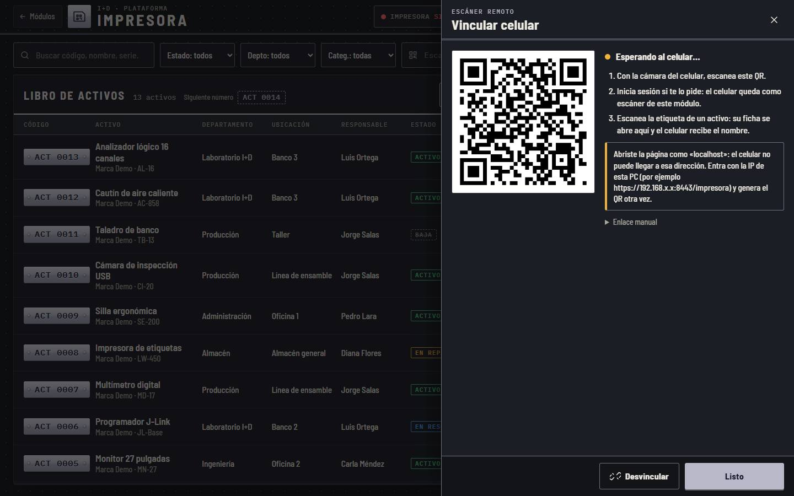

1. QR para el celular
2. Pasos
3. Desvincular

> **Nota:** Si abriste la página como «localhost», el celular no puede llegar a esa dirección: entra con la IP de la PC (por ejemplo https://192.168.x.x:8443/impresora).

## Ficha técnica

| Campo | Detalle |
| --- | --- |
| Rutas | /impresora (libro) · /impresora/acceso (inicio de sesión) |
| Código | ACT 0000, consecutivo; el siguiente número aparece junto al título del libro |
| Etiqueta | DYMO 30334 con el código ACT y su QR |
| Formas de imprimir | DYMO compartida (oficina) · DYMO Connect (USB) · archivo .dymo · navegador (SVG) |
| Estados | Activo · Baja · En reparación · En resguardo |
| Importar / exportar | Excel (.xlsx) |

## Problemas frecuentes

**Dice «Impresora sin conexión».**

La DYMO compartida de la oficina no responde. Usa «Otras vías» (DYMO Connect, .dymo o navegador) o vuelve a comprobar más tarde.

**El celular no abre el QR de «Vincular celular».**

Entra a la plataforma con la IP de la computadora, no con «localhost», y vuelve a generar el QR.

**No veo «Nuevo activo» ni «Editar».**

Tu cuenta es de consulta (solo lectura).

**Eliminé un activo por error.**

La eliminación no se puede deshacer. Regístralo de nuevo; tendrá otro número ACT.

## Guías relacionadas

- [Primeros pasos](primeros-pasos.md)
- [Cuentas y permisos](cuentas.md)
