<!-- Generado por scripts/generar_manual_md.py desde app/static/documentacion/guias/primeros-pasos.json. No editar a mano. -->

# Primeros pasos

*Portal, acceso y navegación* · Ruta: `/inicio` · Lectura: 8 min

Cómo moverte por la Plataforma I+D: el portal de módulos, cómo entrar a cada módulo con tu cuenta, qué hacer si olvidas tu contraseña y cómo volver al portal o cerrar sesión.

**Quién puede hacer qué**

- **Administrador**: Ve todos los módulos como Disponibles y, desde el núcleo «I+D», administra cuentas y módulos.
- **General**: Entra a los módulos que tiene asignados; los demás aparecen como «Sin acceso».
- **Consultor**: Entra a sus módulos asignados para consultar y escanear; no puede crear, editar ni borrar datos.

## ¿Qué es la Plataforma I+D?

Es la web del equipo de hardware. Reúne varios módulos: Escáner TQT, TPMS, Skudo AntiJammer, SpeedLocker, Skudo Sigfox, Caiquén, Impresora y Documentación TEAM HW. Cada módulo es una aplicación con su propio permiso.

Todo empieza en el portal `/inicio`. Si abres la dirección principal `/` sin sesión, también llegas al portal.

Usas una sola cuenta (tu correo y tu contraseña) para todos los módulos. Un administrador decide a qué módulos entras y con qué rol. Los roles y permisos están en la guía «Cuentas y permisos».

## El portal de módulos

El portal muestra los módulos como estrellas que giran alrededor del núcleo «I+D». Cada estrella tiene el nombre del módulo y su estado debajo.

En la cabecera ves el saludo y la fecha, tu correo y tu rol (si iniciaste sesión), la hora, el estado del servidor («Servidor en línea»), la versión de la plataforma y el botón de tema claro/oscuro.

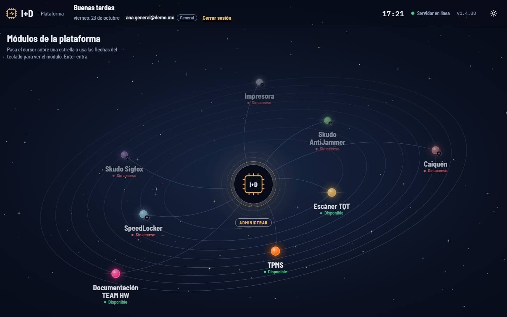

1. Tu correo, tu rol y el enlace «Cerrar sesión»
2. Núcleo «I+D»: el botón «Administrar» (solo sirve a administradores)
3. Módulo Disponible: puedes entrar
4. Módulo con candado y «Sin acceso»: tu cuenta no lo tiene asignado

## Ver la ficha de un módulo

Antes de entrar puedes ver para qué sirve cada módulo y si tienes acceso.

### Paso 1. Pasa el cursor sobre una estrella

Las órbitas se detienen y aparece una ficha con el nombre, el estado y la descripción del módulo. También puedes usar las flechas del teclado para recorrer los módulos: Enter entra y Escape cierra la ficha.

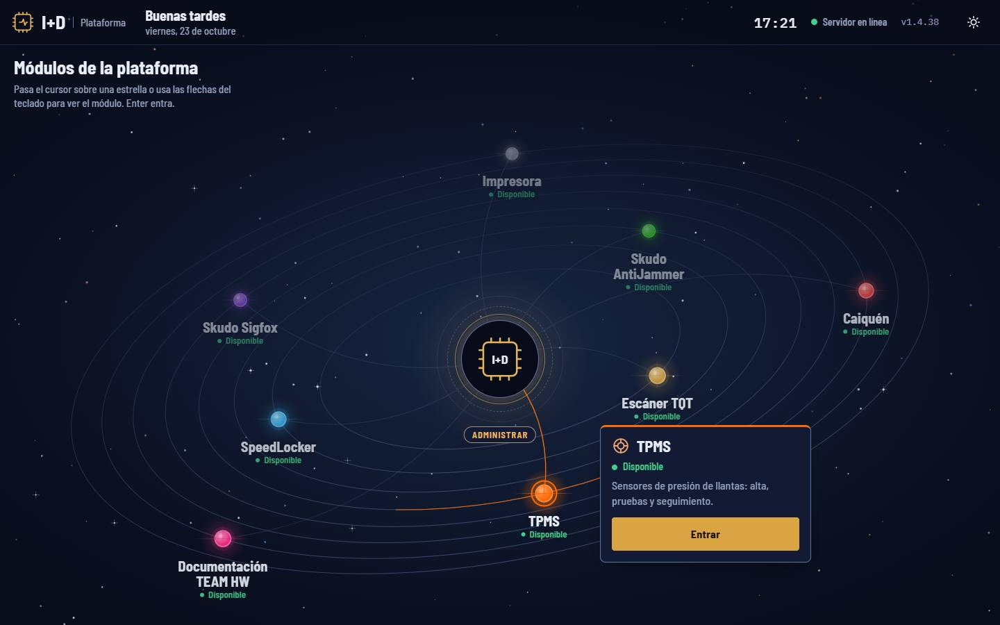

1. Estrella bajo el cursor
2. Estado del módulo
3. Botón «Entrar»

### Paso 2. Lee el estado

«Disponible»: el módulo funciona y tu cuenta puede entrar. «Sin acceso»: el módulo funciona, pero no lo tienes asignado; la ficha no muestra «Entrar» y te pide solicitarlo a un administrador. «Próximamente» y «En mantenimiento» indican que el módulo aún no se puede usar; al pulsarlo verás un aviso en lugar de entrar.

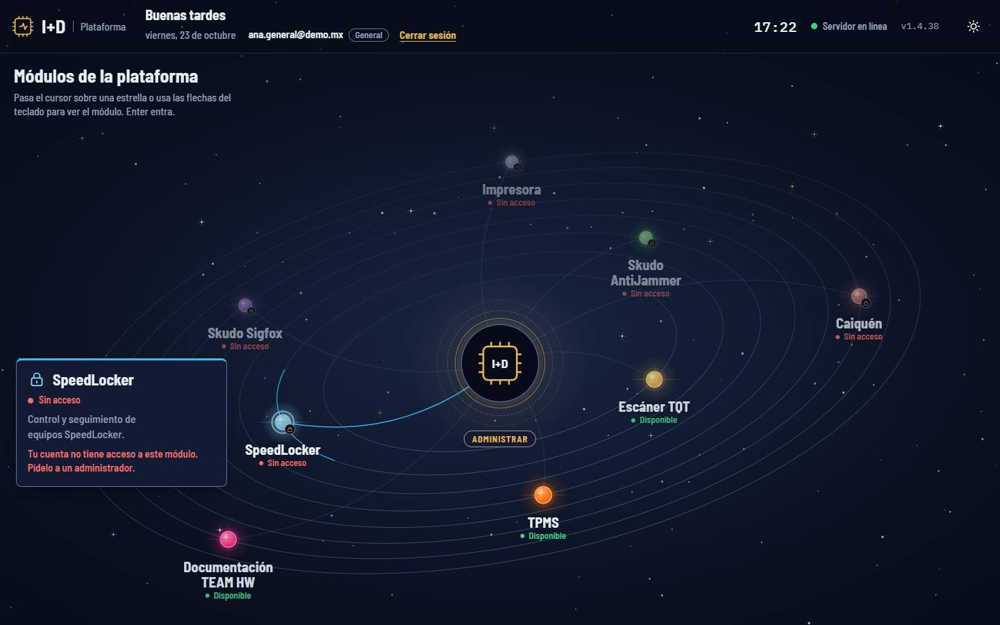

1. La estrella lleva un candado
2. Estado «Sin acceso»
3. Qué hacer: pedir el módulo a un administrador

> **Nota:** Sin sesión, todas las estrellas aparecen como «Disponible»: el permiso se revisa cuando inicias sesión.

## Tema claro/oscuro y uso en celular

El portal se adapta a tu pantalla y recuerda el tema que elijas.

### Paso 1. Cambia el tema

Pulsa el botón del sol o la luna, arriba a la derecha. El icono muestra el tema al que vas a cambiar. Tu elección se guarda en el navegador y la usan también los demás módulos.

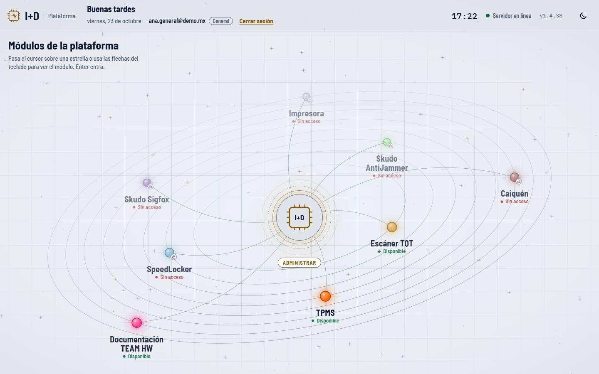

1. Botón de tema: en claro muestra una luna (para volver a oscuro)
2. Tu sesión se mantiene al cambiar de tema

### Paso 2. Usa el portal en el celular

En pantallas angostas (hasta 640 px de ancho) o muy bajas, los módulos se muestran como una lista vertical, sin órbitas, para ahorrar batería. Cada tarjeta trae nombre, estado, descripción y «Entrar» si tienes acceso. Un solo toque abre el módulo. En una tableta con la vista de órbitas, el primer toque muestra la ficha y el segundo entra.

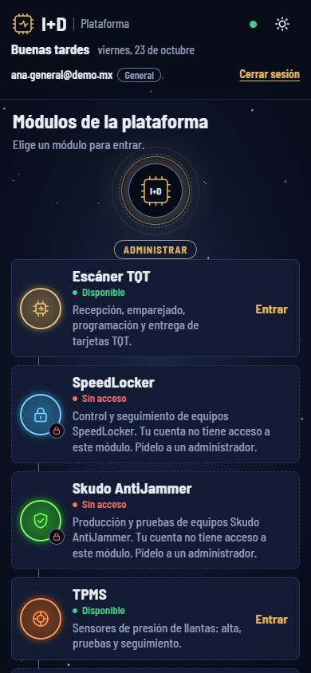

1. Tu cuenta, tu rol y «Cerrar sesión»
2. Módulo disponible: un toque para entrar
3. Módulo sin acceso, con candado

## Entrar a un módulo e iniciar sesión

Cada módulo tiene su propia pantalla de acceso (por ejemplo `/tpms/acceso`, `/caiquen/acceso`). Escáner TQT usa la pantalla general `/login`. Todas aceptan la misma cuenta. Documentación TEAM HW no pide iniciar sesión.

### Paso 1. Elige el módulo en el portal

Pulsa la estrella o «Entrar» en la ficha. Si ya iniciaste sesión y tienes el módulo, entras directo. Si no, el portal muestra «Comprobando tu sesión…» y te lleva a la pantalla de acceso de ese módulo.

### Paso 2. Escribe tu correo y tu contraseña

Usa «Ver» para mostrar la contraseña mientras la escribes. Si tienes Bloq Mayús activado, aparece un aviso. Pulsa «Entrar». Al terminar vuelves al módulo que habías elegido.

1. Tu correo
2. Tu contraseña (con «Ver» para mostrarla)
3. «Entrar»
4. «¿Olvidaste tu contraseña?»
5. «Módulos»: regresa al portal

> **Nota:** Si te equivocas varias veces seguidas, el acceso se bloquea unos minutos. Espera y vuelve a intentarlo.

### Paso 3. La pantalla general /login

Es la de Escáner TQT y la que se usa cuando un módulo no tiene pantalla propia. Funciona igual: correo, contraseña y «Entrar». Si ya tienes sesión abierta, te lleva directo a donde ibas.

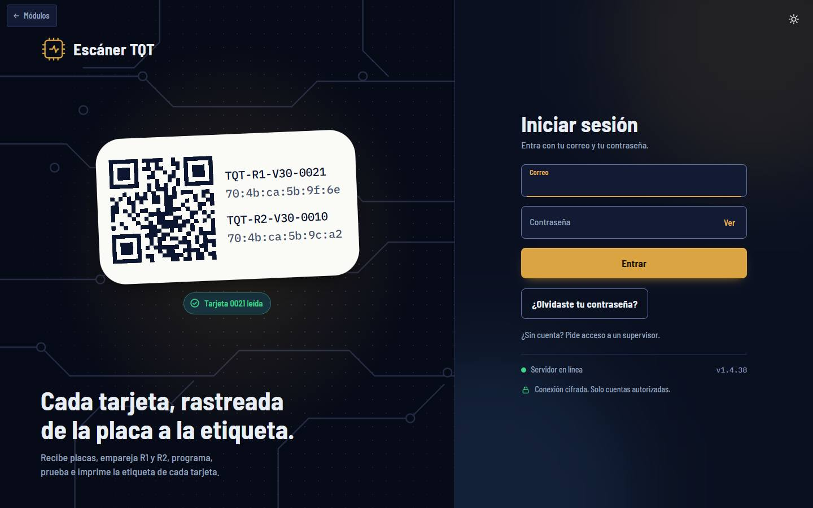

1. Formulario de correo y contraseña
2. «¿Olvidaste tu contraseña?»
3. «Módulos»: vuelve al portal sin iniciar sesión

> **Nota:** ¿No tienes cuenta? No hay registro libre: un administrador te envía una invitación (ver «Cuentas y permisos»).

## Cambiar tu contraseña inicial

Si tu cuenta aún tiene la contraseña inicial, al iniciar sesión la pantalla te pide cambiarla.

### Paso 1. Llena el formulario de cambio

Escribe tu «Contraseña actual», la «Contraseña nueva» (mínimo 10 caracteres y distinta de la actual) y repítela. Pulsa «Guardar contraseña». Verás «Contraseña cambiada.» y entrarás al módulo.

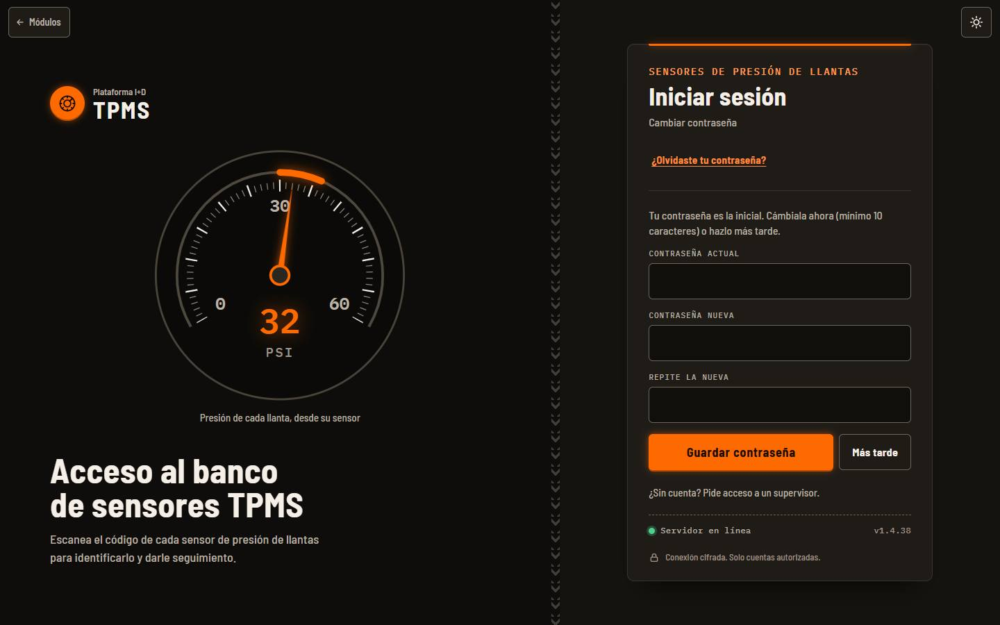

1. Aviso: tu contraseña es la inicial
2. Contraseña actual
3. Nueva (mínimo 10 caracteres) y su repetición abajo
4. «Guardar contraseña»
5. «Más tarde»: entras sin cambiarla

> **Nota:** Al cambiar la contraseña se cierran tus sesiones en otros equipos. «Más tarde» te deja entrar, pero el aviso volverá en tu próximo inicio de sesión.

### Paso 2. Cámbiala cuando quieras

En la consola de escritorio del Escáner TQT, el botón del candado («Cambiar mi contraseña») abre este mismo formulario (`/login?cambiar=1`).

## ¿Olvidaste tu contraseña?

No hay correo de recuperación automático: otra persona con sesión abierta aprueba tu solicitud y te dicta un código de 6 dígitos. Hazlo con esa persona a tu lado.

### Paso 1. Pide ayuda

En cualquier pantalla de acceso pulsa «¿Olvidaste tu contraseña?», escribe tu correo y pulsa «Pedir ayuda». La pantalla queda esperando y avanza sola cuando aprueban la solicitud. La solicitud vence a los 15 minutos.

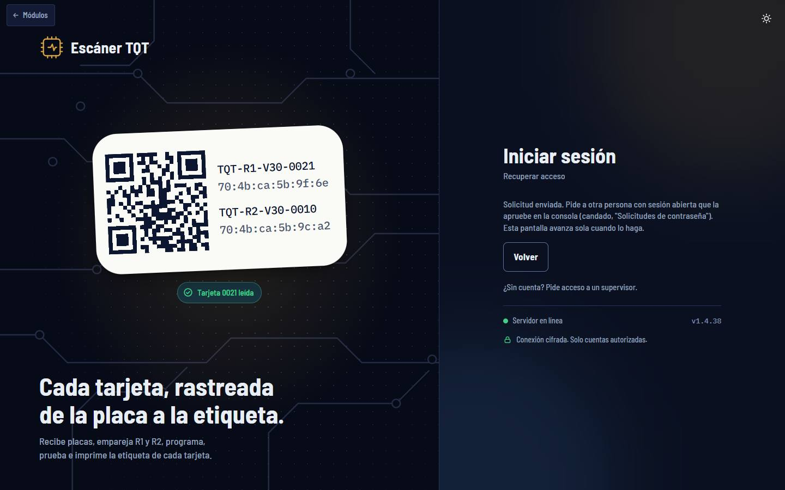

1. Solicitud enviada: espera la aprobación
2. «Volver» cancela la espera

### Paso 2. La otra persona aprueba la solicitud

Quien te ayuda abre la consola de escritorio del Escáner TQT (`/monitor`). Cuando hay solicitudes aparece un botón con un escudo y un número arriba a la derecha («Solicitudes de contraseña»). Ahí ve tu correo y pulsa «Aprobar» (o «Rechazar»).

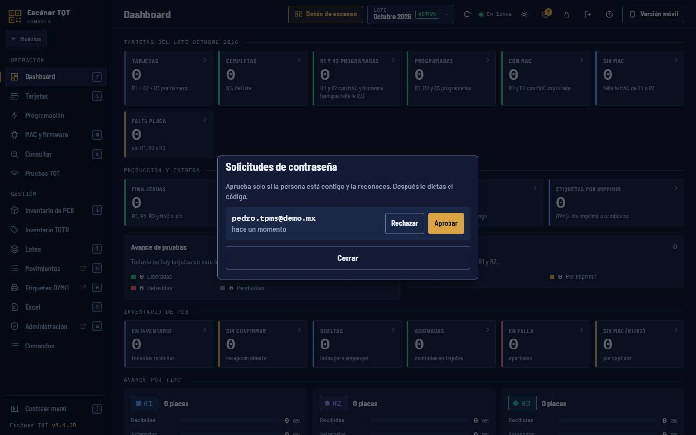

1. Botón «Solicitudes de contraseña» con el número de pendientes
2. Quién pide ayuda y hace cuánto
3. «Aprobar»
4. «Rechazar»

> **Nota:** Solo aprueba quien tenga un rol igual o mayor que el tuyo: una cuenta General aprueba a otra General o a un Consultor; la de un administrador solo la aprueba otro administrador. Un Consultor no aprueba solicitudes. Nadie aprueba la suya.

### Paso 3. Te dictan el código

Al aprobar aparece un código de 6 dígitos, válido 10 minutos. Se muestra una sola vez: la otra persona te lo dicta en persona.

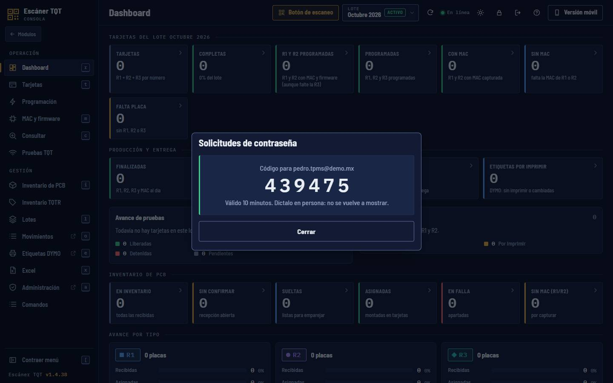

1. Código de 6 dígitos
2. Para quién es y cuánto dura

### Paso 4. Escribe el código y tu contraseña nueva

Tu pantalla ya avanzó sola. Escribe el «Código de 6 dígitos», la «Contraseña nueva» (mínimo 10 caracteres) y «Repite la nueva». Pulsa «Guardar contraseña». Verás «Contraseña cambiada. Entra con la nueva.» y vuelves al formulario de acceso.

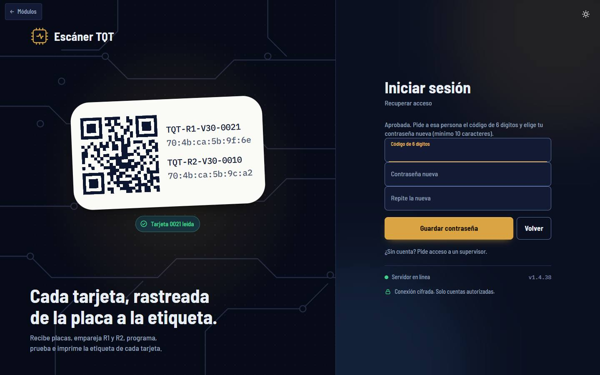

1. Código de 6 dígitos que te dictaron
2. Contraseña nueva
3. Repite la nueva
4. «Guardar contraseña»

> **Nota:** Si se rechaza, se reemplaza o vence la solicitud, la pantalla vuelve al primer paso con el motivo. Pídela de nuevo.

## Volver al portal y cerrar sesión

Desde cualquier módulo puedes regresar al portal o salir de tu cuenta.

### Paso 1. Usa el botón «Módulos»

Todos los módulos y pantallas de acceso tienen arriba a la izquierda el botón «← Módulos». Te lleva al portal `/inicio` sin cerrar tu sesión.

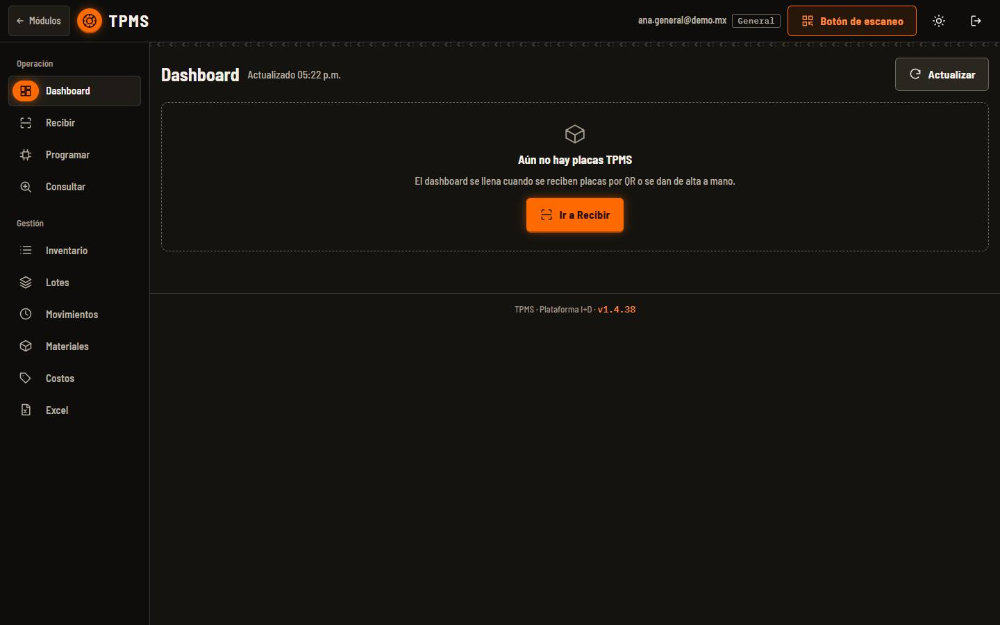

1. «Módulos»: volver al portal
2. Cerrar sesión

### Paso 2. Cierra sesión

En un módulo pulsa el icono de «Cerrar sesión» (la puerta con flecha): sales de tu cuenta y vuelves a la pantalla de acceso de ese módulo. En el portal usa el enlace «Cerrar sesión» junto a tu correo. La sesión es una sola para toda la plataforma: al cerrarla en un módulo, se cierra en todos.

> **Nota:** En una computadora compartida, cierra sesión siempre al terminar. Si no, la sesión vence sola (por defecto a las 12 horas).

## El módulo Documentación TEAM HW

Es la estrella rosa del portal (`/documentacion`). Presenta los proyectos del equipo de hardware como «circuitos» de una misma placa (PCB). Es pública: cualquier persona la puede ver, con o sin cuenta, igual que este manual.

Arriba tienes el menú: «La placa», «El mapa», «Proyectos», «Entrar» y «Manual», y el botón «Módulos» para volver al portal. Cada proyecto tiene un botón «Abrir …» que te lleva a su módulo y muestra si para ti está Disponible o Sin acceso. Al final, «ENTRAR A LA PLATAFORMA» te lleva al portal.

1. «Proyectos»: salta a la lista de proyectos
2. «Módulos»: volver al portal
3. Empieza el recorrido por la placa
4. Abre este manual

## Cómo usar este manual

El manual vive dentro de Documentación TEAM HW, en `/documentacion/manual`. Las guías se agrupan en «Empieza aquí» (esta guía y «Cuentas y permisos»), «Módulos de placas» (Escáner TQT, TPMS, Skudo AntiJammer, SpeedLocker, Skudo Sigfox, Caiquén) y «Herramientas» (Costos y Materiales, Impresora).

Las capturas son de la aplicación real con datos de demostración (correos @demo.mx). Los círculos numerados sobre cada captura corresponden a la lista de su pie: busca el número para saber qué señala.

Cada guía de módulo trae: qué es y para quién, un recorrido de la pantalla, los pasos de cada tarea, una ficha técnica (rutas, formatos de QR, estados, roles) y problemas frecuentes. Si algo de la pantalla no coincide con la guía, la versión de la app puede ser más nueva: avisa al equipo.

## Ficha técnica

| Campo | Detalle |
| --- | --- |
| Portal | /inicio (también / sin sesión) |
| Pantalla de acceso general | /login (Escáner TQT) · Documentación TEAM HW y el manual no piden sesión |
| Pantallas de acceso por módulo | /tpms/acceso · /antijammer/acceso · /speedlocker/acceso · /sigfox/acceso · /caiquen/acceso · /impresora/acceso |
| Rutas de los módulos | Escáner TQT / · SpeedLocker /speedlocker · Skudo AntiJammer /antijammer · TPMS /tpms · Skudo Sigfox /sigfox · Caiquén /caiquen · Documentación TEAM HW /documentacion · Impresora /impresora |
| Estados de un módulo | Disponible · Sin acceso (con sesión, no asignado) · Próximamente · En mantenimiento |
| Contraseña | Mínimo 10 caracteres; la nueva debe ser distinta de la actual |
| Recuperar contraseña | Solicitud válida 15 min → aprobación de otra cuenta → código de 6 dígitos válido 10 min |
| Duración de la sesión | 12 horas por defecto; una sola sesión para todos los módulos |
| Tema | Claro u oscuro; se guarda en el navegador y lo comparten todos los módulos |
| Vista de lista | Pantallas de hasta 640 px de ancho o de poca altura |

## Problemas frecuentes

**Un módulo aparece como «Sin acceso».**

Tu cuenta no lo tiene asignado. Pide a un administrador que te lo dé en el panel «Cuentas y módulos» del portal. Después recarga el portal.

**Entré a la dirección de un módulo y me regresó al portal.**

Pasa lo mismo: no tienes ese módulo. Para Escáner TQT el portal muestra el aviso «Tu cuenta no tiene acceso a Escáner TQT»; para los demás módulos solo verás su estrella con «Sin acceso».

**Dice «Correo o contraseña incorrectos.»**

Revisa el correo y que no esté activado Bloq Mayús. Si no la recuerdas, usa «¿Olvidaste tu contraseña?». Tras varios intentos fallidos el acceso se bloquea unos minutos.

**Pedí ayuda con mi contraseña y nadie ve la solicitud.**

La solicitud se ve solo en la consola de escritorio del Escáner TQT (`/monitor`), con una cuenta General o Administrador. Si tu cuenta es de administrador, solo otro administrador la ve. Vence a los 15 minutos.

**El código de 6 dígitos no funciona.**

Vale 10 minutos y solo para la solicitud abierta en esa pantalla. Si pediste ayuda otra vez, el código anterior ya no sirve: pide que aprueben la nueva.

**El indicador dice «Sin conexión con el servidor».**

La página no alcanza al servidor. Revisa tu red. El portal lo vuelve a comprobar cada 30 segundos.

**Quiero ver las órbitas en el celular.**

En pantallas angostas el portal usa la lista a propósito. Gira a horizontal en una tableta o usa una computadora.

## Glosario general

- **Módulo**: Cada aplicación de la plataforma (Escáner TQT, TPMS, Caiquén…). Tiene su propia ruta, su pantalla de acceso y su permiso.
- **Portal**: La página /inicio con todos los módulos. Desde ahí entras a cada uno.
- **Núcleo I+D**: El círculo del centro del portal. Es el botón «Administrar», que abre el panel de cuentas para los administradores.
- **Cuenta**: Tu correo y tu contraseña. Sirve para todos los módulos que tengas asignados.
- **Rol**: Lo que tu cuenta puede hacer: Administrador, General o Consultor.
- **Consultor**: Rol de solo consulta: puede ver y escanear, pero no crear, editar, mover, enviar ni borrar datos.
- **Sesión**: El tiempo en que tu navegador queda identificado después de iniciar sesión. Es una sola para todos los módulos.
- **Invitación**: Enlace que envía un administrador para activar una cuenta nueva. Vale 48 horas y se usa una vez.
- **Placa / PCB**: Placa de circuito impreso. Cada placa trae una etiqueta con QR que la identifica, por ejemplo PCB_TQT-R3_V2_0_TIMER-0004.
- **QR**: Código cuadrado de la etiqueta. Al escanearlo con la cámara o con el celular, la plataforma sabe qué placa, tarjeta o activo es.
- **Tarjeta**: En Escáner TQT, el equipo armado con sus placas R1, R2 y R3, identificado por un número (por ejemplo 0021). Se sigue desde la recepción de las placas hasta la entrega.
- **Lote**: Grupo de producción con el que se trabaja, por ejemplo «Octubre 2026». Las placas y tarjetas se registran en el lote activo.
- **Recibir**: Registrar en la plataforma las placas que llegan, normalmente escaneando su QR.
- **Firmware**: Programa que se carga en el microcontrolador de la placa.
- **Programada**: Estado de una placa a la que ya se le cargó el firmware.
- **MAC**: Identificador único de radio de una placa, con formato 70:4b:ca:5b:9f:6e.
- **DYMO**: Impresora de etiquetas que usa la plataforma para imprimir etiquetas con QR.
- **Botón de escaneo**: Función de los módulos para usar el celular como lector de QR vinculado a la computadora.

## Guías relacionadas

- [Cuentas y permisos](cuentas.md)
- [Escáner TQT](escaner-tqt.md)
- [TPMS](tpms.md)
