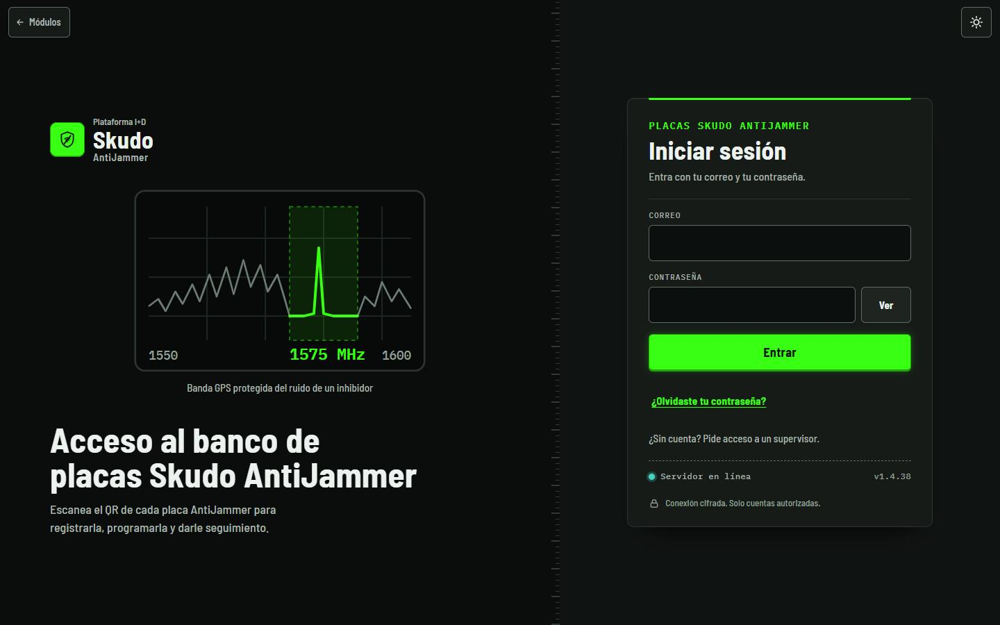
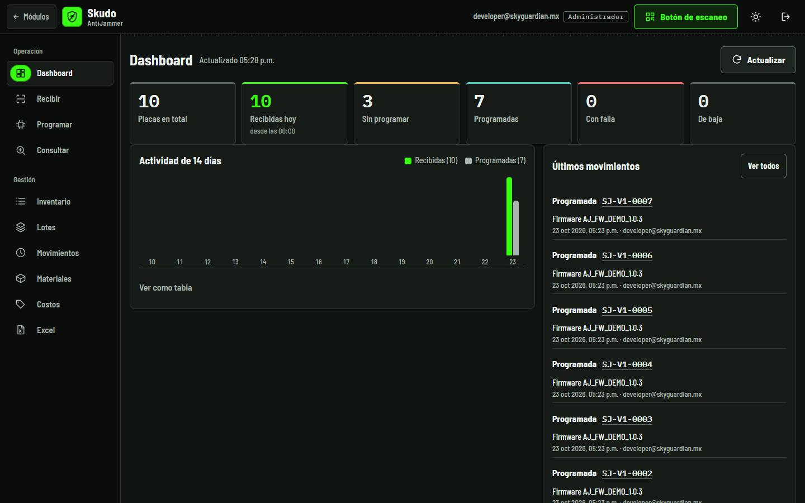
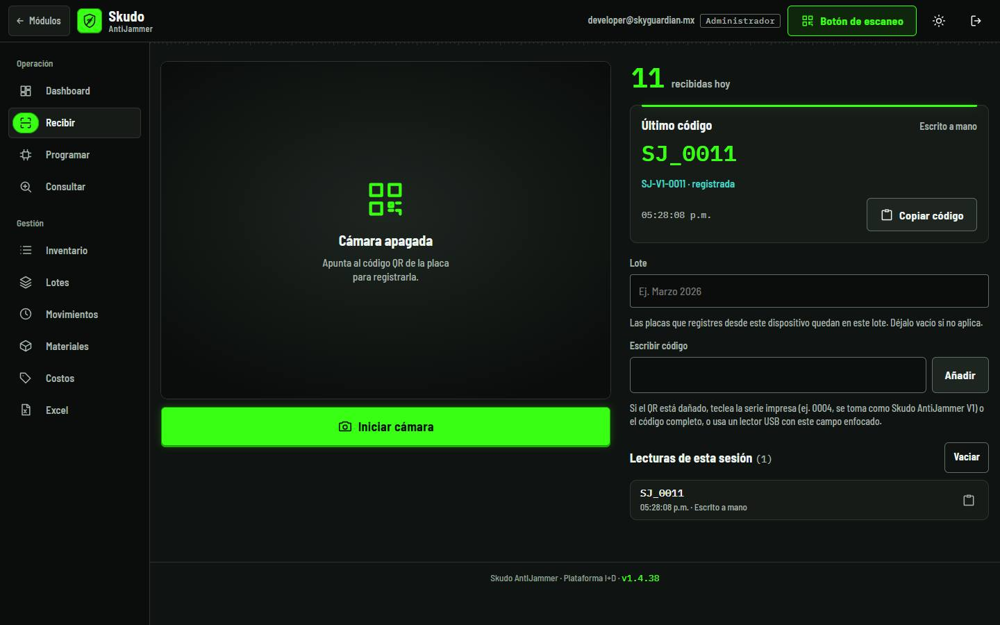
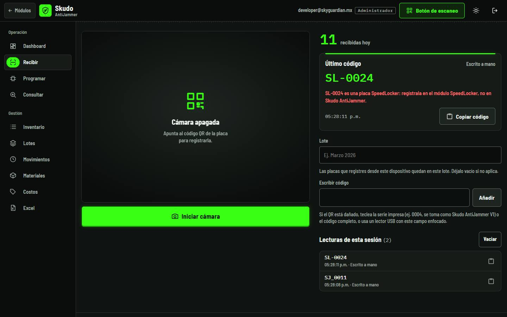
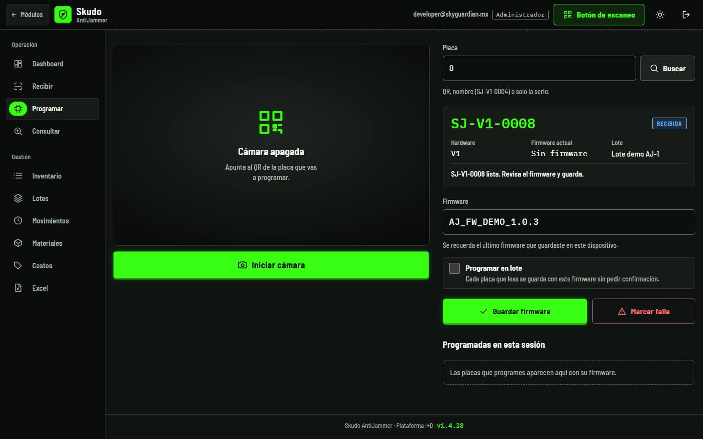
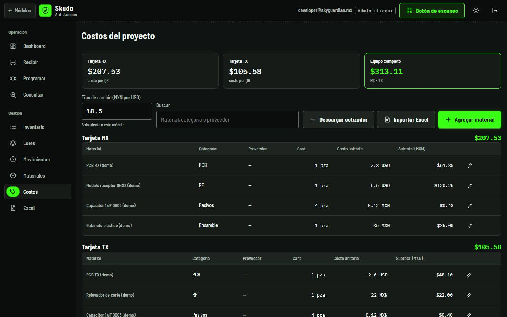
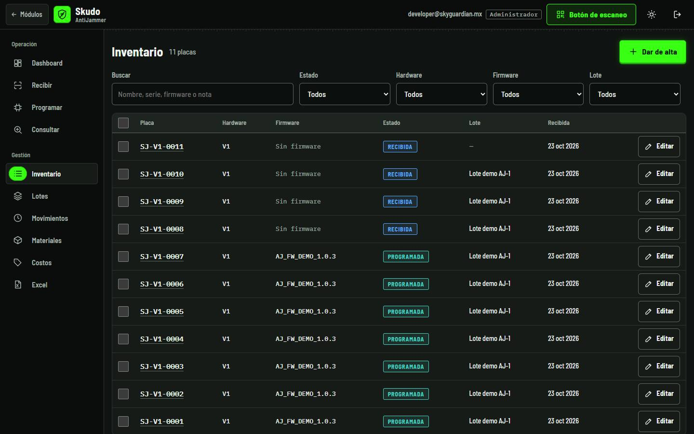

<!-- Generado por scripts/generar_manual_md.py desde app/static/documentacion/guias/skudo-antijammer.json. No editar a mano. -->

# Skudo AntiJammer

*Tarjetas RX y TX* · Ruta: `/antijammer` · Lectura: 5 min

Banco de las placas Skudo AntiJammer: se registran por su QR (SJ_0052), se anota su firmware y se sigue su estado. Cada equipo lleva dos tarjetas, RX y TX, con su propio costo y su propia lista de materiales.

**Quién puede hacer qué**

- **Administrador**: Todo: recibir, programar, editar, cambios en masa, eliminar, asignar RX/TX, costos y materiales.
- **General**: Lo mismo que el administrador dentro de AntiJammer, si su cuenta tiene asignado el módulo.
- **Consultor**: Solo consulta y descarga de Excel; no registra, programa, asigna RX/TX ni edita.

## ¿Qué es?

Skudo AntiJammer es el módulo de las placas del equipo AntiJammer. Usa la misma consola que TPMS (Dashboard, Recibir, Programar, Consultar, Inventario, Lotes, Movimientos, Materiales, Costos y Excel, con «Más» en el celular y el «Botón de escaneo»); el manejo de cada pestaña está en la guía de TPMS.

Lo propio de AntiJammer: el formato del QR (SJ_0052) y que el proyecto tiene dos tarjetas, RX y TX. El QR no dice si una placa es RX o TX; eso se indica en Materiales para descontar la lista correcta. Sin sesión, /antijammer te lleva a /antijammer/acceso.

1. Correo
2. Entrar

## La consola

En computadora abre en el Dashboard: placas por estado, actividad de 14 días y últimos movimientos. Las placas se nombran SJ-V1-0001, SJ-V1-0002…

1. Pestañas (iguales a TPMS)
2. Placas por estado
3. Botón de escaneo

## Recibir y programar

### Paso 1. Lee el QR

El QR de la placa es SJ_ seguido de la serie, por ejemplo SJ_0052. Sin versión se registra como V1: SJ_0011 queda como SJ-V1-0011. Escribir solo la serie (11) también se toma como SJ-V1-0011.

1. SJ_0011 → SJ-V1-0011 · registrada
2. Lote
3. Escribir código

### Paso 2. QR de otros módulos

Un QR de Caiquén, Skudo Sigfox, SpeedLocker, TPMS o de una tarjeta de Escáner TQT se rechaza diciendo a qué módulo va.

1. Rechazo: va en SpeedLocker

### Paso 3. Anota el firmware

En Programar busca la placa (QR, nombre SJ-V1-0004 o solo la serie), escribe el firmware y pulsa «Guardar firmware». La placa pasa de RECIBIDA a PROGRAMADA. Aquí no se elige RX o TX.

1. Placa (aquí la serie 8)
2. SJ-V1-0008
3. Firmware
4. Guardar firmware / Marcar falla

## Tarjetas RX y TX

Cada QR es una sola tarjeta. En Costos hay una lista de materiales para RX y otra para TX; en Materiales indicas cuál es cada placa programada.

### Paso 1. Costo por tarjeta

En Costos verás «Tarjeta RX», «Tarjeta TX» y «Equipo completo» (RX + TX), con la tabla de materiales de cada tarjeta. Al importar el Excel del cotizador, una fila marcada «Tarjeta RX y TX» reparte su cantidad a partes iguales entre las dos.

1. RX, TX y equipo completo
2. Materiales de la tarjeta RX

### Paso 2. Asigna las placas «por asignar»

Con el inventario de materiales activo, cada placa programada sin tarjeta aparece en «Placas programadas sin tarjeta». Pulsa RX o TX en cada una, o «Todas RX» / «Todas TX» para la lista completa. Al asignarla se descuentan los materiales de esa tarjeta.

1. Posibles y descontadas por tarjeta
2. Placas por asignar
3. Todas RX / Todas TX
4. RX o TX por placa

> **Nota:** Mientras una placa no tenga tarjeta, no descuenta nada. Si te equivocas, la corrección RX↔TX se hace por la API de Materiales (/api/antijammer/materiales/asignar): el consumo se rehace con la lista de la otra tarjeta. En la pantalla solo aparecen las placas aún sin asignar.

## Inventario y el resto de pestañas

Inventario, Lotes, Movimientos y Excel funcionan igual que en TPMS. El Inventario no tiene columna RX/TX: esa asignación vive en Materiales.

1. Buscar y filtros
2. Placas SJ-V1-…

## Ficha técnica

| Campo | Detalle |
| --- | --- |
| Rutas | /antijammer (consola) · /antijammer/acceso (inicio de sesión) · mismas pestañas que TPMS |
| Formato del QR | SJ_0052 → SJ-V1-0052. También acepta SKUDO-AJ-0052, prefijo PCB, guion o espacio, minúsculas y versión explícita (SJ_V2_0003 → SJ-V2-0003). |
| Versión por omisión | V1. Solo la serie (52) → SJ-V1-0052. |
| No válidos | Versión 0 o serie 0000. QR de Caiquén, Skudo Sigfox, SpeedLocker, TPMS o Escáner TQT: se rechazan diciendo a qué módulo van. |
| Estados | RECIBIDA → PROGRAMADA (al guardar firmware) · FALLA · BAJA |
| Tarjetas | RX y TX. El QR no las distingue: se asignan en Materiales a las placas programadas desde la activación del inventario. |
| Exportación | SkudoAntiJammer_placas_AAAAMMDD.xlsx con hojas Placas y Movimientos (últimos 2000) · Cotizador_SkudoAntiJammer_AAAAMMDD.xlsx desde Costos |

## Problemas frecuentes

**Programé placas y Materiales no descontó nada.**

Revisa que el inventario esté activo y que la placa se haya programado desde la fecha de activación. Si aparece en «Placas programadas sin tarjeta», indícale RX o TX.

**Asigné una placa con la tarjeta equivocada.**

En la pantalla ya no aparece para reasignar. Un administrador puede corregirla por la API de Materiales (asignar con la otra tarjeta): el consumo se rehace con la lista correcta.

**Dice que el QR es de SpeedLocker u otro módulo.**

No es una placa AntiJammer. Regístrala en el módulo que indica el mensaje.

**«no es un QR de placa Skudo AntiJammer (ej. SJ-V1-0001)».**

El texto no tiene el formato SJ-serie. Revisa el QR o escribe la serie impresa.

## Guías relacionadas

- [TPMS](tpms.md)
- [Costos y Materiales](costos-materiales.md)
- [SpeedLocker](speedlocker.md)
