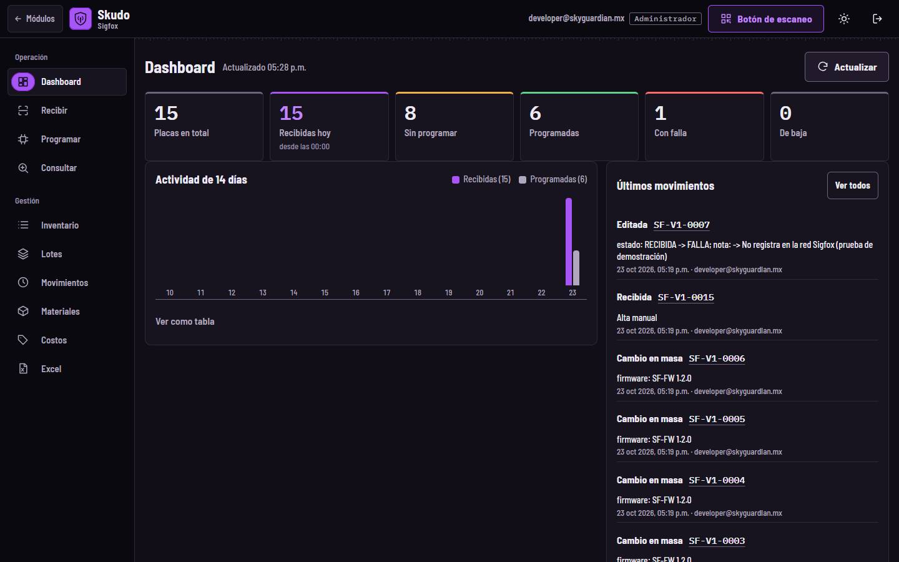
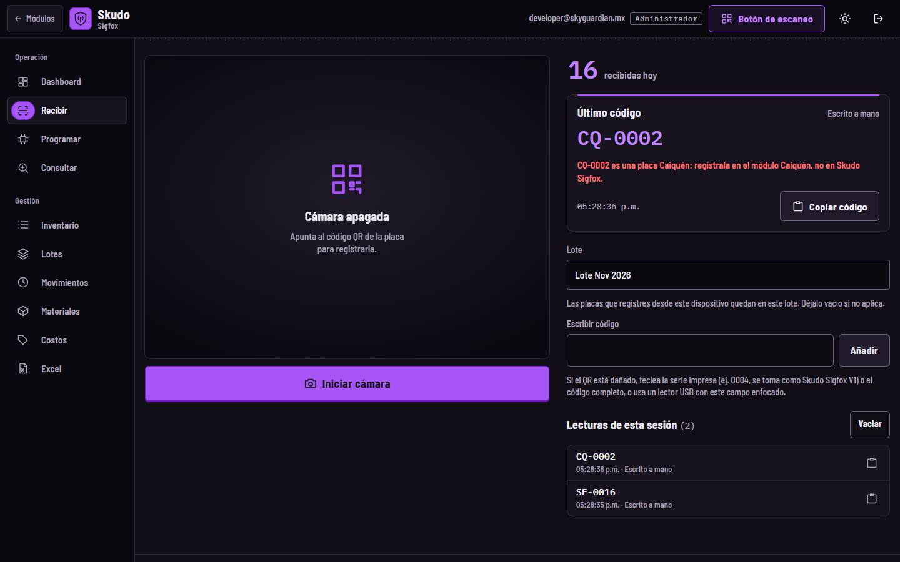
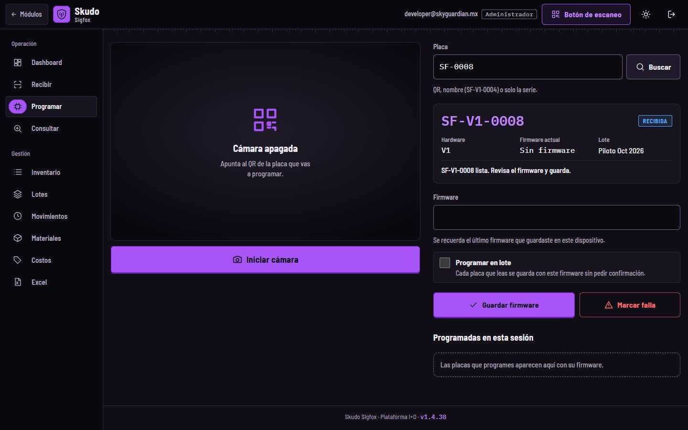
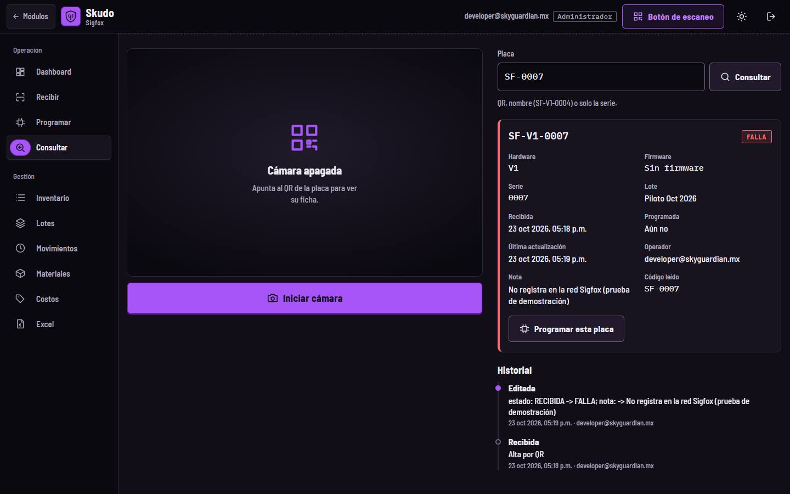
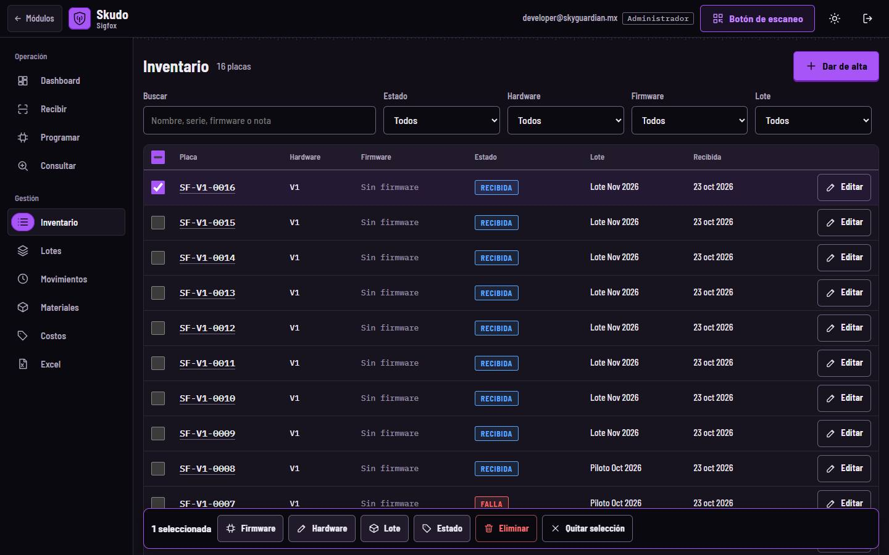
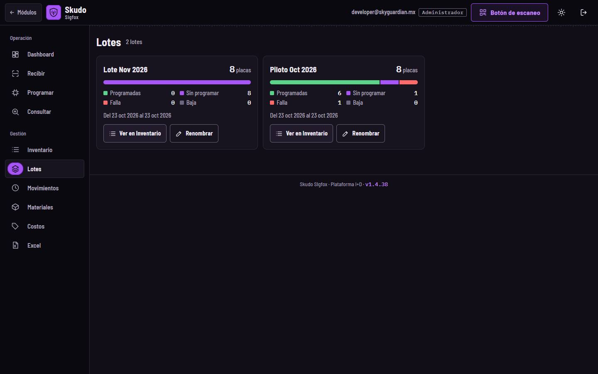
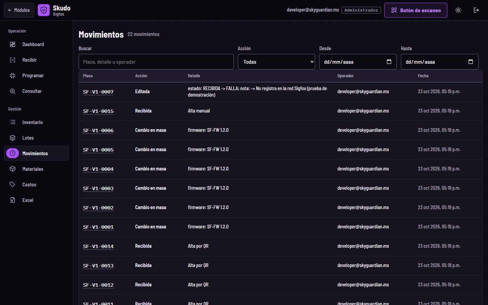
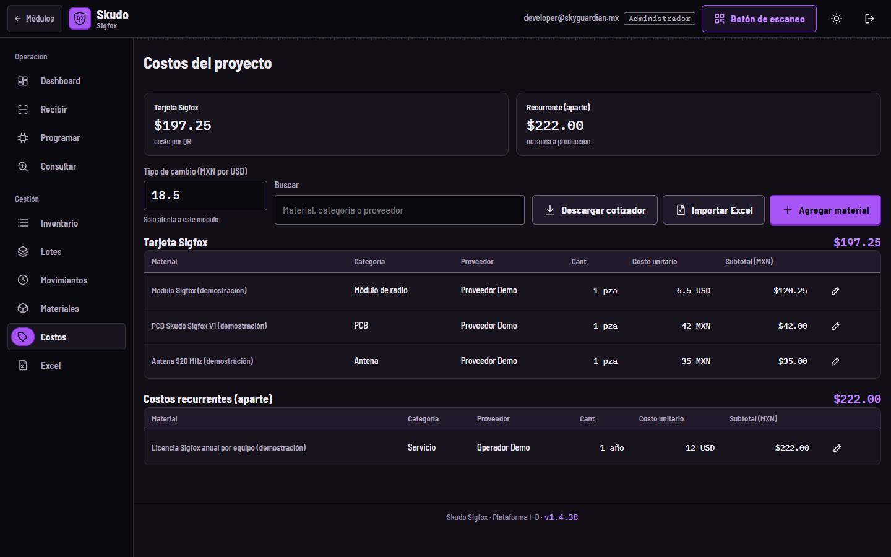
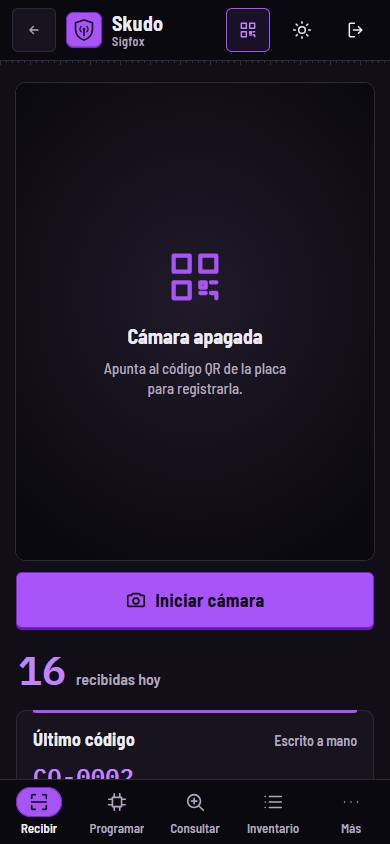

<!-- Generado por scripts/generar_manual_md.py desde app/static/documentacion/guias/skudo-sigfox.json. No editar a mano. -->

# Skudo Sigfox

*Equipos con red Sigfox* · Ruta: `/sigfox` · Lectura: 4 min

Banco de las placas Skudo Sigfox: se registran por su QR (SF-0001), se anota su firmware y se sigue su estado, lote e historial. Usa la misma consola que TPMS y SpeedLocker; en Costos la licencia Sigfox va aparte como costo recurrente.

**Quién puede hacer qué**

- **Administrador**: Todo: recibir, programar, editar, cambios en masa, eliminar, renombrar lotes, costos y materiales.
- **General**: Lo mismo que el administrador dentro de Skudo Sigfox, si su cuenta tiene asignado el módulo.
- **Consultor**: Solo consulta y descarga de Excel; no registra, programa, edita ni borra.

## ¿Qué es?

Skudo Sigfox es el módulo de las placas que transmiten por la red Sigfox. Su consola es la misma que la de TPMS: Dashboard, Recibir, Programar, Consultar, Inventario, Lotes, Movimientos, Materiales, Costos y Excel, con el «Botón de escaneo» para usar el celular como lector. El detalle de cada pestaña está en la guía de TPMS; aquí va lo propio de Sigfox.

Sus placas tienen tablas propias y no se mezclan con los demás módulos. Sin sesión, /sigfox te lleva a su pantalla de acceso, /sigfox/acceso.

1. Pestañas (iguales a TPMS)
2. Placas por estado
3. Últimos movimientos
4. Botón de escaneo

## Recibir placas Sigfox

Lote opcional, cámara, lector USB o código escrito, igual que en TPMS.

### Paso 1. Lee el QR

El QR provisional es SF- seguido de la serie, por ejemplo SF-0001; se registra como SF-V1-0001. Si el QR está dañado, escribe solo la serie impresa (0004) y se toma como Skudo Sigfox V1.

1. Iniciar cámara
2. Lote
3. Escribir código
4. Lecturas de esta sesión

> **Nota:** El formato SF-0001 es provisional: cuando se conozca el QR real de la placa, se ajustará.

### Paso 2. QR de otros módulos

Si el código es de otro módulo, Sigfox lo rechaza y dice dónde va. En la captura, CQ-0002 es una placa Caiquén.

1. Rechazo: va en Caiquén

## Programar y consultar

### Paso 1. Programar

Busca la placa (o léela con la cámara), escribe el firmware y pulsa «Guardar firmware»: pasa de RECIBIDA a PROGRAMADA. «Programar en lote» guarda el mismo firmware en cada placa que leas, sin pedir confirmación. «Marcar falla» la deja en FALLA con una nota.

1. Placa
2. Placa encontrada
3. Firmware
4. Programar en lote
5. Guardar firmware · Marcar falla

### Paso 2. Consultar

Muestra la ficha (hardware, firmware, serie, lote, fechas, operador, nota y código leído) y el historial. Desde aquí puedes ir a «Programar esta placa».

1. Ficha
2. Historial

## Inventario, Lotes y Movimientos

### Paso 1. Inventario

Filtra por estado, hardware, firmware o lote. Marca varias placas para cambiarles firmware, hardware, lote o estado de una vez, o eliminarlas.

1. Buscar y filtros
2. Dar de alta
3. Cambios en masa

### Paso 2. Lotes

Cada lote muestra cuántas placas hay programadas, sin programar, con falla y de baja. «Ver en Inventario» filtra por el lote y «Renombrar» le cambia el nombre.

1. Lote y su avance

### Paso 3. Movimientos

La bitácora de todo lo que pasó: altas, programaciones, ediciones y cambios en masa, con fecha y operador. Filtra por texto, acción y fechas.

1. Filtros
2. Bitácora

## Costos: la licencia va aparte

En Skudo Sigfox cada placa es una tarjeta «Tarjeta Sigfox». La licencia de la red Sigfox es un costo recurrente: se muestra aparte y no se suma al costo de producción de la tarjeta.

Materiales descuenta los componentes de la tarjeta cada vez que una placa se programa (cuando el inventario está activo). Ver la guía Costos y Materiales.

1. Costo por tarjeta
2. Recurrente (aparte)
3. Lista de la tarjeta
4. Costos recurrentes

## En el celular

El menú baja a la barra inferior y el resto de pestañas está en «Más».

## Ficha técnica

| Campo | Detalle |
| --- | --- |
| Rutas | /sigfox (consola) · /sigfox/acceso (inicio de sesión) |
| Formato del QR | PROVISIONAL: SF-0001 → SF-V1-0001. También acepta SIGFOX-0001, SKUDO SIGFOX 0001, prefijo PCB, guion bajo o espacio, minúsculas y versión explícita (SF-V2-0001). Solo la serie (4) → SF-V1-0004. |
| No válidos | QR de Caiquén, SpeedLocker, Skudo AntiJammer, TPMS o Escáner TQT: se rechazan diciendo a qué módulo van. |
| Estados | RECIBIDA → PROGRAMADA (al guardar firmware) · FALLA · BAJA |
| Exportación | Excel con hojas Placas y Movimientos |
| Tarjetas en Costos/Materiales | Una: Tarjeta Sigfox · licencia como recurrente |

## Problemas frecuentes

**Leí una placa y dice que es de Caiquén u otro módulo.**

El QR no es de Sigfox. Regístrala en el módulo que indica el mensaje.

**El QR real de mi placa no se reconoce.**

El formato SF-0001 es provisional. Escribe la serie impresa y avisa al equipo para ajustar el formato.

**¿Por qué la licencia no se suma al costo de la tarjeta?**

Es un pago recurrente por equipo, no un material de producción; se muestra aparte.

## Guías relacionadas

- [TPMS](tpms.md)
- [Costos y Materiales](costos-materiales.md)
- [Caiquén](caiquen.md)
