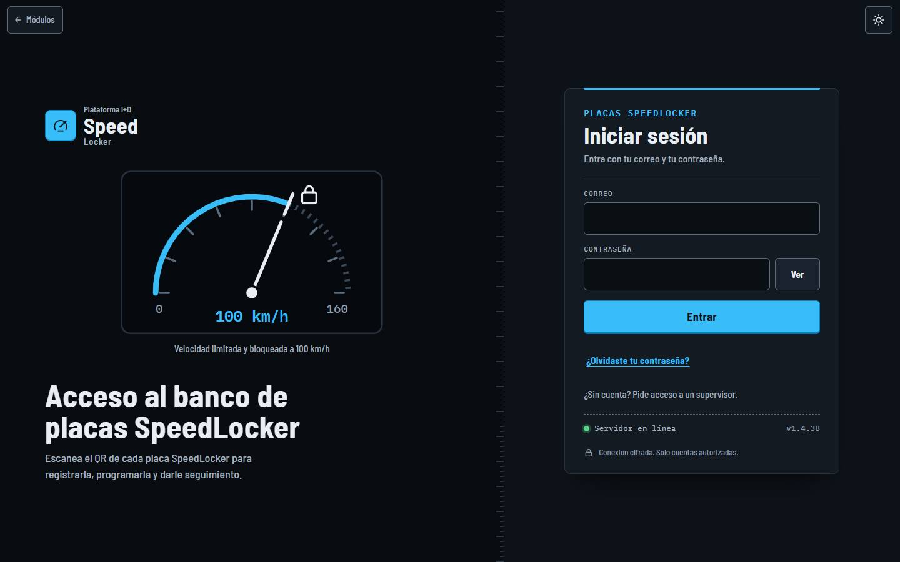
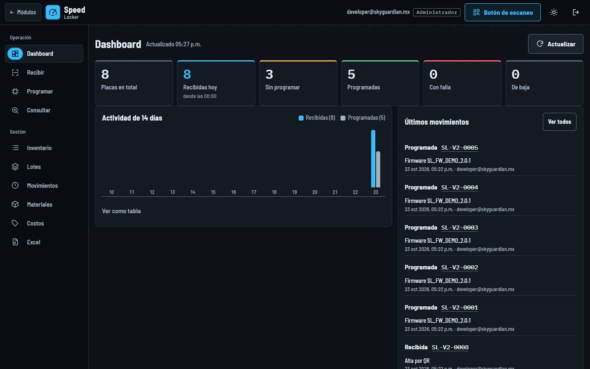
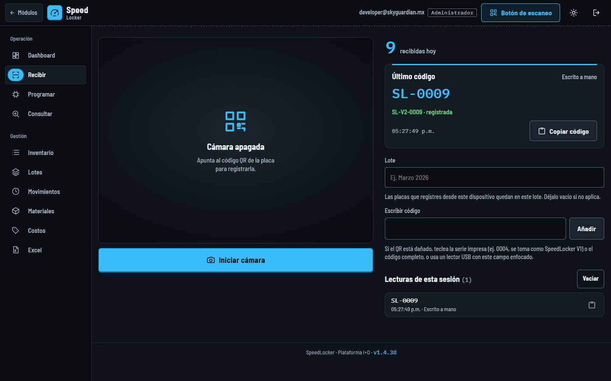
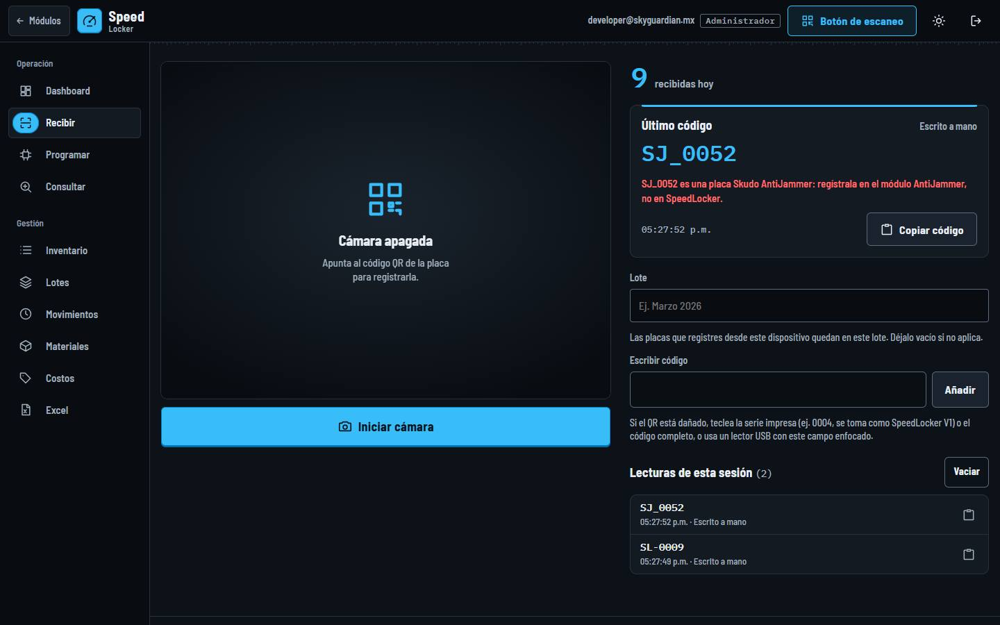
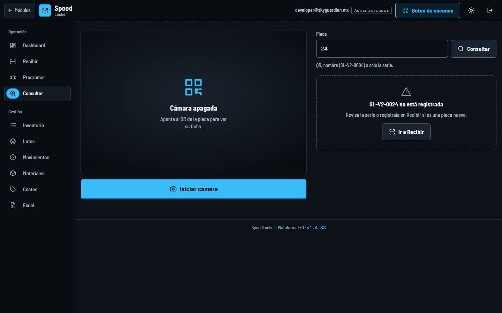
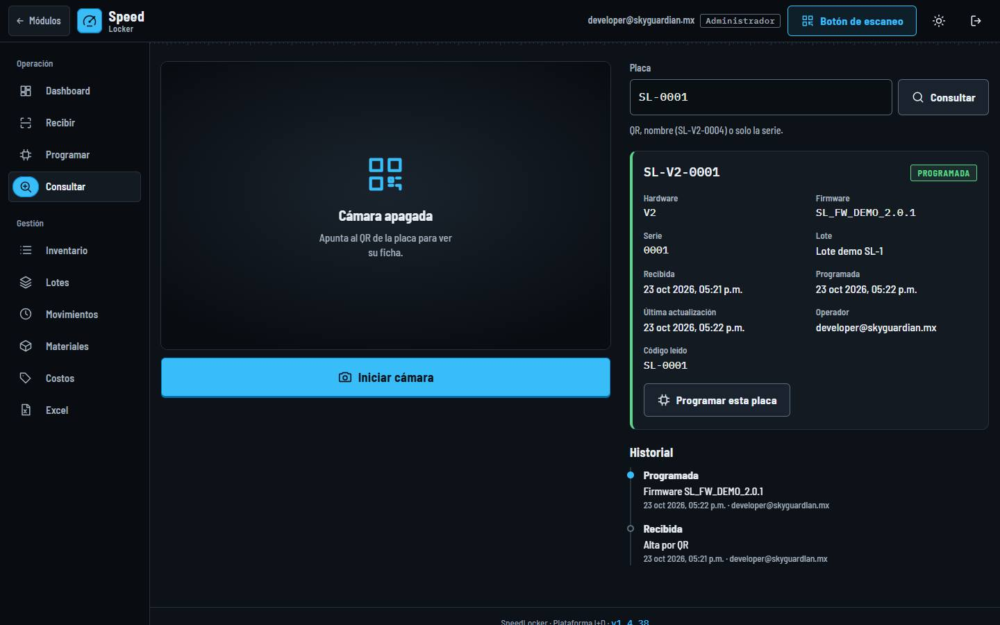
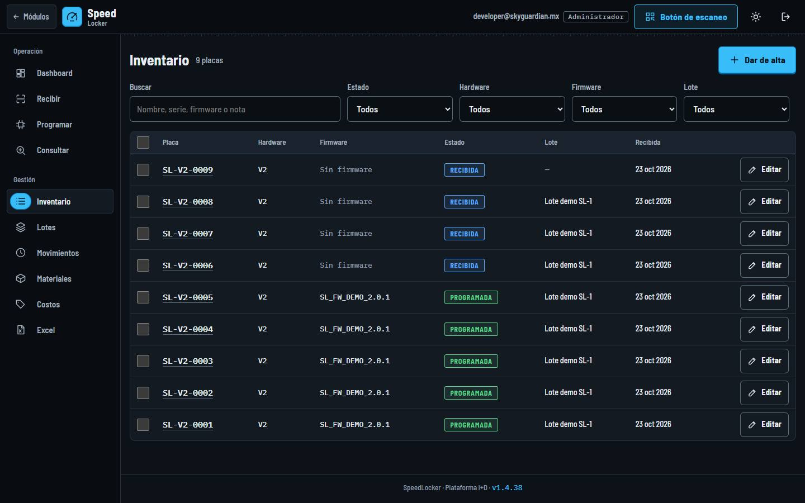

<!-- Generado por scripts/generar_manual_md.py desde app/static/documentacion/guias/speedlocker.json. No editar a mano. -->

# SpeedLocker

*Limitador de velocidad* · Ruta: `/speedlocker` · Lectura: 4 min

Banco de las placas SpeedLocker: se registran por su QR (SL-0024), se anota su firmware y se sigue su estado, lote e historial. Usa la misma consola que TPMS.

**Quién puede hacer qué**

- **Administrador**: Todo: recibir, programar, editar, cambios en masa, eliminar, renombrar lotes, costos y materiales.
- **General**: Lo mismo que el administrador dentro de SpeedLocker, si su cuenta tiene asignado el módulo.
- **Consultor**: Solo consulta y descarga de Excel; no registra, programa, edita ni borra.

## ¿Qué es?

SpeedLocker es el módulo de las placas del limitador de velocidad. Su consola es la misma que la de TPMS: Dashboard, Recibir, Programar, Consultar, Inventario, Lotes, Movimientos, Materiales, Costos y Excel, con barra inferior y «Más» en el celular y el «Botón de escaneo» para usar el celular como lector. El uso de cada pestaña está explicado en la guía de TPMS; aquí solo va lo propio de SpeedLocker.

Las placas SpeedLocker tienen tablas propias (no se mezclan con TPMS, AntiJammer ni Escáner TQT). Sin sesión, /speedlocker te lleva a su pantalla de acceso, /speedlocker/acceso.

1. Correo
2. Entrar

## La consola

En computadora abre en el Dashboard: placas por estado, actividad de 14 días y últimos movimientos. Las placas se nombran SL-V2-0001, SL-V2-0002…

1. Pestañas (iguales a TPMS)
2. Placas por estado
3. Botón de escaneo

## Recibir placas SpeedLocker

Igual que en TPMS: lote opcional, cámara, lector USB o código escrito.

### Paso 1. Lee el QR

El QR de la placa es SL- seguido de la serie, por ejemplo SL-0024. No trae versión: se registra como hardware V2, así que SL-0009 queda como SL-V2-0009.

1. SL-0009 → SL-V2-0009 · registrada
2. Lote
3. Escribir código

### Paso 2. QR de otros módulos

Antes de enviarlo, SpeedLocker revisa si el código es de otro módulo (Caiquén, Skudo Sigfox, Skudo AntiJammer, TPMS o una tarjeta de Escáner TQT) y lo rechaza diciendo dónde va.

1. Rechazo: va en AntiJammer

## Buscar solo con la serie

En Recibir, Programar y Consultar puedes escribir solo la serie.

### Paso 1. La serie se toma como V2

Si escribes solo números, SpeedLocker busca SL-V2-. En la captura, «24» se buscó como SL-V2-0024; como no está registrada, ofrece «Ir a Recibir».

1. Solo la serie
2. Se busca como SL-V2-0024

> **Nota:** El texto de ayuda de Recibir dice «se toma como SpeedLocker V1», pero la aplicación usa V2 (lo que ves en la captura).

### Paso 2. Ficha de una placa

Con una placa registrada, Consultar muestra hardware V2, firmware, serie, lote, fechas, operador, el código leído y el historial.

1. Ficha
2. Historial

## Inventario y el resto de pestañas

Inventario, Lotes, Movimientos y Excel funcionan igual que en TPMS (filtros, edición, cambios en masa todo o nada, renombrar lotes, bitácora y exportación). Programar anota el firmware y pasa la placa de RECIBIDA a PROGRAMADA.

Costos y Materiales: en SpeedLocker cada placa es una tarjeta «SpeedLocker». Mientras el inventario de materiales no se active, la pestaña Materiales muestra «Inventario preparado, sin activar». Ver la guía Costos y Materiales.

1. Buscar y filtros
2. Placas SL-V2-…

## Ficha técnica

| Campo | Detalle |
| --- | --- |
| Rutas | /speedlocker (consola) · /speedlocker/acceso (inicio de sesión) · mismas pestañas que TPMS (#recibir, #costos…) |
| Formato del QR | SL-0024 → SL-V2-0024. También acepta SPEEDLOCKER-0024, prefijo PCB, guion bajo o espacio, minúsculas y versión explícita (SL-V2-0024, SL_V2_1_0024 → V2.1). |
| Versión por omisión | V2 (las placas son hardware V2.0 y el QR no trae versión). Solo la serie (24) → SL-V2-0024. |
| No válidos | Versión 0 o serie 0000. QR de Caiquén, Skudo Sigfox, Skudo AntiJammer, TPMS o Escáner TQT: se rechazan diciendo a qué módulo van. |
| Estados | RECIBIDA → PROGRAMADA (al guardar firmware) · FALLA · BAJA |
| Exportación | SpeedLocker_placas_AAAAMMDD.xlsx con hojas Placas y Movimientos (últimos 2000) |
| Tarjetas en Costos/Materiales | Una: SpeedLocker |

## Problemas frecuentes

**Escribí la serie y busca SL-V2 aunque la ayuda dice V1.**

Es correcto: sin versión, SpeedLocker usa V2. Si tu placa es de otra versión, escribe el nombre completo (por ejemplo SL-V3-0024).

**Leí una placa y dice que es de AntiJammer, TPMS u otro módulo.**

El QR no es de SpeedLocker. Regístrala en el módulo que indica el mensaje.

**«no es un QR de placa SpeedLocker (ej. SL-0024)».**

El texto no tiene el formato SL-serie. Revisa el QR o escribe la serie impresa.

**Materiales dice «Inventario preparado, sin activar».**

Falta registrar las entradas y activar el inventario. Ver la guía Costos y Materiales.

## Guías relacionadas

- [TPMS](tpms.md)
- [Costos y Materiales](costos-materiales.md)
- [Skudo AntiJammer](skudo-antijammer.md)
