<!-- Generado por scripts/generar_manual_md.py desde app/static/documentacion/guias/tpms.json. No editar a mano. -->

# TPMS

*Sensores de presión de llantas* · Ruta: `/tpms` · Lectura: 9 min

Registra cada placa TPMS por su QR, anota con qué firmware la programaste y sigue su estado, su lote y su historial. La misma consola tiene el cotizador (Costos) y el inventario de componentes (Materiales) del proyecto.

**Quién puede hacer qué**

- **Administrador**: Todo: recibir, programar, editar, cambios en masa, eliminar, renombrar lotes, costos y materiales.
- **General**: Lo mismo que el administrador dentro de TPMS, si su cuenta tiene asignado el módulo TPMS.
- **Consultor**: Solo consulta: ve el Dashboard, Consultar, Inventario, Lotes, Movimientos, Costos y Materiales y descarga los Excel. No puede registrar, programar, editar ni borrar.

## ¿Qué es?

TPMS es el banco de las placas de sensor de presión de llantas. Cada placa entra con su QR (Recibir), se programa y se anota su firmware (Programar), y desde ahí puedes ver su ficha, su lote y todo lo que le ha pasado.

Las placas TPMS tienen tablas propias: no cuentan en los tableros de Escáner TQT y Escáner TQT rechaza sus QR. Lo mismo al revés: si lees aquí el QR de una placa de otro módulo, TPMS te dice a qué módulo pertenece y no la registra.

Si no tienes la sesión iniciada, al abrir /tpms llegas a la pantalla de acceso del módulo (/tpms/acceso). Entra con tu correo y tu contraseña. El botón «Módulos» te regresa al portal.

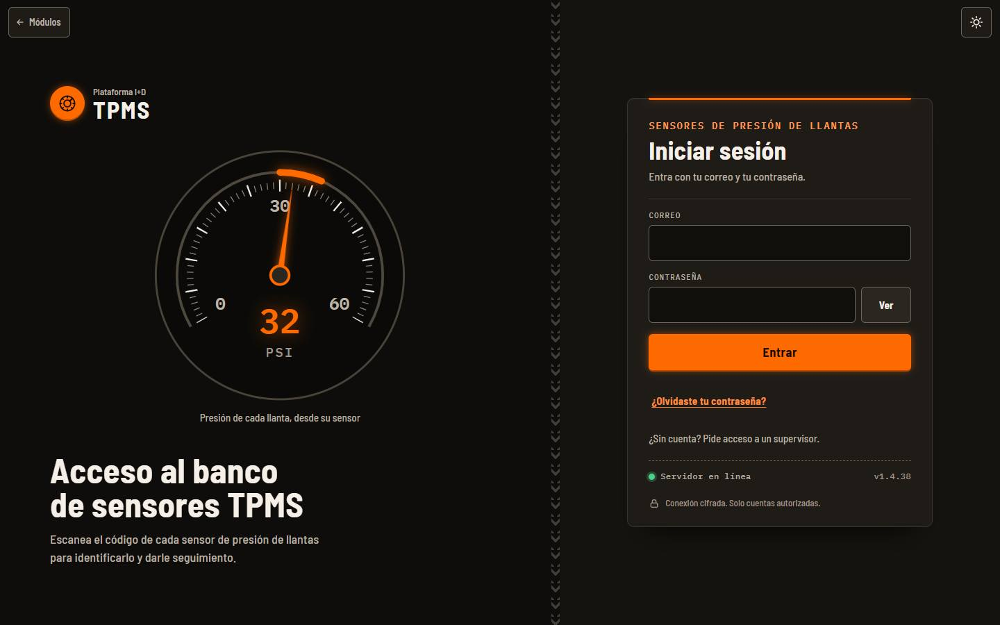

1. Correo
2. Contraseña
3. Entrar
4. Volver al portal de módulos

## Recorrido de la consola

En computadora (1024 px de ancho o más) la consola abre en el Dashboard. A la izquierda está el riel con dos grupos: Operación (Dashboard, Recibir, Programar, Consultar) y Gestión (Inventario, Lotes, Movimientos, Materiales, Costos, Excel). Cada pestaña tiene su dirección: /tpms#recibir, /tpms#costos, etc.

El Dashboard muestra las placas por estado (total, recibidas hoy, sin programar, programadas, con falla y de baja), la actividad de los últimos 14 días y los últimos movimientos. Las cifras por estado y las barras de hardware y firmware abren el Inventario ya filtrado. «Actualizar» vuelve a leer los datos.

Arriba a la derecha están tu correo y tu rol, el «Botón de escaneo» (para usar tu celular como lector), el cambio de tema claro/oscuro y cerrar sesión.

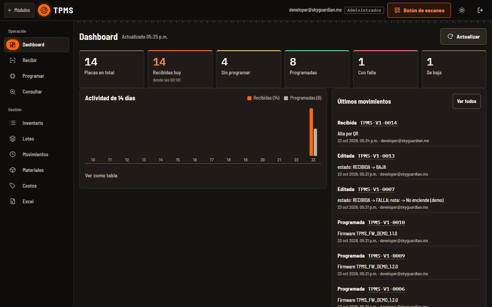

1. Riel de pestañas: Operación y Gestión
2. Placas por estado (abren el Inventario filtrado)
3. Actividad de 14 días: recibidas y programadas por día
4. Últimos movimientos
5. Botón de escaneo (celular como lector)

## Recibir placas

Recibir da de alta las placas nuevas. Puedes leer el QR con la cámara del equipo, con un lector USB o escribir el código a mano.

### Paso 1. Escribe el lote (opcional)

Abre Recibir y escribe el lote en el campo «Lote» (por ejemplo «Marzo 2026»). Las placas que registres desde ese dispositivo quedan en ese lote; el valor se recuerda en el dispositivo. Déjalo vacío si no aplica.

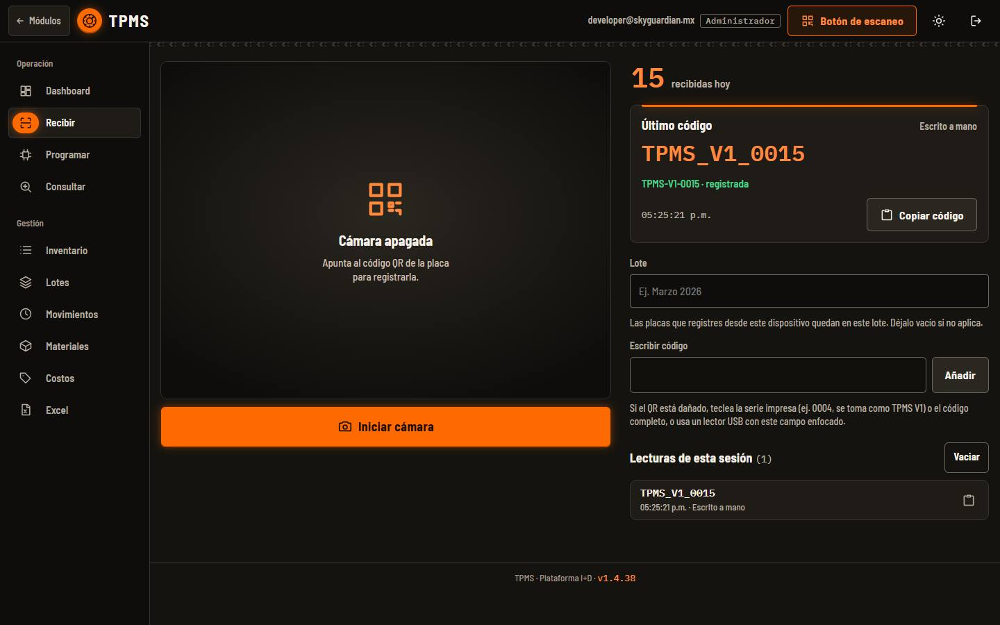

1. Iniciar cámara
2. Lote
3. Escribir código (o lector USB)
4. Último código y su resultado
5. Lecturas de esta sesión

### Paso 2. Lee el QR

Pulsa «Iniciar cámara» y apunta al QR de la placa, o enfoca el campo «Escribir código» y usa el lector USB. Si el QR está dañado, teclea la serie impresa (por ejemplo 0004, se toma como TPMS V1) o el código completo y pulsa «Añadir».

> **Nota:** Necesitas permiso de cámara en el navegador para leer con la cámara del equipo.

### Paso 3. Revisa el resultado

En «Último código» aparece el nombre de la placa y el resultado: «registrada» (verde) si es nueva, «ya estaba registrada» (amarillo) si ya existía, o en rojo el motivo por el que no se aceptó. El contador «recibidas hoy» sube con cada placa nueva. «Copiar código» copia el texto leído.

### Paso 4. Si el QR es de otro módulo

Si lees por error una placa de otro módulo, no se registra y te dice dónde va (por ejemplo «SJ-V1-0052 es una placa Skudo AntiJammer: regístrala en el módulo Skudo AntiJammer.»).

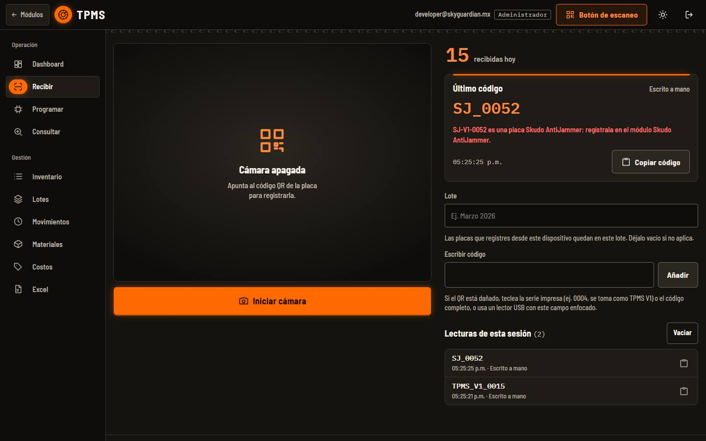

1. Motivo del rechazo y módulo correcto

> **Nota:** «Lecturas de esta sesión» guarda las últimas 12 lecturas solo en este dispositivo; «Vaciar» las borra. Se borran también al cerrar sesión.

## Usar el celular

Hay dos formas: abrir la consola en el celular, o vincular el celular como lector de la consola de la computadora con el «Botón de escaneo».

### Paso 1. Consola en el celular

En pantallas angostas las pestañas pasan a una barra inferior: Recibir, Programar, Consultar, Inventario y «Más». La consola abre en Recibir (en Consultar si tu rol es de consulta).

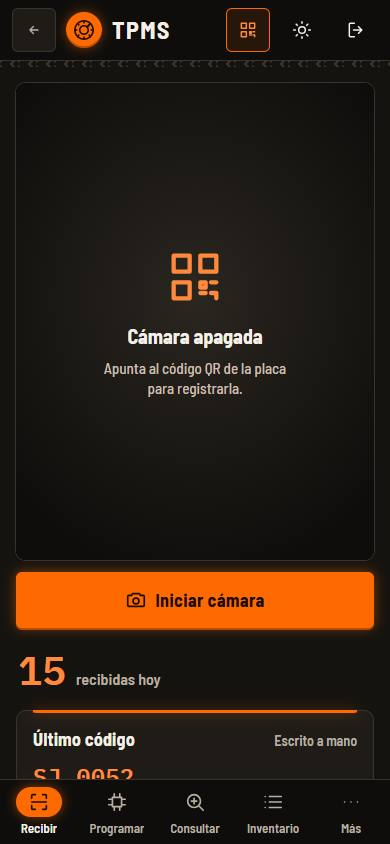

1. Iniciar cámara
2. Barra inferior
3. Más

### Paso 2. Menú «Más»

«Más» abre una hoja con el resto de secciones: Dashboard, Lotes, Movimientos, Materiales, Costos y Excel.

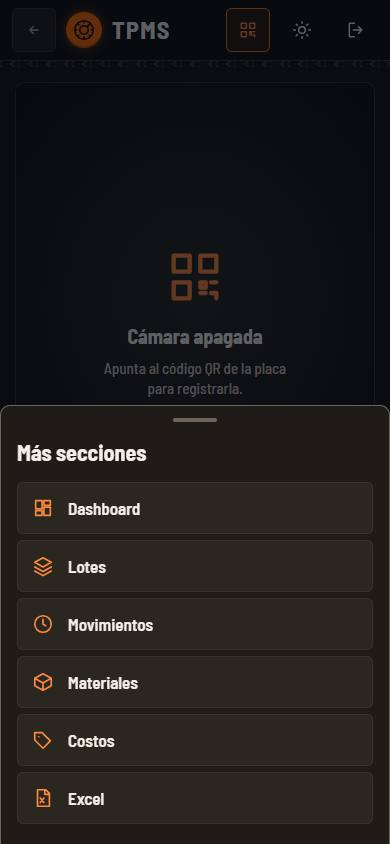

1. Más secciones

### Paso 3. Vincular el celular como lector

En la computadora pulsa «Botón de escaneo». Aparece un QR: escanéalo con la cámara del celular (o en la app: Más opciones › Escáner para la consola) e inicia sesión si te lo pide. Cuando diga «Celular vinculado», lo que escanees llega a la pestaña abierta: en Recibir se registra, en Consultar se abre su ficha y desde otra pestaña se abre en Consultar. «Desvincular» corta el enlace.

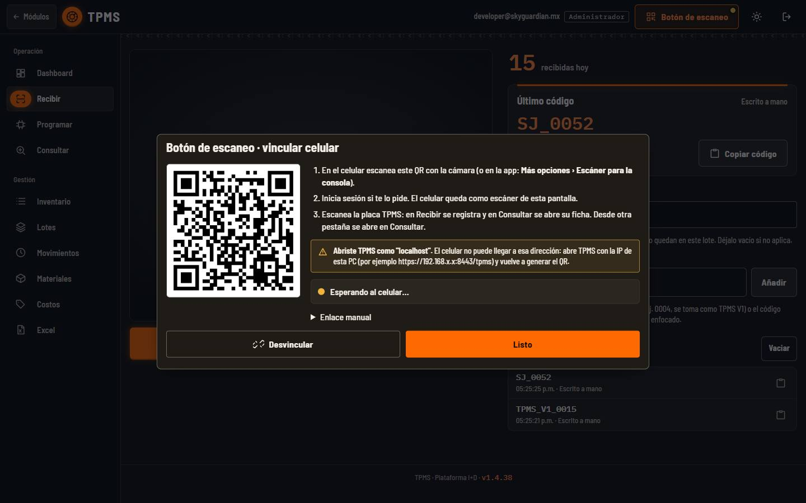

1. QR para el celular
2. Pasos
3. Estado de la vinculación

> **Nota:** Si abriste la consola como «localhost», el celular no puede llegar a esa dirección: ábrela con la IP de la PC y vuelve a generar el QR (la hoja lo avisa). La vinculación con un celular real no se probó para este manual.

## Programar y anotar el firmware

La programación física se hace con tu herramienta habitual; en esta pestaña anotas con qué firmware quedó cada placa.

### Paso 1. Busca la placa

En Programar escanea el QR o escribe en «Placa» el QR, el nombre (TPMS-V1-0004) o solo la serie, y pulsa «Buscar». Si no está registrada te ofrece «Ir a Recibir».

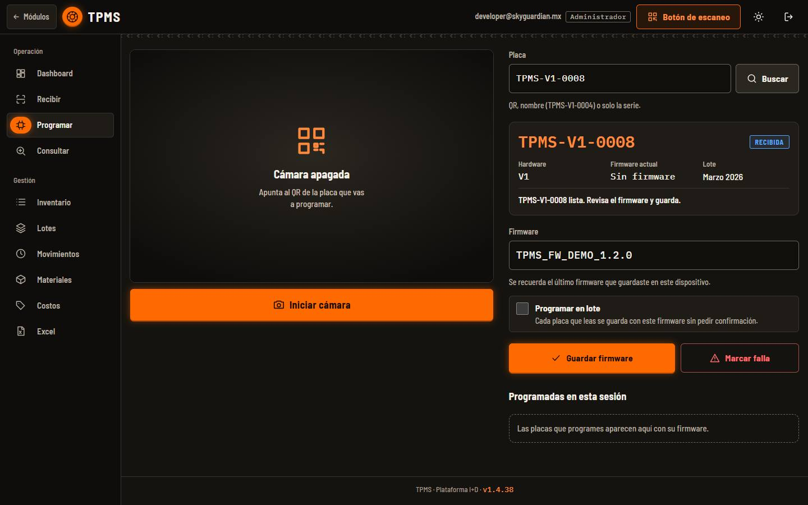

1. Placa: QR, nombre o serie
2. Placa seleccionada y su estado
3. Firmware
4. Programar en lote
5. Guardar firmware / Marcar falla

### Paso 2. Escribe el firmware y guarda

Escribe el firmware y pulsa «Guardar firmware». Una placa RECIBIDA pasa a PROGRAMADA. El último firmware que guardaste se recuerda en el dispositivo y la lista «Programadas en esta sesión» muestra lo que llevas.

### Paso 3. Modo lote

Activa «Programar en lote» para guardar sin confirmar: cada placa que leas se guarda con el firmware escrito. Útil para series grandes con el mismo firmware.

### Paso 4. Marcar o quitar una falla

«Marcar falla» abre una hoja donde puedes anotar qué falló (opcional) y la pasa a FALLA. Si la placa ya está en falla, el botón dice «Quitar falla» y la regresa a PROGRAMADA (si tiene firmware) o a RECIBIDA.

> **Nota:** Si el inventario de Materiales está activo, guardar el firmware descuenta los materiales de la placa. Ver la guía Costos y Materiales.

## Consultar una placa

Consultar es de solo lectura y sirve a todos los roles.

### Paso 1. Busca y lee la ficha

Escanea el QR o escribe el QR, el nombre o la serie y pulsa «Consultar». La ficha muestra hardware, firmware, serie, lote, fechas de recepción y programación, última actualización, operador, nota y el código leído tal cual. Abajo está el historial de la placa. «Programar esta placa» la abre en Programar.

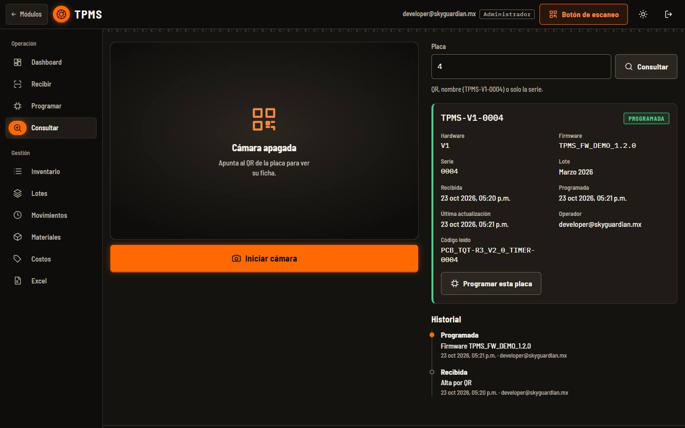

1. Búsqueda (aquí solo la serie: 4)
2. Ficha de la placa
3. Programar esta placa
4. Historial

> **Nota:** En la captura, el «Código leído» es PCB_TQT-R3_V2_0_TIMER-0004: las primeras placas TPMS V1 traen impresa por error la plantilla de la R3 Timer, y TPMS la reconoce como TPMS-V1-0004.

## Inventario: filtrar, editar y cambios en masa

El Inventario lista todas las placas con filtros por texto, estado, hardware, firmware y lote.

### Paso 1. Filtra y selecciona

Usa «Buscar» (nombre, serie, firmware o nota) y los filtros. Marca las casillas de las placas: abajo aparece la barra de acciones con Firmware, Hardware, Lote, Estado, Eliminar y Quitar selección. El nombre de cada placa abre su ficha en Consultar.

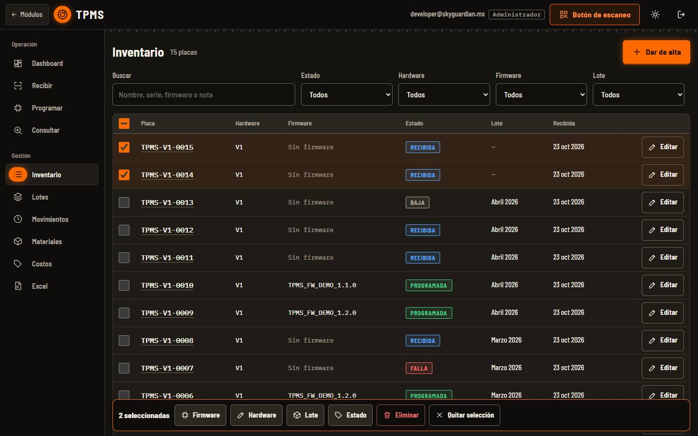

1. Buscar y filtros
2. Dar de alta (placa sin QR legible)
3. Editar una placa
4. Acciones con la selección

> **Nota:** Los cambios en masa son todo o nada: si una placa falla (por ejemplo, un nombre que ya existe al cambiar el hardware), no se cambia ninguna.

### Paso 2. Edita una placa

«Editar» abre una hoja con hardware (versión), serie, firmware, estado, lote y nota. «Guardar cambios» aplica; «Eliminar TPMS-V1-…» la borra. Si cambias hardware o serie y ya existe otra placa con ese nombre, no se guarda.

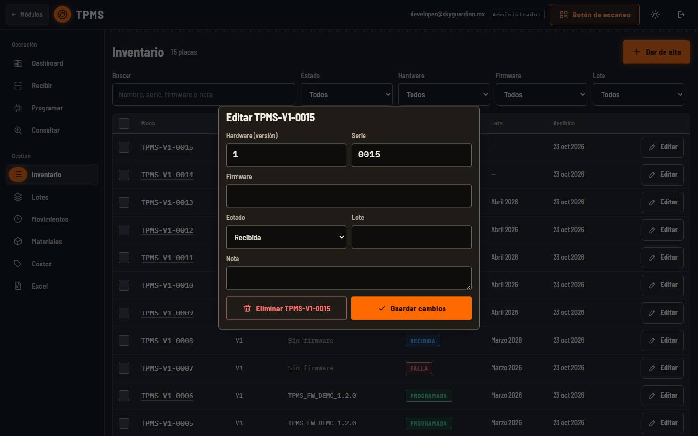

1. Hoja de edición

### Paso 3. Alta manual

«Dar de alta» es para placas cuyo QR no se puede leer: escribe hardware (versión) y serie. La placa queda como RECIBIDA.

## Lotes, Movimientos y Excel

### Paso 1. Lotes

Cada lote muestra sus placas por estado (programadas, sin programar, falla, baja) y el rango de fechas. «Ver en Inventario» abre sus placas; «Renombrar» cambia el lote de todas sus placas (si escribes un lote que ya existe, se juntan). Las placas sin lote salen en «Sin lote» con el botón «Asignar lote».

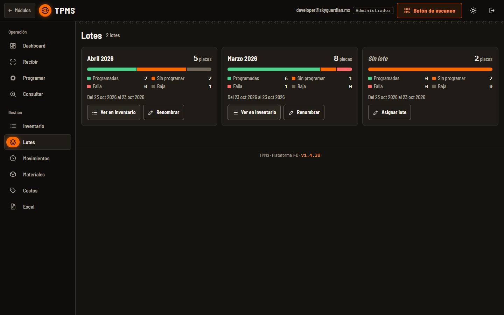

1. Un lote con su conteo por estado
2. Ver en Inventario / Renombrar

### Paso 2. Movimientos

Bitácora de cada placa recibida, programada, editada, eliminada o cambiada en masa, con detalle, operador y fecha. Filtra por texto, acción y rango de fechas. Muestra 50 por página.

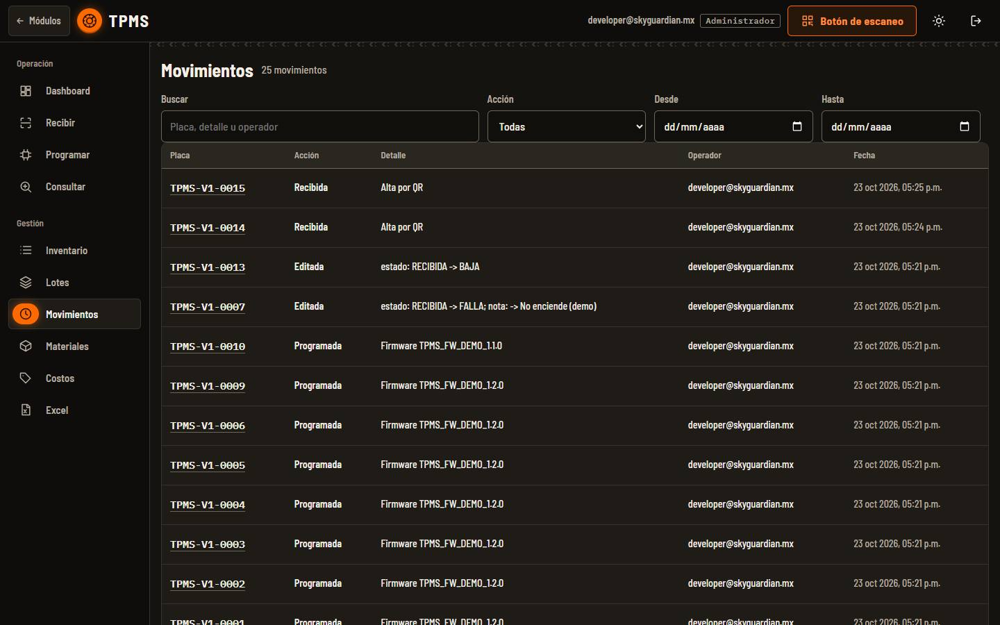

1. Buscar, Acción, Desde y Hasta
2. Placa, acción, detalle, operador y fecha

### Paso 3. Exportar a Excel

Elige los filtros (parte de los que tengas en Inventario), revisa cuántas placas saldrán y pulsa «Descargar Excel». El archivo TPMS_placas_AAAAMMDD.xlsx trae la hoja Placas y la hoja Movimientos (los últimos 2000). El rol de consulta también puede descargarlo.

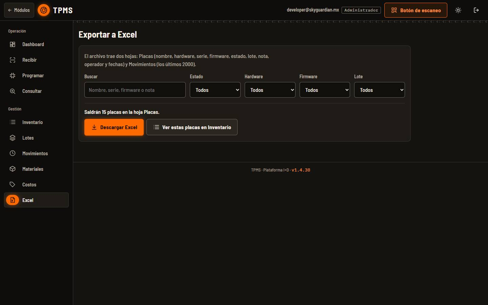

1. Qué placas exportar
2. Cuántas saldrán
3. Descargar Excel

## Costos y Materiales

Las pestañas Costos (cotizador: lista de materiales y costo por tarjeta) y Materiales (existencias que se descuentan al programar) funcionan igual en TPMS, SpeedLocker, Skudo AntiJammer, Skudo Sigfox y Caiquén. En TPMS cada placa es una tarjeta «TPMS». Consulta la guía «Costos y Materiales».

## Ficha técnica

| Campo | Detalle |
| --- | --- |
| Rutas | /tpms (consola) · /tpms/acceso (inicio de sesión) · pestañas con #dashboard, #recibir, #programar, #consultar, #inventario, #lotes, #movimientos, #materiales, #costos, #excel |
| Formato del QR | TPMS_V1_0004 o PCB_TPMS-V1-0004 → TPMS-V1-0004. La versión es opcional (sin versión = V1) y admite decimal (V1_1 → V1.1). Acepta guion, guion bajo o espacio y mayúsculas o minúsculas. |
| QR de las primeras V1 | PCB_TQT-R3_V2_0_TIMER-0004 (plantilla de la R3 con guiones) → TPMS-V1-0004. La R3 Timer real usa guiones bajos (PCB_TQT_R3_V2_0_TIMER_0073) y sigue siendo de Escáner TQT. |
| Solo la serie | Escribir 4 o 0004 en Recibir, Programar o Consultar se toma como TPMS-V1-0004. |
| No válidos | Versión 0 o serie 0000. QR de SpeedLocker, Skudo AntiJammer, Skudo Sigfox o Caiquén: se rechazan diciendo a qué módulo van. |
| Estados | RECIBIDA → PROGRAMADA (al guardar firmware). También FALLA y BAJA. Quitar el firmware a una PROGRAMADA la regresa a RECIBIDA. |
| Acciones en la bitácora | Recibida, Programada, Editada, Eliminada, Cambio en masa |
| Qué se guarda por placa | Nombre, hardware, serie, código leído, lote, firmware, estado, nota, operador, fecha de recepción, de programación y de última actualización |
| Exportación | TPMS_placas_AAAAMMDD.xlsx con hojas Placas y Movimientos (últimos 2000) |
| Guardado en el dispositivo | Lote de Recibir, último firmware y modo lote de Programar (navegador). Las lecturas de la sesión se borran al cerrar sesión. |
| Permiso | La cuenta necesita el módulo TPMS asignado; si no, vuelve al portal de módulos. |

## Problemas frecuentes

**Leí una placa y dice «ya estaba registrada».**

Esa placa ya existe; no se duplica. Ábrela en Consultar para ver su lote y su historial.

**Dice que es una placa de otro módulo.**

El QR pertenece a SpeedLocker, Skudo AntiJammer, Skudo Sigfox o Caiquén. Regístrala en ese módulo.

**«no es un QR de placa TPMS».**

El texto no tiene el formato TPMS. Revisa que el QR sea de una placa TPMS o escribe la serie impresa.

**En Programar dice «no está registrada».**

Primero regístrala en Recibir (o con «Dar de alta» en Inventario) y vuelve a buscarla.

**No puedo guardar ni registrar nada y veo un aviso de rol de consulta.**

Tu cuenta es de consulta. Pide a un administrador que cambie tu rol si necesitas operar.

**El cambio en masa no se aplicó a ninguna placa.**

Es todo o nada: si una placa no se puede cambiar (por ejemplo, el nombre nuevo ya existe), no cambia ninguna. Revisa el mensaje, corrige la selección y vuelve a aplicar.

**El celular no se vincula.**

Abre la consola con la IP de la PC (no «localhost»), genera el QR otra vez y comprueba que el celular esté en la misma red.

**La cámara no enciende.**

Da permiso de cámara al sitio en el navegador. Mientras tanto, usa un lector USB o escribe la serie.

## Guías relacionadas

- [Costos y Materiales](costos-materiales.md)
- [SpeedLocker](speedlocker.md)
- [Skudo AntiJammer](skudo-antijammer.md)
- [Cuentas y permisos](cuentas.md)
